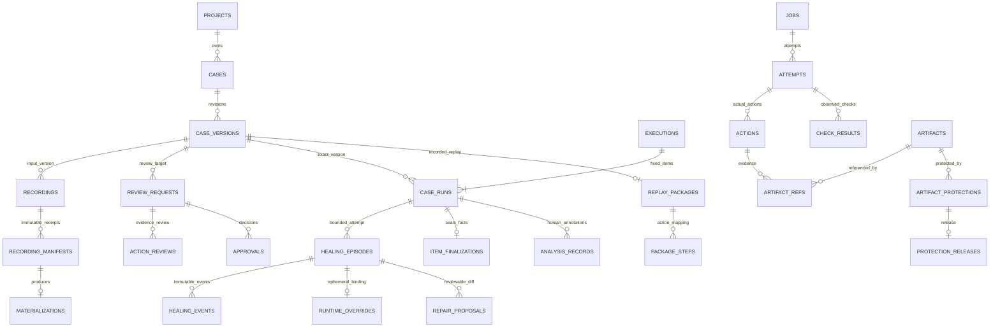

# 데이터·승인·재녹화·누적 분석 설계 v0.6

개정일: **2026-10-31 (Asia/Seoul)**. 상태: 검토용 상세 설계. **DB·migration·제품 코드·테스트를 생성/실행한 문서가 아니다.** 모든 API·필드·제약은 제안 플랫폼 계약이다.

[DESIGN.md](DESIGN.md)는 전체 아키텍처, [UI_SPEC.md](UI_SPEC.md)는 화면/동선, [IMPLEMENTATION_PLAN.md](IMPLEMENTATION_PLAN.md)는 후속 작업이다. 이 문서는 세 문서의 **저장·무결성·승인/재녹화 transaction·분석/보관 계약**을 구체화한다. 물리 저장소를 나누어도 사용자의 기본 관리 단위는 검증 정의·설정·녹화 절차·증거를 함께 가진 케이스 하나다. TC는 계속 선택 사항이다.

v0.6은 code/action replay·선택 verifier·healing ON/OFF를 추가한다. [실행 상세](docs/superpowers/specs/2026-10-31-replay-and-self-healing-design.md)가 실행/격리/dispatch/한도 규범이며 이 문서가 DB·불변성/보관 규범이다. [v0.5 데이터 설계](docs/history/v0.5/DATA_DESIGN.md)는 보관했다. 제품 DB·모델/기기는 아직 실행/검증하지 않았다.

## 1. 점검 결과와 보완 범위

| 발견 사항 | v0.4에 있던 수준 | v0.5 보완 |
|---|---|---|
| 테이블 관계 | 저장 단위·불변성 원칙 | PK/FK/UNIQUE/CHECK·동일 project/case 제약·인덱스·삭제 정책 |
| 승인/재녹화 | version/CAS 개념 | 승인 pointer·근거 보호·재녹화 분기·실패/반려·approve/revoke 경쟁 transaction |
| 부분 기록 | 중단도 stored 가능 | 저장/종료/절차 완결성/증거 준비/승인을 별개 필드로 분리 |
| 늦은 증거 | read-only 복구 원칙 | 불변 source manifest revision·멱등 복구·새 version/review 연결 |
| 누적 분석 | RUN 리포트·수행 비교 | 영구 최소 facts·관측 단위·기간·cohort·rerun/attempt·재계산 기준 |
| 보관 | 상세 metadata90일·PNG30일 | 장기 facts/승인/lineage 유지, 상세 만료·pin 해제·DB/파일 정합 복구 |

따라서 기존 설계를 ‘DB까지 이미 검증됨’이라고 보지 않는다. 아래 제약과 fault/부정 시험을 실제 구현에서 확인해야 한다. 엔진 성공률·UI 동작·DB 부하 시험은 아직 미실행이다.

## 2. 저장소와 데이터 책임

- **SQLite:** 구조화 facts·ID/FK·version/manifest hash·작업/상태·action/check·승인/분석·artifact metadata. API만 접근, worker는 HTTP/자체 spool 사용.
- **로컬 artifact 저장소:** 정제 PNG·action log·APK·export. 생성 object key/hash로 접근하고 임의 절대경로를 API에 받지 않는다. DB에 큰 PNG BLOB를 넣지 않는다.
- **worker spool:** 업로드 전 정제 기록·파일과 ACK journal. 서버 DB의 대체 저장소로 영구 사용하는 것은 아니다.
- **OS secret store:** 실제 키/비밀번호/인증 state. DB/manifest는 secret reference와 필요한 revision ID만 보존한다.

DB/파일은 비동기화 `%LOCALAPPDATA%/AIQA/`의 별도 디렉터리다. OneDrive/NAS DB 파일 공유는 지원하지 않는다. SQLite WAL·단일 API writer를 시작점으로 하고 연결마다 foreign_keys 활성화를 검증한다. 긴 모델 호출/파일 업로드 중 DB write transaction을 잡지 않는다. SQLite는 한 번에 하나의 writer이므로 claim/승인 등은 짧은 transaction과 조건부 update로 처리한다. [SQLite FK 공식 문서](https://sqlite.org/foreignkeys.html), [transaction 공식 문서](https://sqlite.org/lang_transaction.html).

### 관계도

JOBS는 recording 또는 case_run을 배타적으로 소유한다. optional TC·suite/data·environment/build·usage는 아래 표에 포함한다. report는 결과 원본을 복사한 편집 테이블이 아니라 immutable facts의 projection이다.

## 3. 논리 schema와 필수 제약

### 3.1 공통 규칙

1. ID는 UUID, 시각은 UTC 정규화 값으로 저장한다. 화면/기간 선택은 Asia/Seoul로 변환한다. duration은 별도 monotonic 측정값이다.
2. 모든 project 자산은 project_id 필수다. 부모는 `(project_id,id)` UNIQUE, child는 composite FK로 같은 project를 강제한다. case version/approval/source는 필요한 곳에 case_id까지 포함해 **다른 케이스의 증거·승인을 연결할 수 없게** 한다.
3. 참조되는 자산·version·승인·결과는 ON DELETE RESTRICT가 기본이다. 보관은 archive metadata, 데이터 파괴는 별도 명시 purge 정책이며 자동 cascade하지 않는다.
4. version content/source manifest/review snapshot·decision/final result와 event/action/check의 identity/hash·최소 사실은 append-only다. 불변 content UPDATE/DELETE는 repository와 DB trigger로 거부한다. live 상태·pointer·storage availability 같은 운영 projection은 별도 컬럼으로 분리한다.
5. JSON은 원문/계획/설정/작은 snapshot용이다. 목록·분석·중복/FK에 쓰는 ID·상태·시각·hash·비용 계측 상태는 정규 컬럼으로 둔다. JSON 속 임의 ID를 유일한 연결 키로 쓰지 않는다.
6. version hash는 `canon-json-v1`(UTF-8, 정렬된 key, 공백 없는 직렬화, 유한 수만 허용, 금액은 decimal 문자열)과 schema_version을 고정해 계산한다. 별도 verification_digest는 목적/조건·입력 schema·기대/필수 경로의 의미 snapshot에 계산한다. 이름/태그·선택 TC metadata·live pointer·실제 secret·파일 보관 상태는 content hash에서 제외한다.

불변 원본 row와 만료 가능한 상세 payload를 물리적으로 분리한다. events/actions/check_results에는 ID·소속·순번/시각·type/status·필수 판정/오류 요약·근거 hash·payload hash만 남긴다. 상세 관찰/정제 command 내용은 `detail_payloads`(정확히 하나의 event/action/check/model_call owner FK, content/hash, expiry)로 분리한다. 원본 seal 뒤 payload 내용도 변경하지 않으며 만료 시 payload row/파일만 삭제한다. 별도 `payload_retention_events`가 owner/hash·expired_at/사유를 남긴다. immutable 원본에 대한 예외 UPDATE/DELETE로 expiry를 구현하지 않는다. version/manifest/review의 최소 body에는 장기 보존할 정의·ID/hash·요약만 넣고 큰 정제 관찰은 payload/artifact ref로 분리한다.

### 3.2 케이스·녹화·검토

| 저장 단위 | 필수 필드·연결 | DB/transaction 제약 |
|---|---|---|
| automation_cases | project/id/name, next_revision, latest_draft_version_id, current_approval_id, lock_version, archived_at, optional tc_reference | pointer는 동일 case 소속. 별도 TC FK는 필수 아님. pointer 갱신 CAS |
| case_versions | project/case/id/revision, parent_version_id, base_version_id, creation_kind(input/recorded/edit/import), immutable definition/settings/procedure JSON, content_hash/verification_digest, source_manifest_id nullable, actor/time/reason | UNIQUE(case_id,revision), parent/base/source는 동일 case. 새 revision 번호는 짧은 DB transaction에서 배정. 입력 draft의 source는 null 허용 |
| case_steps/case_checks | case_version_id, stable logical step/check ID, order/required/kind, semantic_hash | UNIQUE(version,step_id/check_id), check의 step FK. version 생성 때 JSON에서 projection을 같은 transaction에 생성하며 내용 일치 검증 |
| recording_sessions | project/case/id, mode(initial/rerecord), input_case_version_id, base_case_version_id nullable, reason, lifecycle/storage_status, outcome, procedure_readiness | input/base는 동일 case. rerecord면 base/reason 필수. stored가 completed를 의미하지 않음 |
| recording_manifests | project/case/recording/id/revision, prior_manifest_id nullable, kind(original/recovery/package_rebuild), body/hash, captured event range, evidence_completeness, request_key/body_hash | UNIQUE(recording,revision), UNIQUE(recording,request_key). immutable. 같은 key 다른 body409 |
| recording_materializations | recording_id/manifest_id/produced_case_version_id | UNIQUE(manifest_id), UNIQUE(produced_version_id), 동일 recording/case. 한 receipt에서 produced draft1개만 생성 |
| review_requests | project/case/version, version_hash, source_manifest_id/hash, trial_case_run_id/final_result_hash, evidence_set_json/hash, expected_current_approval_id, actor/time | review snapshot은 불변. source/trial/version 동일 case·exact content 검증. 상태는 decision projection |
| review_evidence_entries | review_request_id, owner_kind/REC 또는 ITEM ID, attempt_id/action_id, artifact_ref_id, role/hash | 불변 exact evidence membership. action→attempt→job owner가 선택 source REC/exact trial ITEM과 일치해야 함 |
| action_reviews | review_request_id, owner(REC/ITEM), attempt/action ID, evidence_digest, reviewed/needs_change/evidence_missing, actor/time/comment | 대상 action/artifact는 review_evidence_entries의 exact 소속·digest와 일치해야 함. 원본 record append-only, 같은 reviewer의 최신 의견을 읽되 이전 기록 보존 |
| approvals | review_request_id, case/version/hash, decision(approved/rejected/revoked), revokes_approval_id nullable, actor/time/reason | review당 approved/rejected 최종 결정 합계 최대1, 이후 revoke는 별도 event. revoke는 approved event를 참조하고 중복 revoke 최대1. current pointer는 approved·미철회 record만 가능 |

`case_steps/case_checks`는 사용자가 따로 관리하는 TC가 아니라 케이스 version 내부 정의의 검색/FK용 projection이다. 내용 변경은 새 case version이며 stable ID 의미가 바뀌면 semantic_hash도 바꾼다. 좌표만 달라졌다고 검증 의미가 바뀌는 것은 아니지만 expected/path 변경을 같은 의미라고 자동 추정하지 않는다.

### 3.2.1 v0.6 replay package·dispatch·치유 기록

| 저장 단위 | 필드·제약 |
|---|---|
| replay_packages/package_artifacts | project/case/version, source manifest/input hash·raw script/approved script 또는 Android plan·runtime/lock/transform·mapping·body_hash. version당0..1 UNIQUE, ready/승인 시1 필수. produced version FK는 hash body 밖 receipt |
| package_steps | package/stable step/action ID·target semantic hash·source/code line mapping·condition·allowlist. 같은 version의 step/check와 composite FK, raw action 우회 금지 |
| healing_episodes | project/case_run/attempt/package/failed action, ordinal/trigger/policy hash·reserved limit·상태/outcome/시각. 초기 ITEM당1개, 같은 ITEM/attempt/package membership·멱등 key/body 검사 |
| healing_events | episode/commit_seq/type·candidate/accept/reject/dispatch/check·짧은 이유·evidence refs/hash. append-only, 제안·오류·마스킹 상세는 detail_payloads로 분리 |
| runtime_overrides | episode UNIQUE·original binding hash·accepted candidate hash·target/action 의미·actual dispatch action ID. 실행 snapshot의 부속 사실이며 원본 package/code 변경 금지 |
| repair_proposals/adoption_events | project/case/source version/package/ITEM/episode·diff/hash/근거·생성 actor/time, 채택 시 새 REC/input ref. proposal은 불변, 채택은 별도 append event. 승인 가능한 case version으로 자동 승격 금지 |

case hash에는 package hash를 넣고 package body에는 produced case ID/hash를 넣지 않는다. source manifest는 compiled package hash를 포함하지 않는다. sealed source→compiler/계측 검사/artifact ready→짧은 materialization transaction에서 새 case version/package row/step mapping/receipt/CAS를 함께 확정한다. version↔package composite FK는 DEFERRABLE INITIALLY DEFERRED로 commit 시 검증한다. 입력/실패/부분 version의 package는 null 가능하며 나중 attach/UPDATE하지 않는다. compiler 실패는 사유 있는 draft로 먼저 저장하고 나중 컴파일은 `package_rebuild` manifest revision→새 version/trial/review다. recording_manifests.kind에 original/recovery/package_rebuild를 허용하며 manifest별 materialization 유일성은 유지한다. jobs.purpose enum에도 package_rebuild를 추가한다. 관리 job의 recording_id/case_run_id는 모두 null, QA=null이며 worker slot만 사용하고 physical session·기기/브라우저/모델 제어 권한은 없다. source_manifest_id는 별도 payload ref로 동일 project/case를 검사하고 compiler/lock ref·요청 멱등 키와 함께 고정한다. source 읽기·compile·artifact 작성·새 materialization만 허용한다.

action의 dispatch journal은 planned/lookup_failed/dispatch_started/acknowledged/observed/unknown이다. read-only lookup 실패와 command 전달을 분리하고 command API 호출 전에 dispatch_started를 flush한다. 이후 click navigation timeout/ADB timeout·post capture 실패는 미dispatch로 되돌리지 않는다. DB/worker ACK 여부와 별개로 durable local journal이 없으면 행동 금지다. 치유는 dispatch_started 이력이 없는 lookup 실패에만 가능하다.

episode 예약+case_run healing counter/모델 예약+audit는 같은 transaction/CAS로 처리하고 이벤트 재전송이 추가 호출/동작을 만들지 않게 한다. ITEM당 episode1·healer 합계2호출(전송 retry 포함)·30초 초기 제안, job/lease/예산 우선. runtime ON/OFF는 execution 접수 snapshot이며 scope 확대는 새 version/승인이다. 정상 lookup 재생은 model actor0, verifier/healer 권한은 별도 broker가 검사한다. [실행 상세](docs/superpowers/specs/2026-10-31-replay-and-self-healing-design.md)의 deterministic 동일 target 증명과 신뢰 driver 경계를 따른다.

### 3.3 실행·동작·결과

| 저장 단위 | 필수 필드·연결 | 제약·분석 용도 |
|---|---|---|
| suites/suite_versions | exact case version/hash·data row·environment defaults·order/failure policy JSON | immutable 구성, 명시 version 교체. DATA 확장 후 실행 ITEM100개 한도 |
| executions | project/id/purpose/source, release_label nullable, requested_at, actor, suite_version nullable, resolved snapshot/hash·exclusions, status/cancel flag | purpose trial/regression/reverification. 시작 snapshot immutable, final parent 결과는 한 번 확정 |
| case_runs | project/id/execution/entry, case/version/hash·verification_digest, purpose/scope_requested_at, approval_id nullable, data/env/target snapshot, rerun_of_item_id/root_lineage_id, final status/verdict/disposition/display_result·criteria_version/hash, first/latest attempt, package_hash·resolved_healing_policy_hash·requested_self_healing·healing_used/outcome·unassisted_pass·role별 호출/usage/duration summaries | UNIQUE(execution,entry). scope_requested_at/purpose는 parent snapshot과 composite FK/transaction 검사. trial만 approval null 허용, 정식/reverification은 exact approval 필수 |
| jobs | project/id/purpose(backup 포함), recording_id nullable, case_run_id nullable, payload hash·idempotency, status/lease·reason | recording이면 REC만, trial/regression이면 ITEM만, 관리 job은 둘 다 null인 CHECK. 각 REC/ITEM 소유 job 최대1 |
| attempts | project/job/id/ordinal, resource/session/generation, start/end/duration, termination/error·side_effect_state | UNIQUE(job,ordinal). 모델/action 재시도를 별 attempt로 부풀리지 않음 |
| events | attempt/local_seq, captured_at/received_at, event_type, body/hash | UNIQUE(attempt,local_seq). 동일 hash 재전송만 수락. 불변 identity/hash·최소 envelope, 상세는 detail_payloads |
| actions | attempt/id/action_seq, replay/healing_override provenance·package_step·dispatch_state/history, version의 step ID, type/intent/target·coordinates/transform·input ref, before/after capture metadata·command result, error/recovery link·body_hash | UNIQUE(attempt,action_seq), step/version 및 attempt→job→REC/ITEM 소속 검사. 미완료 projection→seal 후 최소 content 불변, 상세는 detail_payloads |
| check_results | attempt/version/check_id/action_id nullable, occurrence_seq, expected/observed/status/method·oracle version, evidence ref·reason/hash | check/version FK·action은 동일 attempt의 composite FK, UNIQUE(attempt,check_id,occurrence_seq). observation append-only. 필수 violation latch는 후속 satisfied로 삭제 불가 |
| model_calls | attempt/role(authoring/verification/healing/maintenance)·check 또는 episode owner/call_id/provider request ID·actual model, started/end, usage nullable·measurement status, price/currency·reservation/settlement | call ID UNIQUE, count≥0 또는 null, 비용 decimal. 늦은 청구/보정은 별도 append record, 원본을 0으로 채우지 않음 |
| analysis_records | case_run_id, classification/status·assignee/comment/issue URL, actor/time, prior record ID | 별도 append-only. QA/result facts UPDATE 금지 |

jobs에 `(recording_id)`와 `(case_run_id)`의 nullable owner unique 인덱스를 둔다. REC/ITEM의 job_id는 이 관계로 조회하는 projection이어도 된다. 양쪽에 독립 mutable backlink를 저장하지 않는다. REC/ITEM 생성+job 등록은 같은 transaction이어서 외부에 ‘저장만 되고 실행 job 없음’ 상태를 노출하지 않는다. `reverification` execution의 제어 job purpose는 regression으로 사상한다.

정식 ITEM의 approval_id는 **접수 당시 선택한 exact 승인의 ID**다. claim에서 그 승인이 철회되었으면 차단한다. 새 승인 pointer가 다른 version으로 이동했다는 이유만으로 snapshot을 바꾸지 않는다. 별도 TC 참조는 결과 조회용 당시 metadata일 뿐 QA/실행 FK 조건이 아니다.

최종 case_run에 최소 facts를 직접 seal한다. case identity/version/hash·verification_digest, requested_at/purpose·source/rerun lineage, data/환경/실제 build·device/browser/engine/model/oracle fingerprint, 진행 결과/QA/disposition/display_result, 필수 check/violation/unknown·attempt/retry/recovery count, 소요/usage·비용 계측 상태, evidence manifest hashes·보관 상태를 포함한다. 모든 상세 로그를 보존해야만 통계를 계산할 수 있는 구조로 만들지 않는다.

재현 가능한 시점을 위해 project별 `project_commit_clock`의 단조 증가 `commit_seq`를 **해당 변경과 같은 DB transaction**에서 배정한다. wall clock은 표시용이며 정렬/cursor는 seq다.

| 장기 이력 | 필드·계약 |
|---|---|
| execution/item 접수 | created_commit_seq, requested_at. as_of 이전에 접수한 ITEM만 분모에 포함 |
| item_finalizations | item_id UNIQUE, finalized_commit_seq/time, immutable final_result_hash·최소 결과 facts |
| item_lifecycle_events | item/job ID, commit_seq, status/time·간단 이유. 상세 worker events 만료 뒤에도 당시 진행 표시를 복원할 최소 전이만 유지 |
| usage_adjustments | call/item ID, commit_seq/time, prior ledger ref·correction/delta·measurement status·price version/currency·reason. 원본 usage/final facts는 수정하지 않음 |
| analysis/audit·review/approval/protection events | commit_seq/time·actor·사유. 과거 조회는 해당 seq까지 적용 |

actual build/model 등 실행 중 새로 알게 되는 fingerprint는 commit_seq를 가진 관찰 snapshot으로 남긴다. 과거 as_of에는 당시 확인된 값만 필터/strict cohort에 사용하고 미관찰 값은 unknown/planned를 구분한다. 최신 actual 값을 과거 진행 항목에 소급 적용하지 않는다.

최종 facts가 현재 존재해도 `finalized_commit_seq > as_of`이면 당시 집계에서는 진행 항목이다. 접수/확정·usage ledger·필터용 immutable snapshot은 상세90일 정책에서 제외한다. release_label은 접수 snapshot의 표시/필터 축이며 여러 RUN을 임의의 새 결과 하나로 합치지 않는다. 보고서 export는 as_of commit_seq·requested 기간·resolved filter/cohort/criteria version을 저장하고 그 cursor 이전 facts/ledger만 읽는다. 필요한 model_calls 최소 usage facts에는 commit_seq를 남겨 late settlement를 과거 비용에 소급 합산하지 않는다.

### 3.4 artifact·보관 참조

| 저장 단위 | 필드·규칙 |
|---|---|
| artifacts | project/id, generated object_key/hash/bytes/content_type, storage_state(staging/ready/delete_pending/expired/quarantined), capture/redaction metadata, created/expiry. 파일 내용 불변·운영 보관 상태만 변경 |
| artifact_refs | project/artifact, action_id/check_result_id/recording_manifest_id/review_request_id/app_build_id/export_job_id/package_artifact_id/healing_event_id/repair_proposal_id/resource_observation_id 중 **정확히 하나** FK, role(before/after/log/check/source/export), expected_hash |

typed owner FK/project FK는 소속의 첫 검사다. 같은 project/case/version이라도 다른 실행의 증거를 쓸 수 없으므로 **artifact_ref→action/check→attempt→job→선택 source REC 또는 exact trial ITEM** 경로를 review 요청/승인 transaction에서 검증한다. check의 action은 동일 attempt, action의 case step은 job의 input/produced 또는 exact trial version mapping을 따른다. review_evidence_entries는 이 검사를 통과한 membership만 보존하며 action_review는 그 entry를 참조한다. JSON의 임의 ID/hash 일치만으로 승인하지 않는다. action의 role·capture time·expected hash는 source manifest에서 검증한다. `after_delayed`를 `after_immediate`로 바꾸지 않는다. approve 보호는 review evidence set에서 참조하는 required artifact를 모두 포함한다.

**provenance ref와 삭제 방지 보호는 다르다.** artifact_refs는 파일의 출처/역사를 영구 설명하며 그 자체로 무기한 pin을 뜻하지 않는다.

| 보호 단위 | 필드·제약 |
|---|---|
| artifact_protections | project/id/artifact_id, reason_kind(review/approval/manual/backup/build), review_request_id 또는 approval_id 또는 manual_request_id 또는 backup_receipt_id 또는 app_build_id 중 해당 kind의 정확히 하나 FK, created_commit_seq/time, expires_at nullable |
| artifact_protection_releases | protection_id UNIQUE, commit_seq/time, actor, reason. append-only 해제 event |
| backup_receipts/manual_retention_requests | 보호의 typed 근거·기간/actor·hash manifest·완료/해제 이력, project scope |

active protection은 생성된 protection 중 만료되지 않고 release되지 않은 것이다. review는30일 만료/연장(새 보호 record), approval은 유효한 동안 expires_at=null이다. revoke transaction에서 approval 보호를 해제하고90일 유예 보호를 같은 approval 근거로 추가한다. 다른 valid approval/manual/backup/build 보호가 남으면 GC 금지다. 원본 provenance refs는 이 과정에서 지우지 않는다. receipt/revoke/release는 멱등 unique key를 가진다.

최소 facts/승인·manifest가 참조하는 artifact row/ID/hash는 파일 만료 뒤에도 tombstone으로 남긴다. 파일이 없어도 FK를 없애거나 ID를 재사용하지 않는다. capture 내용이 아니라 보관 상태만 변한 경우와 새 capture/복구 manifest가 생성된 경우를 구별한다.

## 4. 인덱스·query·불변성 검사

필수 인덱스는 다음 조회를 기준으로 잡는다. 실제 query plan/용량은 T10에서 검증하며 지금 성능을 보장하지 않는다.

| 조회/경합 | 인덱스·제약 |
|---|---|
| 케이스 목록/현재 기본 실행 | cases(project,archived_at,updated_at,id), case_versions(case,revision UNIQUE), current_approval FK |
| 녹화/재녹화 이력 | recordings(project,case,created_at,id), manifests(recording,revision UNIQUE), materializations(manifest UNIQUE) |
| 같은 이벤트/행동 중복 | events(attempt,local_seq UNIQUE), actions(attempt,action_seq UNIQUE) |
| 한 REC/ITEM에 job1개 | jobs(project,recording_id UNIQUE WHERE non-null), jobs(project,case_run_id UNIQUE WHERE non-null) |
| queue/claim | jobs(status,created_at,id), resource의 단일 lease/current generation |
| 프로젝트 기간/케이스 추세 | case_runs(project,scope_requested_at,id), (project,case_id,scope_requested_at,id), (project,verification_digest,display_result,scope_requested_at) |
| check별 반복 실패 | check_results(version_id,check_id,status,attempt_id), attempts(job,ordinal) |
| 보호/시점 재현 | protections(artifact_id,expires_at), release(protection_id UNIQUE), finalizations(project,finalized_commit_seq), lifecycle/usage_adjustments(project,commit_seq), project_commit_clock(project UNIQUE) |
| 리뷰/철회·파일 GC | approvals(case/version,time), approvals(revokes_approval_id UNIQUE WHERE non-null), artifact_refs(artifact_id), artifacts(storage_state,expires_at) |

UNIQUE partial index는 null owner가 많은 job에서 소유권 유일성을 표현하는 수단이다. 복잡한 다른 테이블 조건을 partial-index WHERE에 넣지 않으며 승인 적합성은 transaction에서 검사한다. [SQLite partial index 공식 문서](https://sqlite.org/partialindex.html).

제안 부하 gate: 합성 metadata 기준 ITEM10,000/action100,000에서 최근30일 케이스 추세/필터 p95≤1초, 이벤트200개 page p95≤500ms를 초기 목표로 둔다. 파일 I/O·실기기 latency와 분리 측정한다. 재현되지 않으면 인덱스/query/batch부터 확인하고 여러 writer/여러 PC가 필요해질 때 PostgreSQL로 옮긴다. warehouse/Kafka/Elasticsearch는 MVP에 추가하지 않는다.

## 5. 원자 transaction과 파일 복구

| 작업 | 한 transaction 안에서 확정할 것 | transaction 밖 작업/충돌 처리 |
|---|---|---|
| draft 저장 | parent/base 확인·revision 배정·case version/step/check projection·latest draft CAS·audit | 장시간 모델 호출 없음. 최신본 충돌은409 또는 명시 branch 보존 |
| 녹화 접수 | input snapshot/REC/job/idempotency receipt | lease/실제 환경은 worker에서. 같은 key/body는 같은 REC |
| 녹화 materialize | sealed manifest 존재/소속 확인·새 produced version·materialization unique row·draft pointer CAS·audit | input UPDATE 없음. 실패/중단도 저장. late finish는 branch만 보존 |
| 검토 요청 | exact version/source/trial/evidence snapshot·검토 요청·임시 보관 보호 | SHA/파일 검증은 사전 수행하되 transaction에서 ready 상태 재검사 |
| 승인·기본 실행 전환 | 검토/evidence/현재 approval CAS 확인·approved event·보호 ref·current_approval pointer·audit | 하나라도 실패 시 rollback. UI만 성공 표시 금지 |
| 실행 접수 | exact version/approval·env/data snapshot, RUN/전체 ITEM/jobs·exclusions·멱등 receipt | preview가 resource 예약은 아님. claim에서 revoke/실제 환경 재확인 |
| ITEM finalize | final_seq/check/evidence·violation latch 확인·facts/hash·job terminal·parent 집계 | staging 근거로 PASS 금지. terminal 후 late evidence가 QA를 덮지 않음 |
| revoke | revoke event·현재 pointer 정리/차단·queued claim 차단과 취소 요청의 영구 기록·audit | worker cancel은 다음 heartbeat로 전달. 전달 실패도 watchdog 처리 |

서버는 job 상태와 cancel 요청을 DB에 남기므로 메모리 메시지 유실이 작업을 잃게 하지 않는다. 외부 클릭/주문은 DB transaction과 원자적이지 않으며 exactly-once를 보장하지 않는다.

파일 저장은 DB commit과 한 transaction이 될 수 없다. 순서는 **staging metadata→같은 저장 볼륨 임시 파일→길이/hash/flush 확인·원자 rename→DB ready+참조 ACK**다. rename 뒤 DB 실패는 reconcile이 hash/소유권을 검사해 ready로 마무리하거나 격리한다. DB ready인데 파일이 없으면 corruption/missing으로 표시하고 승인/새 PASS를 차단한다. final/승인 원본을 새 파일로 몰래 대체하지 않는다.

GC는 짧은 transaction에서 active artifact_protection이 없는 ready artifact만 delete_pending으로 표시한다. approve는 ready/보호 조건을 재검사하므로 GC와 경쟁 시 하나가 이긴다. 파일 삭제는 밖에서 수행하고 tombstone을 확정한다. delete_pending/expired 파일을 승인이 pin했다고 뒤늦게 복구된 것으로 표시하지 않는다.

## 6. 승인과 재녹화 정책

### 6.1 서로 다른 상태

| 상태 축 | 의미 |
|---|---|
| storage_status local/spooling/stored | 수집한 기록의 보관/서버 ACK 여부. 완성/성공이 아님 |
| recording_outcome completed/interrupted/error | 수행 종료 이유. 저장 여부와 독립 |
| procedure_readiness complete/incomplete/needs_review | 승인된 검증 의도를 수행하는 절차의 완결성. required step/path mapping 확인 |
| evidence_completeness complete/incomplete | 필수 전후PNG/로그·출처·hash/타이밍·artifact ready 충족 |
| review state·approval | 저장된 exact case/source/trial을 사람이 검토·승인했는가 |

MVP는 **전체 흐름 재녹화**를 기본으로 한다. 중단/오류·부분 절차도 저장하지만 그대로 승인 가능한 완성본으로 자동 승격하지 않는다. completed source·complete procedure/evidence·같은 case manifest의 PASS trial·required action review를 요구한다. 부분 step만 바꿔 이어 붙이기/자동 중간 재개는 후속이다. 부분본을 편집 참고로 쓸 수 있지만 정식 승인은 완결된 새 녹화/시범 근거로 받는다.

‘모든 버튼을 눌렀다’는 complete의 유일 근거가 아니다. case_checks/path의 누락·임의 완화, source/trial 불일치·미검토가 있으면 needs_review다. 원본 기록 저장과 draft 조회는 이 조건에 관계없이 가능하다.

### 6.2 승인본에서 재녹화

예시에서 현재 승인 version은 v2다. 내부 입력/결과 revision이 별도로 생기므로 후보가 v3 또는 v4처럼 번호를 건너뛰어 보일 수 있다.

1. 사용자가 **재녹화**를 선택하고 기준 case version(v2), 사유, 목표/기대 유지 여부·변경 diff, device/브라우저·앱/URL·데이터/reset을 확인한다.
2. 같은 case 아래 base=v2인 새 input draft/REC/job을 만든다. 기존 v2/source/approval·current_approval pointer를 변경하지 않는다. 기본은 verification_digest를 유지하며 AI가 기대 결과를 바꾸지 못한다.
3. action별 PNG/로그는 계속 저장하고 finish/stop은 새 produced draft를 만든다. 실패/중단/반려·저장 단절에도 v2가 기본 정식 실행본으로 남는다. 최신 draft와 현재 승인본을 UI에서 따로 표시한다.
4. 완료 후 v2↔후보 diff를 **검증 정의/필수 경로·절차/대상·설정·오류/근거**별로 검토하고 후보 exact hash로 trial을 수행한다. 녹화 성공은 승인 아님, trial PASS도 자동 승인 아님.
5. reviewer의 기본 버튼은 **‘이 버전 승인 및 기본 실행본으로 사용’**이다. DB transaction이 approved event·evidence 보호·current pointer를 함께 확정한다. expected_current_approval_id가 바뀌었으면409로 비교/재확인을 요구한다.
6. v2의 기존 승인은 자동 철회하지 않는다. **기존 suite 구성·queued/running RUN은 계속 exact v2**다. 새 단독 기본 실행만 새 approval을 선택한다. 묶음 갱신은 diff와 영향 확인 후 새 suite_version으로 명시 교체한다.
7. v2가 더는 실행되면 안 되면 별도의 **승인 철회**를 명시한다. 철회된 approval을 snapshot한 미시작 ITEM은 BLOCKED, 진행 job은 cancel 요청·정리/불명 결과 정책을 적용한다. 완료 결과와 저장본은 바꾸지 않는다.

MVP에서 ‘승인하되 기본본으로 전환하지 않음’ 같은 추가 모드는 넣지 않는다. 과거 approved version 선택 실행은 유효한 exact approval을 지정하면 가능하고, 새 default로 몰래 변환하지 않는다. current approval 철회 시 이전 version으로 자동 fallback하지 않고 default=null/실행본 선택 필요로 표시한다.

### 6.3 반려·수정·경쟁

- 반려: reason·reviewer/time·candidate hash를 남기고 후보/원본 증거 보존. 새 수정본·새 REC로 이어간다. 기존 승인 pointer 유지.
- 검증 내용/절차/핵심 설정 변경: 새 case version과 fresh trial/review. 기존 action review/승인 자동 복사 금지. 참고 TC 연결/해제는 여전히 metadata만 변경.
- approve와 revoke 경쟁: 같은 short transaction/CAS 규칙으로 순서를 정한다. 새 후보 승인 전 snapshot한 이전 approval의 철회/변경이 있으면 새 상태를 보여주고 재확인한다.
- 같은 REC finish 재전송: 같은 manifest면 같은 produced version. 다른 body/hash면409. 다른 녹화의 늦은 finish는 최신 편집을 덮지 않고 branch로 저장한다.
- 새 후보 제작 중 기존 v2의 별도 실행은 요청할 수 있으나 동일 기기/worker slot은 공유할 수 없으므로 queue 순서·lease를 따른다. 상시 두 기기를 요구하지 않는다.

## 7. 늦은 증거 복구·누락

evidence_sync는 제어 권한 없는 보관 작업이다. `(recording_id,recovery_request_key,body_hash)`를 확인해 **새 recording_manifest revision**을 추가한다. 같은 key/body는 같은 receipt, 다른 body409다. 이전 source manifest·case version·approval·final result/export를 UPDATE하지 않는다.

새 manifest를 사용하려면 같은 REC와 해당 receipt에 대해 멱등 materialization으로 **새 case version**을 생성하고 새 trial/review로 연결한다. 실제 captured hash/시각이 있는 미전송 파일의 업로드와, 나중에 다시 찍은 관찰 화면은 구별한다. 후자는 delayed/re-observation이며 누락된 ‘그 동작 직후’ PNG를 소급 충족하지 않는다. 원본 QA/명령 결과를 늦은 화면으로 PASS로 바꾸지 않는다.

REC/job이 error/lost로 종료했어도 부분 기록과 receipt를 조회할 수 있다. 파일을 수집하지 못한 경우 missing/사유를 보존하고 저장 성공을 만들어내지 않는다. 수집한 원본을 복구할 수 없거나 절차가 불완전하면 새 전체 녹화를 안내한다. terminal job 결과는 보존하고 별도 REC 보관 상태/provenance만 추가한다.

## 8. 누적 분석·결과 사실

### 8.1 기본 집계

기본 관측 단위는 **ITEM(케이스 version×data 행×실행 대상)**이다. 하나의 ITEM 안 model/action/attempt retry는 관측 수를 늘리지 않는다. 사용자 재실행은 새 RUN/ITEM이므로 전체 관측 이력에 새 행으로 누적하고 원본 실패를 남긴다. REC·관리 job은 제외, trial은 기본 제외하고 명시 필터/배너로만 포함한다.

기간 기준은 **parent execution.requested_at의 UTC [from,to)**를 ITEM에 snapshot한다. 이 기준은 미시작/NOT_RUN도 기간에서 사라지지 않게 한다. 화면의 KST 날짜를 UTC bound로 변환하고 requested/started/finished는 각각 표시한다. as_of project commit_seq와 표시용 시각·criteria_version을 보고서에 고정한다. created_commit_seq≤as_of인 ITEM을 포함하고 finalized_commit_seq≤as_of일 때만 terminal로 읽으며 그 외는 당시 진행 상태다. ‘완료된 수행만’ 필터는 별도 명시하며 진행 항목을 몰래 분모에서 빼지 않는다.

기존 7개 terminal 결과+진행=N, 완료율=terminal/N, 검증 통과=PASS/(PASS+FAIL), 전체 통과=PASS/N, 미검증5종 합계를 유지한다. 분모0은 산출 불가다. FAIL+취소는 display_result FAIL 한 번, 취소는 보조 진행 표시다. first/latest attempt와 required violation latch를 유지한다.

### 8.2 비교 cohort와 두 가지 보기

| 보기 | 정의 |
|---|---|
| **전체 수행 이력**(기본) | 기간/조건에 맞는 모든 ITEM 관측. 원본 FAIL과 재실행 PASS 모두 남음 |
| **조건별 최근 완료 결과** | 선택 strict_cohort_key별 as_of 시점 terminal ITEM 중 requested_at·execution ID·ITEM ID 정렬의 마지막1개. 조회 projection일 뿐 원본/전체 지표를 변경하지 않음. 더 최근 진행 중 항목은 별도 badge |

두 key를 구분한다. **series_key**는 project/case·verification_digest·target kind·environment profile revision·data fingerprint·oracle policy version이다. **strict_cohort_key**는 series_key에 실제 app/service build·device identity/OS·browser revision/viewport/DPR·engine/patch·actual model/prompt fingerprints를 더한다. 실행하지 못해 알 수 없는 값은 unknown으로 유지하고 알려진 값과 같은 조건으로 합치지 않는다. normalized fingerprints와 key schema version을 ITEM 최소 facts에 보존한다.

기본 분포/추세와 `latest_terminal`은 **strict_cohort_key별**로 계산한다. case version/절차 개선 비교는 같은 series_key 안에서 version·strict cohort를 나란히 비교하며 key 차이를 숨기지 않는다. 여러 build/device/model을 의도적으로 합치는 series 보기에서는 혼합 조건 배너·구성별 표본수를 표시하고 이를 같은 조건의 latest 결과라고 이름 붙이지 않는다. data fingerprint는 정제 변수·row/version 및 secret **참조 revision**으로 만들며 secret 원문 hash를 분석용으로 보관하지 않는다.

case version이 달라도 검증 정의가 같고 절차만 개선된 경우 같은 case/verification_digest 안에서 버전별 비교할 수 있다. 기대/필수 경로가 바뀌면 verification_digest가 다른 새 series다. ‘검증을 완화해서 성공률이 높아진 것’을 자동화 안정성 개선으로 표시하지 않는다. stable step/check ID에 semantic_hash를 병기해 변경 전후 비교 조건을 보여준다.

누적 화면은 날짜별 결과/미검증·첫 시도 통과·재시도/복구 사용·반복 실패 check·원인 분류·실행/대기·모델 시간 p50/p95·사용량/비용 계측 상태·artifact량을 제공한다. NOT_RUN/준비 전 취소의 duration은 null이지0ms가 아니다. 반복 성공/실패는 관측 이력이며 작은 표본으로 ‘불안정 확률’을 확정하지 않는다.

분석 분류·담당자/이의 의견 변경은 별도 기록이다. 자동 verdict를 수정하지 않는다. ‘정정 의견을 반영한 검토 보기’를 제공해도 원본 통계와 구분하고 criteria_version·사유를 표시한다. late usage는 commit_seq를 갖는 append 보정 ledger이고 원본 export는 as_of 결과를 유지한다.

추가 최소 facts는 일반 action actor0·verification/healing/authoring/maintenance 호출 수와 계측 상태, episode outcome/원래 오류·runtime override/proposal hashes, package/runtime/lock hash·resolved policy/요청 ON/OFF·healing_used·unassisted_pass다. 실제 모델을 호출하지 않았으면 role의 actual model은 null+`not_used`이며 계측 실패 unknown과 구분한다. strict cohort에 replay runtime/lock·요청 ON/OFF·healing policy hash와 검증 method/binding을 추가한다. 모델0실행을 누락 usage로 오인하지 않는다.

`PASS & healing_used`는 PASS bucket 안의 부분집합이다. 정상 동작 오류/retry/recovery/healing이 없는 PASS만 unassisted_pass다. AI verifier 사용 여부는 별도 축이다. 원래 lookup 오류/정책 거부·치유 성공/실패와 유효 제품 FAIL은 구분하고 같은 ITEM의 위반 latch/7결과 합계를 유지한다. episode/proposal·role usage ledger/commit_seq를 보존해 상세 만료 후에도 통계/as_of가 재현되어야 한다.

### 8.3 재계산·저장

MVP는 indexed facts query로 계산하며 warehouse/매일 summary table은 필수가 아니다. 필요 시 cache에는 criteria_version/filter/cohort/time/as_of commit_seq를 key로 저장하고 원본이 아닌 삭제/재생성 가능한 projection으로 둔다. 새 산식으로 과거 summary를 다시 만들 수 있지만 원본 ITEM QA/승인/hash는 변경하지 않는다. PNG가 만료되면 과거 시각 판정을 다시 할 수 있다고 보장하지 않는다. 남아 있는 facts·판정 이유·hash로 당시에 무엇을 판정했는지 설명한다.

## 9. 보관·삭제·백업

| 데이터 | 제안 기본 보관 |
|---|---|
| case versions·replay package metadata/mapping·healing/proposal 최소 facts/hash·lineage·source/review/approval/revoke/audit, RUN/ITEM 최소 결과/snapshot hash·분모·usage 계측 facts·분석 기록 | 프로젝트 보관 중 유지, 기본 자동 삭제 기한 없음. project archive로 삭제하지 않음 |
| detail_payloads·상세 events/action/check 관찰/정제 변수 | 기본90일. 불변 identity/hash·최소 사실과 payload를 별도 저장하므로 payload만 만료하고 retention event 유지 |
| PNG/action log·영상 선택 증거 | 기본30일. required approval evidence는 아래 pin 규칙 우선 |
| worker ACK spool | ACK된 기록만 최대7일, server hash/receipt 확인 후 정리. 미ACK는 자동폐기하지 않고 공간 압박 시 새 행동 중지/부분 보존 |
| opt-in debug | 최대24시간, 비밀/hidden reasoning 원문은 opt-in이어도 보존 대상 아님 |
| APK/export | 참조 build/승인 근거는 보호. export는 생성 시 명시한 기간/만료 상태 유지 |

유효 approved version의 required script/plan/lock/mapping artifact와 source/trial evidence는 **현재 default가 아니어도** pin한다. 대체 승인이 생겼다는 이유로 old approval의 근거를 지우지 않는다. 철회 뒤에는 기본90일 검토 유예와 명시 pin을 적용하고, 유예 이후 정책에 따라 파일을 만료시킬 수 있다. 승인/철회 record·당시 evidence IDs/hash/판정 이유는 계속 유지하며 UI는 파일 만료와 이유를 표시한다. 기존 ‘승인 유효기간’ 문구는 이 구체 규칙으로 대체한다.

열린 review의 evidence는 기본30일 임시 보호, 연장 가능하다. 만료 후 artifact가 없으면 승인은 차단하고 필요한 새 녹화/시범으로 갱신한다. draft/반려 기록은 보관되지만 모든 파일을 영구 pin하지는 않는다. active artifact_protection이 남아 있으면 자동 GC 금지, 파일이 보호 상태인지/누가 왜 보호했는지 UI에서 확인한다.

파일 전체20GB·REC/ITEM500MB 제안 한도를 유지한다. 최소 facts/DB와 파일 용량을 따로 표시하고 보호 파일 때문에 한도를 넘으면 새 action을 중지/기록 보존·공간 조치를 안내한다. 오래된 결과를 조용히 삭제해 공간을 확보하지 않는다. 사용자 명시 purge는 영향/대상 기간·최소 facts/복원 가능성·공유 artifact 참조를 보여준 뒤 수행하는 별도 기능이며 기본 archive와 구분한다.

백업은 SQLite online backup 등 일관 snapshot과 그 DB가 참조한 ready artifact manifest를 함께 만든다. snapshot 획득/보호 등록 구간은 artifact GC를 잠시 중지하고 이미 delete_pending인 파일은 대상에서 제외한다. DB snapshot에서 ready ref 목록을 읽어 live DB에 backup protection을 등록한 다음 GC를 재개하고 hash/길이를 검증·복사해 receipt를 확정한다. 도중 누락은 incomplete backup으로 기록하며 성공으로 표시하지 않는다. backup 생성 시각/DB commit cursor·artifact manifest hash는 sidecar receipt에 남긴다. running DB 파일만 단순 복사하거나 DB와 무관한 최신 파일 목록을 묶지 않는다. 복원은 schema version·FK/integrity·case/manifest/approval/hash·누락 파일·최소 facts를 검사하고 과거 작업을 자동 재실행하지 않는다. OS secret store 자격증명은 백업에 평문 복사하지 않고 복원 뒤 재설정/가용성 확인으로 분리한다. [SQLite backup 공식 문서](https://sqlite.org/backup.html).

## 10. UI·API 추가 계약

| 화면/조작 | 제안 API·중요 인자 | 저장/표시 |
|---|---|---|
| 케이스 재녹화 | POST cases/{id}/rerecordings: base_case_version_id, expected_draft_head, reason, input_case_version_id/hash, resource | 기존 승인 유지·새 REC/job·candidate branch |
| source 보관/부분 이력 | GET recordings/{id}/manifests | storage/outcome/procedure/evidence 상태·receipt별 output version |
| 검토/승인 | POST case-versions/{id}/review-requests·/approvals: exact review/evidence digest, expected_current_approval_id, reason | 승인과 default pointer·보호 ref 원자 확정, 충돌409 |
| old version 철회 | POST approvals/{id}/revoke: reason·expected current pointer | 자동 fallback 없음, snapshot된 queued/running 영향 설명 |
| replay package 조회 | GET case-versions/{id}/replay-package | source/compiled hashes·runtime/lock·mapping·ready/차단 이유 |
| healing 기록/제안 | GET case-runs/{id}/healing-episodes, repair-proposals/{id} | 원래 오류·제안/정책/dispatch/검증·role usage·immutable diff |
| 실행 접수 | 기존 execution-previews/executions에 self_healing_enabled·package/policy hash | 기본OFF, 승인된 capability 범위만 ON·snapshot 고정 |
| 수정 제안 채택 | rerecordings에 repair_proposal_id optional | 새 전체 REC/input 제안, 원본/current approval/suite 불변 |
| 묶음 version 갱신 | POST suites/{id}/versions | old/new exact case version diff·영향 목록·새 구성 |
| 누적 분석 | GET projects/{id}/analytics: from/to/timezone, purpose, case/version, verification_digest, cohort, build/model/data, view=all_observations 또는 latest_terminal, as_of/criteria_version | 분모/미검증·관측 수·필터·혼합 조건/비교 차이 표시 |
| 증거 보관 | GET artifacts/{id}/retention | refs/pins·expiry·missing/corruption·tombstone. 권한 내 조회만 |

모든 mutation은 project scope/actor·CSRF 또는 worker auth·멱등성·expected revision을 사용한다. 부분본 저장/반려가 기존 승인본을 바꾸지 않는다. TC가 없거나 선택 참조가 바뀌어도 이 계약은 동일하다.

## 11. 필수 검증 계획 — 이번에는 미실행

1. 다른 project/case/version/action/PNG/check/approval를 교차 연결하면 DB/API에서 거부. null TC는 정상 동작.
2. 같은 event/finish/materialization/recovery/승인 재전송은 추가 action/version/approval 없이 같은 receipt. 다른 body는409.
3. v2 승인→전체 재녹화→중단/오류/부분 stored/반려에서도 current=v2·기존 source/suite/RUN 불변.
4. 완료 후보의 정의/절차/check·전후PNG/로그/현재 trial/action review가 충족되어야 승인. 저장은 승인 없이 먼저 성공.
5. 승인 pointer/근거 pin 중간 오류는 모두 rollback. approve/revoke/동시 후보/GC 경합에 잘못된 default·삭제 evidence 승인0.
6. 후보 승인 뒤 새 기본 실행만 새 version, 기존 suite/queued RUN은 원래 version. old revoke는 별도 차단/취소, 자동 fallback0.
7. terminal REC 복구→새 source manifest→새 case/review, 기존 승인/result/export hash 유지. 늦은 사진으로 즉시 후 PNG 대체0.
8. detail payload90일/PNG30일 만료와 revoke90일 유예 후에도 기간별 최소 facts·승인/lineage·통계 유지. expiry UI·pin/공간/backup·restore 검사.
9. 원본 FAIL+새 rerun PASS는 전체 이력2개, latest_terminal1개. trial/REC 제외·attempt 중복0·대기/NOT_RUN 포함·UTC/KST 경계·분모0·7결과 합계 검증.
10. verification_digest/expected/path·data/build/model 변화는 cohort/조건 차이를 표시. 재녹화로 검증 조건이 사라진 것을 개선으로 표시하지 않음.
11. 같은 project/case/version의 다른 ITEM action/PNG를 source/trial로 혼입하거나 check를 다른 attempt action에 연결하면 거부한다.
12. provenance ref를 유지한 채 unprotected 파일은 만료 가능, active approval/review/manual/backup 보호가 있으면 GC 불가다. revoke/GC/재승인 경합에서도 보호와 기본본이 일치한다.
13. 접수→보고서 as_of→ITEM 확정→늦은 비용 보정 후에도 이전 as_of의 진행/분모/비용이 동일하다. 상세 payload 삭제가 불변 core/hash·최소 facts를 변경하지 않는다.
14. 합성 ITEM10,000/action100,000 query plan/목표 지연·용량을 측정한다. 이 수치는 제안 시험 규모이지 입증 성능이 아니다.

15. package0개인 입력/미완성 draft 저장, ready version의 package1개·hash 비순환·원자 materialization. 나중 컴파일은 package_rebuild/new version이며 기존 version UPDATE0.
16. pure replay/결정적 검사/OFF에서 모델 key 제거·endpoint 차단으로 역할별 호출0; 명시 AI 검증은 OFF/ON과 독립.
17. ON의 미dispatch lookup·결정적 동일 target만 episode1/2호출/30초, 중복 예약0; click navigation timeout/결과 불명은 재dispatch0.
18. 유효 expected/path violation은 치유 이후에도 FAIL, 모든 조건 충족 치유 PASS는 PASS 부분집합·unassisted가 아님.
19. runtime override/proposal 저장 후 원본 code/approval/default/suite/hash 불변. 제안은 새 전체 녹화·OFF clean trial·사후 승인으로만 기본본 교체.
20. role usage·healing facts/commit_seq·ON/OFF·strict cohort·late correction과 만료 뒤 as_of 재현.
21. script가 raw Playwright/CDP·model key·broker/행동 우회 시 격리·신뢰 driver에서 차단; VM/세션 종료도 기존 lease/cleanup 규칙 유지.
22. 월1회3,000 TC의 최초녹화/반복검증/예외치유/전체재녹화 비용·정상/치유 통과·저장량을 표본에서 측정/추정하고 가격/성능 보장과 구분.

이 계약을 구현하고 위 부정/장애/복원 시험을 통과하기 전에는 ‘DB 구성이 검증됐다’고 표현하지 않는다.

## 12. v0.7 작업 세분화에서 발견한 저장 계약 보완

[공통 계약 C12](docs/execution/CONTRACTS.md#c12--제안메모관찰의-영속-소유-보완)와 [검토 기록](docs/execution/REVIEW.md)을 적용한다. 제품 schema/migration은 아직 생성하지 않았다.

| 저장 단위 | 불변 내용/연결 | 제약/담당 |
|---|---|---|
| recording_notes | project/REC/id/actor/time/commit_seq/text/request_key/body_hash | append-only·같은 key/body 같은 note·다른 body409. browser가 worker local_seq를 배정하지 않음. W06-01/W16-04 |
| resource_observations | project/resource/probe_job/attempt/captured_at/geometry/scope_hash/artifact_id | resource_probe·같은 project/resource/physical lease/attempt 검사, typed artifact_refs.resource_observation_id 포함. action before/after 대체 금지. W06-08/W11 |
| case_edit_proposals | project/case/base version/hash·kind(structure/tc_import)·정제 body/hash·source_job_id 또는 tc_version_id | structure는 같은 case의 structure job, tc_import는 같은 project TC. 불변 body·secret/hidden reasoning 제외. W06-09 |
| case_proposal_decisions | proposal_id·accept/reject·actor/time/commit_seq·produced_version nullable·request_key/body_hash | 같은 proposal 수락 최대1, base/hash/expected_head 검사→새 version/decision/audit 원자 생성. 거부는 case 변경0, 재시작 후 diff/결정 조회 가능. W06-09 |

- 공개 편집은 CaseEditInput만 받는다. source_manifest/package/approval/produced version은 서버 materializer가 검증해 공급한다. creation_kind=recorded 안에서 manifest.kind=package_rebuild를 구별하며 기존 버전에 package attach/UPDATE하지 않는다.
- 관리 job purpose에 backup을 포함하고 recording_id/case_run_id 둘 다 null, QA=null이다. backup은 별도 source/receipt refs로 연결하며 기기/browser/model 제어 권한이 없다.
- app_inspect는 저장 APK metadata 분석, live installed app/화면 capture는 physical lease의 읽기 resource_probe다. device alias가 달라도 동일 worker/native serial에는 lease1개다.
- materialization·proposal 수락·notes·resource 관찰 모두 project commit_seq를 해당 변경과 같은 transaction에서 배정한다. worker local_seq와 혼용하지 않는다.
- manual 보호 해제는 manual만, 승인/review/build/backup 보호는 해당 도메인의 수명 절차에서만 해제한다. approval provenance 참조를 지워 보호를 푸는 방식은 금지다.
- 전체20GB는 project 합산 파일 한도다. 미ACK spool은7일 자동삭제하지 않고, 공간 압박 시 새 행동을 중지하고 수집한 정제 기록을 보존한다.
- 복원 시 과거 queued/running을 재실행하지 않고 lease/token/session을 폐기·자원을 quarantine한다. 최소 facts/과거 QA는 그대로 두고 secret 가용성/재설정을 별도 검사한다.

추가 검증은 W06-08/09·W11-01·W16-02/04·W26-02/05가 소유하며 기존22개 DATA 합격 조건을 대체하지 않는다. [요구·저장 모델 추적](docs/execution/COVERAGE.md)에서 함께 확인한다.

백업 receipt의 scope는 local_store(PC 전체)이며 project별 commit cursor map을 보존한다. 접수/조회/다운로드/복원은 local_owner 전용이고 project-only 권한은 거부한다. worker는 DB/snapshot을 SQL로 열지 않고 API가 준비한 snapshot/manifest의 opaque bytes만 인증 HTTP로 복사한다. backup 파일은 일반 project artifact 조회로 노출하지 않는다.

FK를 참조하는 service보다 canonical 부모 schema를 먼저 준비한다. W04-03은 worker/enrollment, W05-02는 case/folder/tag, W05-05는 env/data/model binding, W06-10은 physical key/resource alias, W06-02는 suite/entry와 RUN/ITEM/job/attempt/lease, W06-04는 artifact/protection 및 app_builds/backup_receipts/manual_retention_requests, W06-06은 장기 facts/analysis_records를 소유한다. W06 개별 제약 시험의 test-only 부모 fixture는 제품 DB 근거가 아니다. 실제 canonical head의 migration/FK/integrity/nullable insert 검사는 W06-07에서, 새 schema 추가 뒤 W06-08/09에서 다시 수행하며 W07은 W06-09 통과 뒤 시작한다.
