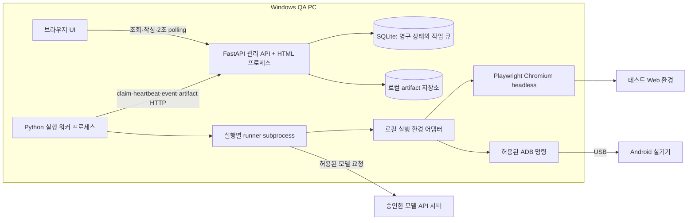
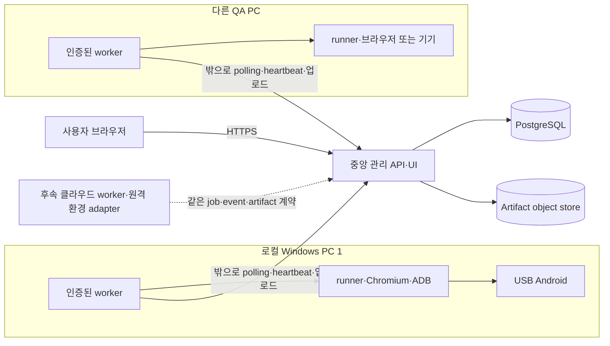

# Web·Android AI QA 플랫폼 설계

문서 버전: **0.5** · 개정일: **2026-10-31 (Asia/Seoul)** · 상태: **설계 검토용, 구현 승인 전**

읽는 순서: [기술 조사](RESEARCH.md) → 이 문서 → [화면 명세·와이어프레임](UI_SPEC.md) → [데이터·승인·재녹화 상세](DATA_DESIGN.md) → [단계별 구현 계획](IMPLEMENTATION_PLAN.md).

개정 근거: 사용자가 확정한 **디바이스 선택→필요 정보→자연어 검증→AI 녹화** 동선과 케이스 중심 관리다. 검증 정의와 녹화 기록을 케이스 버전에 함께 두고 별도 TC는 선택 기능으로 둔다. [v0.3 전체 설계](docs/history/v0.3/DESIGN.md)는 보관했다.

**v0.5 핵심:** AUT(자동화 케이스)가 원문/검증 정의·실행 설정·녹화 절차·증거를 함께 소유한다. TC 등록/연결/버전 일치가 녹화·저장·시범·승인·정식 실행의 조건이 아니다. REC의 action별 PNG/로그는 승인 없이 먼저 저장하고, 완료 후 저장본을 사람이 검토·승인한다. 단일/선택/묶음 RUN과 ITEM·job·QA 정책은 유지한다. 제품 구현·설치·모델 호출·배포는 진행하지 않는다.

이번 DB/수명 점검에서 PK/FK·멱등 materialization·승인 원자성·재녹화 교체·장기 facts/통계·보관 규칙의 구체화가 필요했다. [DATA_DESIGN.md](DATA_DESIGN.md)가 해당 규범이다. 현재 설계는 DB 구현/부하/복원 시험을 통과했다는 의미가 아니다. [v0.4 설계](docs/history/v0.4/DESIGN.md)는 변경 없이 보관했다.

## 1. 추천안과 전제

**Web·Android 모두 Mobile-Agent v3.5의 해당 실행 경로를 사용하는 A안을 추천한다.** Web은 Python Playwright, Android는 ADB를 제어한다. 플랫폼이 테스트 정의·승인·불변 버전·작업 관리·검증·증거·비용을 맡는다. 엔진 완료 보고는 참고 정보이며 QA PASS를 결정하지 않는다.

첫 회귀 모드는 **승인된 단계와 기대 결과를 고정하고, 각 단계에서 AI가 현재 대상을 찾는 방식**으로 제안한다. 공개 runner를 감싸는 것만으로 이 모드가 생기지 않는다. 단계 경계·정책 검사·검증·사용량·취소를 넣는 작은 연동 패치가 필요하다. 한도 내에서 호환성을 확보할 수 있는지는 후속 기술 검증 P0의 gate다. 근거와 B안 비교는 [RESEARCH §6](RESEARCH.md#6-ab-구성-비교와-추천-근거)를 따른다.

### 확정된 목표와 임시 가정

| 구분 | 내용 |
|---|---|
| 요청에서 확정 | 실제 웹 관리 UI, 로컬 브라우저와 직접 연결 Android, 자연어 작성, 실행 증거, 사람 검토·승인, 승인 버전 회귀 묶음, 결과 분석, 영구 저장 |
| 임시 가정 | 개인/소규모 QA 팀, Windows PC 한 대와 USB Android 한 대, Chromium 시작, 외부 모델 API 우선, 단계별 PNG 미리보기 |
| 제안하는 제한 | 초기 동시 실행은 Web 1개 또는 Android 1개로 총 1개. 두 플랫폼 모두 제품 기능으로 완성해야 출시 가능 |
| 모델 임시 선택 | Android는 API로 접근 가능한 GUI-Owl-1.5 Instruct 계열을 우선 검증. Web은 해당 SoM/도구 형식에 맞는 vision model을 호환성 시험 후 선택. 구체 제공자/모델은 미확정 |
| 버전 기준 | MobileAgent `81fa28b564ef7a695521500bc15a0e1324b2b394`; 상세는 RESEARCH |
| 운영 저장 위치 | 코드 문서는 이 저장소. 실행 DB/증거/비밀값은 동기화되지 않는 `%LOCALAPPDATA%/AIQA/` 아래 별도 위치. 현재 OneDrive 저장소에 runtime DB를 만들지 않음 |

MVP 포함: 검증 정의/설정/녹화 절차/증거를 단일 케이스로 관리·녹화 동작별 PNG/로그를 먼저 저장하고 완료 후 승인·단독/선택 수행·리포트를 포함하며, 웹 UI에서 프로젝트·환경 관리, 기기 선택·진단, 설치된 앱 선택·선택적 APK 빌드 등록/명시 설치, 테스트 검색·분류·복제·편집·보관, 구조화 계획 수정, 시범 실행·증거 검토·승인/반려, 버전을 고정한 회귀 묶음의 순차 실행·취소·새 재실행, 결과 비교·내보내기, 모델/제한/보관 설정. Web·Android 모두 실제 직접 연결 실행으로 제공한다. 일상 운영에 CLI 입력을 요구하지 않는다.

후속: 무모델 생성 코드 재생·Skill Factory, **테스트 대상 사이트 안의** 고급 파일 업로드/다운로드·여러 탭 테스트, 영상/trace/logcat, API·DB oracle, 중앙 서버/여러 워커·기기, 클라우드 공급자, 여러 브라우저, 예약·CI·알림. 관리 UI의 APK 업로드와 결과 다운로드는 MVP이며 대상 사이트의 file IO와 구분한다. iOS·K8s·대규모 디바이스팜·멀티테넌트 SaaS·과금 시스템·모델 학습은 후속 검토이며 모든 앱의 무인 실행은 보장하지 않는다.

## 2. 요구사항과 수용 조건

P0는 MVP 출시 필수, P1은 후속이다. 자세한 시험 표본과 제안 기준은 §13을 따른다.

| ID | 우선순위 | 사용자 가치 | 범위 | 수용 조건 |
|---|---|---|---|---|
| R01 | P0 | 자산 관리 | 프로젝트/대상/환경 | URL·package allowlist와 환경 snapshot을 저장·조회 |
| R02 | P0 | 장치 선택 | 워커·Android/브라우저 상태 | 연결/권한/점유·OS·해상도·앱 버전을 표시하고 부적합 자원 배정 차단 |
| R03 | P0 | 자연어 작성 | 원문+구조화 계획 | 둘을 보존하고 모호한 기대 결과는 `needs_review`로 차단 |
| R04 | P0 | Web 실제 실행 | Chromium 단일 탭 | 승인 경로로 입력·버튼·결과 확인, 실패 주입도 판정 |
| R05 | P0 | Android 실제 실행 | USB 실기기 | 앱 실행·터치·입력·캡처·검증, 연결 해제 시험 포함 |
| R06 | P0 | QA 판정 신뢰 | 단계·필수 검증·경로 | 클릭/agent done만으로 PASS 불가, oracle 위반 시 FAIL |
| R07 | P0 | 검토 가능성 | 화면/행동/검증 타임라인 | 필수 전후 화면과 관찰·판정 근거를 step에 연결 |
| R08 | P0 | 승인 통제 | 불변 version manifest | hash·승인자·시간·근거를 저장하고 수정 시 새 버전 |
| R09 | P0 | 반복 검증 | 승인 버전 회귀 | 같은 hash로 새 run·새 증거·새 검증, 이전 PASS 미재사용 |
| R10 | P0 | 오래 걸리는 작업 | API/worker 분리 | 요청은 202로 반환, UI 종료·API 재시작 후 조회 가능 |
| R11 | P0 | 안전한 중단 | 취소·자원 정리 | 모델 대기 중 취소도 실행을 멈추고 정리/격리 상태 표시 |
| R12 | P0 | 장애/중복 내성 | lease·event·멱등성 | 중복 요청/전달에 추가 행동 없음, 늦은 결과가 확정 결과를 덮지 않음 |
| R13 | P0 | 비용 통제 | 모든 모델 역할 계측 | 누락 usage는 null, 호출/시간/단계/예산 한도 강제 |
| R14 | P0 | 정보 보호 | secrets·대상·도구 권한 | 프런트/원문/로그에 secret 미노출, 범위 밖 행동 거부 |
| R15 | P0 | 운영 복구 | 보관/정리·비교 | 재연결 후 이벤트 복원, 보관 만료 표기, 정리 실패 기록 |
| R16 | P0 | 유효한 MVP 검증 | 정상+오류+장애 | Web·Android 모두 §13 gate 충족, 한쪽만으로 완료 불가 |
| R17 | P1 | 저비용 회귀 | CUAWright 코드 재생 | 승인 코드·격리·모델 차단·현재 assertions 확인 후 제공 |
| R18 | P1 | 여러 PC 실행 | 중앙 API+local workers | outbound 연결·등록 폐기·heartbeat·배정·artifact 업로드 검증 |
| R19 | P1 | 강한 oracle | 선택 API·DB 검사 | 별도 read 권한/허용 endpoint, UI 경로 대체 금지 |
| R20 | P1 | 깊은 디버깅 | 영상/trace/logcat | 선택 수집·용량 한도·비밀값 정책 마련 |
| R21 | P0 | UI로 일상 운영 | 목록/편집/설정/대기열 | 검색·필터·정렬·복제·보관·편집을 실제 API와 연결, 새로고침 복원 |
| R22 | P0 | 회귀 묶음 | 버전별 구성·순서·환경·데이터 | immutable 묶음 revision과 실행 snapshot, 순차/중단 정책·전체 판정·미실행 집계 |
| R23 | P0 | 앱 빌드 관리 | 설치 앱 선택·선택적 APK | 해시/버전/OS/ABI 검증, 명시적 설치만 허용, 매 run 재업로드/재설치 없음 |
| R24 | P0 | 검토 동선 완성 | 반려·차이·재승인 | 반려 사유/검토자/시간 저장, 새 revision 승인 뒤 묶음 버전 명시 교체 |
| R25 | P0 | 실행 환경 경계 | 환경 어댑터·세션 | 관리 브라우저와 테스트 context 분리, attempt별 session 확보·정리·quarantine |
| R26 | P0 | 탭/PC 수명 안내 | 재접속·절전/종료 감지 | 관리 탭 닫아도 실행 유지, PC 중단은 정상 완료 처리하지 않고 복구 안내 |
| R27 | P0 | UI 동선 합격 | 기본15화면+선택TC1화면·7와이어프레임/추적 | UI에서 디바이스→정보/검증입력→녹화저장→완료후검토/승인→수행/분석, API/CLI만으로 합격 불가 |
| R28 | P0 | 단일 케이스 관리 | 검증 정의+설정+녹화 절차+증거 | TC 0개/null 참조에서도 녹화·저장·trial·승인·정식 수행. TC 변경/보관은 케이스 차단 사유 아님 |
| R29 | P0 | 동작별 녹화 증거 | 각 탭/swipe/입력/back 전후 PNG·로그 | action ID와 전후 캡처·실제 명령·오류/검증을 조회, 대표 화면 하나로 대체 불가 |
| R30 | P0 | 저장 후 승인 | 녹화 완료→보관→사람 검토 | 승인 없이 중단/미완성도 저장, 녹화 중 승인 없음, 저장된 AUT version만 사후 승인 |
| R31 | P0 | 수행·리포트 | 단일/선택/suite 공통 RUN | 결과7종+진행=N, 세 비율·미검증·재실행 원본 보존 |
| R32 | P0 | 실패 분석·데이터 | 별도 분석/이의·versioned data | 분석이 QA 원본을 바꾸지 않고 data row/hash를 snapshot |

## 3. 아키텍처 결정

| ADR | 결정 | 이유/대안/재검토 조건 |
|---|---|---|
| D01 | A: Mobile-Agent Web+Android | 생성 코드 실행 없이 두 플랫폼의 QA 흐름에 집중. Web 정적 결함을 P0에서 해소 못 하거나 무모델 회귀가 필수가 되면 B 재검토 |
| D02 | FastAPI + Jinja2 + HTMX + 소량 JS/CSS | Python 숙련도 활용. 작성/검토/타임라인은 HTML 부분 갱신으로 충분. React/TS는 복잡한 동시 편집·클라이언트 상태가 실제 필요해질 때 검토 |
| D03 | 별도 Python worker + 실행별 runner subprocess | 웹 요청 수명과 실행 분리, 취소·충돌 범위 제한. FastAPI BackgroundTasks를 장기 실행 큐로 쓰지 않음 |
| D04 | SQLite + SQLAlchemy/Alembic, API만 DB 접근 | 로컬 1 API 프로세스·1 worker에서 추가 broker 최소화. 큐도 transaction으로 저장. 원격 worker는 DB 파일 공유 안 함 |
| D05 | 로컬 파일 artifact + DB metadata/hash | PNG·로그를 DB BLOB로 크게 만들지 않음. 중앙형은 object store로 이전하되 artifact API 계약 유지 |
| D06 | UI 2초 HTTP polling, event cursor 조회 | 영상 요구가 없으므로 SSE/WebSocket 없이 시작. 이벤트는 먼저 DB commit. UI 연결과 실행 수명 독립 |
| D07 | worker는 outbound 2초 polling·10초 heartbeat | 로컬/중앙 동일 프로토콜. Redis/Celery는 도입하지 않음. DB queue 처리량/lock 경합이 문제가 될 때 검토 |
| D08 | 에이전트 adapter와 환경 adapter 분리 | 에이전트는 관찰/계획/행동, 환경은 로컬 context·USB 확보/준비/해제. capability는 교집합만 노출. 클라우드 구현·플러그인 마켓은 후속 |

중앙형 전환 조건은 여러 PC 또는 공유 팀 운영이다. 이때 관리 DB는 PostgreSQL, TLS·팀 계정·artifact object storage를 도입한다. worker는 동일 claim/lease 프로토콜을 사용한다. SQLite는 로컬 단일 API writer에 한정하며 NAS/OneDrive/원격 파일 공유를 지원하지 않는다. 지속적 DB lock 대기 p95가 100ms를 넘거나 작업/이벤트 적체가 발생하면 먼저 batch/인덱스를 확인하고 PostgreSQL 전환을 검토한다. 이는 제안 운영 기준이며 측정값이 아니다.

기술 선택의 공식 근거: [FastAPI의 장기 작업 고려사항](https://fastapi.tiangolo.com/tutorial/background-tasks/), [HTMX](https://htmx.org/docs/), [SQLite WAL의 같은 호스트 조건](https://www.sqlite.org/wal.html), [Playwright context 격리](https://playwright.dev/python/docs/browser-contexts). 라이브러리 설치 버전은 P0 lock 단계에서 확정하며 이 문서는 설치를 수행하지 않는다.

### 로컬 배치도 — MVP



DB·파일 경로는 API가 관리한다. worker/runner는 run별 spool에 쓰고 artifact API로 업로드한다. 같은 PC여도 저장소를 직접 공유하는 특수 경로를 만들지 않는다. API 재시작 동안 spool을 보존하며 lease를 갱신할 수 없으면 행동을 멈춘다. 관리 UI를 띄운 브라우저와 테스트용 Chromium/process/context는 별개다. 프런트엔드는 인증된 HTTP 명령과 증거 조회만 하고 ADB·셸·테스트 브라우저를 직접 제어하지 않는다.

### 중앙 관리 배치도 — 후속



서버가 USB 기기를 직접 제어하지 않는다. 일반 웹 호스팅은 이 UI/API를 제공할 수 있을 뿐, 로컬 장치·지속 워커·GUI 세션이 자동으로 생기지 않는다. PyAutoGUI desktop 경로는 MVP에서 쓰지 않는다. Web headless와 ADB 실기기는 Windows 화면을 마우스로 조작하지 않지만, Android는 잠금 해제·앱 화면 상태가 필요하다. headed browser는 로그인된 사용자 desktop session이 필요하며 서비스 session에서 동작한다고 가정하지 않는다.

### 프로그램 시작·일상 운영·PC 수명

최초 한 번의 설치·SDK/모델 키 설정·USB 권한 승인과, 프로그램 시작 절차를 일상 테스트 동작과 구분한다. MVP는 향후 제공할 로컬 시작 도구가 API와 worker를 **브라우저 탭의 자식이 아닌 지속 프로세스**로 시작하고 localhost URL·상태를 안내하는 방식으로 제안한다. 초기 준비는 기술 작업이지만 테스트 작성/편집/실행/설치 요청/검토/회귀/분석은 웹에서 처리한다. 자동 시작 Windows 서비스화는 필수가 아니며 headed session 조건도 따로 검증한다. 이번에는 시작 도구를 구현/실행하지 않는다.

관리 탭을 닫아도 PC·API·worker가 실행 중이면 작업은 계속된다. 재접속 시 REC/RUN ID로 DB 기록을 복원한다. 프로그램 종료는 진행 작업과 중단 영향을 표시하고 실행 중이면 취소·정리를 먼저 요청한다. 강제 종료·PC 종료·절전에서는 실행 지속을 보장하지 않는다. 전원 이벤트와 monotonic/UTC 경과 차이를 감지하면 새 행동을 차단하고 lease/session을 재검증한다. 절전/재부팅 뒤 멈췄던 runner를 그대로 재개하지 않으며, 이전 side effect 확인·정리/quarantine·새 실행 경로를 안내한다. PC가 꺼진 동안 로컬 서버가 즉시 감지할 수 있다는 가정도 하지 않는다. 복귀한 API/worker가 journal과 만료 lease를 조정하며 job은 lost로 기록하며, 유효 violation이 없는 ITEM은 INCONCLUSIVE·REC/관리 job은 verdict=null이다.

Windows native 실행이 1차 선택이다. WSL/컨테이너로 바꿔야 하면 USB 전달·ADB server/client 경계·기기 권한·파일 경로·headed 화면·프로세스 종료를 별도 P0 gate로 검증한다. Windows 호스트에서 ADB가 된다는 사실만으로 WSL/컨테이너에서도 된다고 단정하지 않는다. 로컬 기기 실행과 외부 모델 추론은 서로 다른 배치 선택이다.

## 4. 컴포넌트와 데이터 흐름

관리 API 책임: 정의/버전/승인 저장, 정책 validation, 작업 등록/claim, 상태 전이, lease, 이벤트·증거 ingest, 판정 집계, 비용 조회, 보관·감사. 테스트를 직접 실행하지 않는다.

worker 책임: 등록/인증, device inventory, claim, 설정·artifact manifest 확인, 자원 준비, runner 시작·취소·정리, spool 재전송, heartbeat, 로컬 watchdog. 모델 키는 worker의 OS secret store에서 참조한다.

runner 책임: 한 attempt만 수행. adapter가 observation→model→action proposal을 받고 정책 gate가 tool 실행을 허용한다. 동작 후 관찰과 validator 결과를 event로 보낸다. 사용량은 공통 model gateway client를 통해 기록한다. upstream loop에서 정책 우회로 직접 실행하는 길은 제거한다.

순서:

1. UI에서 디바이스(Android) 또는 테스트 브라우저(Web)를 먼저 선택한다. 앱/URL·환경·빌드·계정/data·reset/한도를 설정하고 자연어 검증 내용·기대 결과를 입력한다. TC 생성/선택 단계는 없다.
2. 검증 정의/설정을 케이스 입력 초안 version으로 저장하고 AI 구조화 제안을 확인한다. REC/job은 그 exact input_case_version_id/hash와 선택 resource를 snapshot하고202로 반환한다. TC/승인 여부와 무관하게 준비 가능한 초안에서 시작한다.
3. worker가 lease·환경 session을 준비하고 agent는 관찰→proposal→정책 gate→행동을 수행한다. 매 실제 action에 전후 PNG·정제 로그·오류/검증을 저장·ACK한다.
4. 녹화 완료/중단은 새 행동을 멈추고 기록을 flush/seal·정리한다. 실패/미완성 기록도 먼저 보관하고, 입력 검증 정의/설정에 수집 절차·근거를 더한 새 케이스 draft version을 TC 없이 자동 저장한다.
5. 완료·저장된 AUT를 UI에서 열어 원본 동작/화면/로그를 확인한다. 편집은 새 AUT revision이며 원본 REC는 불변이다.
6. 현재 AUT manifest로 새 trial RUN/ITEM을 만들고 동작·QA 근거를 다시 수집한다.
7. 사람이 저장된 source/trial action을 검토하고 exact AUT/evidence digest를 승인 또는 반려한다. 승인 여부는 저장의 선행 조건이 아니다.
8. 단독/선택/suite의 정식 접수는 exact 승인 케이스 version/data/env·명시 제외를 snapshot하여 RUN과 모든 ITEM/jobs를 원자 생성한다.
9. worker는 ITEM을 순차 실행하고 검증/증거/정리 후 terminal로 확정한다. 서버는 상태·QA·disposition·display 결과/분모를 집계한다.
10. UI는 RUN report·ITEM 실패 분석·동작별 근거를 제공한다. 사용자 재실행은 원본 ref/사유가 있는 새 RUN이며 과거 결과를 덮지 않는다.

## 5. 테스트 정의·판정·버전

### 5.1 통합 케이스 정의·녹화 계약

자동화 케이스가 자연어 원문·목적·사전 조건·data/secret ref·수행 의도·단계/최종 기대 결과·필수 경로와 실행 설정·녹화 절차·검증 binding·근거 참조를 한 version에 보존한다. 물리 artifact/event 테이블은 분리해도 사용자는 하나의 케이스 상세에서 함께 관리한다. TC는 기본 승인/실행 계약의 부모가 아니다.

의미가 불명확하거나 필수 검증이 없어도 초안 저장은 허용한다. AI 녹화를 안전하게 수행할 정보는 시작 전에 보완하고, 정식 승인에는 명시 기대 결과/현재 증거가 필요하다. 검증 내용/실행 절차/핵심 설정을 수정하면 케이스의 새 version을 생성한다. 원본 REC·과거 version·수행은 변경하지 않는다.

제안 케이스 초안 JSON(참조 metadata는 응답 envelope이며 승인 hash의 의미 내용과 분리):

```json
{
  "case_id": "AUT-041",
  "case_version_id": "case-input-v1",
  "tc_reference": null,
  "definition": {
    "raw_text": "정상 계정으로 로그인하고 사용자 이름 표시를 확인",
    "objective": "지정 로그인 버튼의 인증과 사용자명 표시 검증",
    "preconditions": ["QA 계정 사용", "로그아웃 상태"],
    "variables": {"expected_user_name": "QA Tester"},
    "secret_refs": {"account": "worker-secret://qa-account"},
    "steps": [
      {"id": "S1", "instruction": "계정 정보를 입력한다", "expected": []},
      {"id": "S2", "instruction": "지정 로그인 버튼을 누른다", "expected": [{"id": "C1", "subject": "signed-in-user", "kind": "text_equals", "value": "${expected_user_name}", "required": true}]}
    ],
    "path_policy": {"must_use": ["S2:login-button"], "forbidden": ["api-state-mutation"]}
  },
  "execution_settings": {
    "target_kind": "android",
    "environment_revision_id": "env-v3",
    "package": "com.example.qa",
    "install_policy": "use_installed",
    "reset_policy": "approved-logout",
    "cleanup_policy": "restore-session-only",
    "limits": {"timeout_seconds": 600, "max_actions": 50, "max_model_calls": 80}
  },
  "recorded_steps": [],
  "source_recording_id": null,
  "review_status": "draft"
}
```

REC는 input version/hash를 고정하고 완료 시 실제 recorded steps·source manifest를 포함한 produced case version을 새로 만든다. 입력 version을 UPDATE하지 않는다. 기록 실패/중단도 새 draft와 증거 상태를 남기며 승인과 저장을 분리한다.

선택 TC는 별도 카탈로그에서 관리한다. nullable tc_reference 연결/해제는 metadata/audit이며 녹화·저장·승인·실행 결과에 영향을 주지 않는다. TC 수정/보관도 케이스를 자동 변경/차단하지 않는다. 사용자가 TC 내용을 명시 가져와 diff를 수락해 검증 내용을 바꿀 때만 새 케이스 version·재검증/재승인한다. v0.3의 필수 주 TC/버전 FK·current/historical TC gate는 제거한다.

`subject`는 케이스 manifest의 의미상 대상 binding이다. Web locator·Android 관찰 영역/도구가 실제 값을 읽을 수 있어야 하며 AI 시각 추출값을 결정적 oracle로 표시하지 않는다. 모델 입력은 저장된 case.definition/설정에서 만들고 참조 TC의 최신 원문을 자동 조회/동기화하지 않는다.

전체 화면·REC/action·케이스/수행 JSON과 계약은 [UI_SPEC §7](UI_SPEC.md#7-데이터api워커--v05-규범-계약)을 따른다.

### 5.2 세 종류의 성공과 최종 판정

| 층위 | 예 | PASS와의 관계 |
|---|---|---|
| 명령 전달 | ADB exit=0, Playwright click 반환 | 버튼 반응을 증명하지 않음 |
| 단계 진행 | 다음 화면/상태가 예상대로 관찰됨 | 단계 기대 결과의 일부 |
| QA 검증 | 상품 코드·수량·필수 UI 경로가 모두 충족 | 현재 실행의 필수 검사 집계로만 PASS |

검증 `status`: `satisfied`, `violated`, `unknown`, `not_run`. 각 결과에 check ID, expected snapshot, observed value/text, 판정 method/version, artifact hash, 관찰 시각, 짧은 이유, 오류 분류를 남긴다. AI 검증은 관찰·기대·실제 화면·판정 이유를 모두 요구하며 parse 실패·가림·누락 화면은 unknown이다. 모델 confidence는 보정 확률로 표시하거나 threshold 근거로 사용하지 않는다. 별도 verifier 모델도 독립 정답을 보장하지 않는다.

최종 집계 순서(실제 검증을 시도한 case_run에 적용; 녹화/관리 job에는 QA verdict를 만들지 않음):

1. 현재 ITEM의 attempt들에서 확인된 검증 가능한 증거에서 필수 기대 결과 또는 필수 경로가 위반되면 **FAIL**. 인프라 오류와 섞이면 root cause와 나머지 unknown을 함께 표시한다.
2. 유효한 위반 증거가 없고, 실행 전/중 필수 환경·권한·사람 입력 문제로 진행 불가면 **BLOCKED**.
3. 위 둘이 없고, 취소·worker lost·모델 한도·증거 손실·불명확 외부 상태·미실행 필수 검사면 **INCONCLUSIVE**.
4. 모든 필수 step/check/path가 satisfied, 필수 evidence 존재, 한도/정책 위반 없음, 승인한 초기/정리 조건 충족이면 **PASS**. 필수 검사가 0개인 정의는 실행 전 거부한다.

필수 정리는 케이스의 expected lifecycle에 포함한다. 로그 업로드 등 운영 정리만 실패하면 `cleanup_status=failed`로 별도 표시하고 해당 자원은 quarantine한다. 운영 정리 실패만으로 이미 관찰한 제품 assertion을 바꾸지는 않는다. 필수 evidence 미전송은 INCONCLUSIVE로 판정하며 PASS를 확정하지 않는다.

고장 난 버튼을 다른 버튼·API로 우회한 경우 path check가 violated다. 제품 버그를 복구로 숨기지 않는다. action retry 전 원래 실패·근거를 남기고 `recovery_used=true`로 기록한다. 필수 버튼 실패 후 동일 검증 목적을 우회해 성공해도 최종 FAIL을 지운다거나 덮지 않는다. 단순 일시적 로딩 재관찰은 실패 assertion 전의 허용된 wait로 취급한다.

결정적 Web oracle은 승인 locator의 visible/text/value 비교와 Playwright 상태 대기를 우선한다. Android는 가능하면 승인된 UI hierarchy/명시적 값 추출을 이용하되 소형 ADB read-only 관찰 추가가 필요하다. 접근 불가능한 custom UI는 visual oracle로 구분한다. API·DB oracle은 P1이며 read 권한·query allowlist를 확보한 경우에만 추가한다. UI 테스트를 API mutation으로 대체할 수 없다.

### 5.3 저장 후 승인·불변성

흐름은 **디바이스/브라우저 선택 → 케이스 정보/자연어 검증 정의 저장 → REC 수행/동작별 증거 저장 → 녹화 완료·원본 보관 확정/AUT 초안 저장 → 저장본 편집·시범 실행 → 완료 후 사람 검토 → AUT version 승인/반려 → 승인 version 정식 수행**이다. 녹화 중 승인·승인해야 저장되는 gate는 없다. 실패/중단/미완성도 먼저 보존하며 반려는 삭제가 아니다.

각 탭/swipe/입력/back 등의 전후 PNG와 정제 로그·오류를 action ID로 보관한다. 녹화 완료 후 source REC의 필수 mapped action과 동일 AUT manifest trial의 실제 action을 검토한다. 검증 정의/근거 누락·미검토·다른 케이스/증거 hash이면 저장은 유지하고 승인만 차단한다. 자세한 capture/flush·누락·단계별 review는 [UI_SPEC §5](UI_SPEC.md#5-동작별-기록저장완료-후-승인-계약)를 따른다.

AUT content는 생성 즉시 append-only다. 승인 record는 AUT hash·source REC digest·현재 trial evidence digest·action review·actor/time/reason에 결합한다. 승인 근거 trial은 해당 플랫폼의 같은 manifest로 completed/PASS이며 모든 필수 evidence가 ready여야 한다. 녹화 성공/PASS trial이 자동 승인이나 다음 실행 PASS를 뜻하지 않는다. 두 플랫폼 검증은 제품 출시 gate이며 한 AUT에 양 플랫폼을 요구하지 않는다.

재승인 대상은 케이스 검증 정의·동작/기대·필수 경로·locator 의미·실행 코드·engine/patch/lock·model/provider/revision/프로토콜·prompt·viewport/locale/reset·한도/권한 확대다. 분류 metadata·승인 schema 내 data 값·정상 secret rotation은 snapshot/audit로 남긴다. 계정 권한 변경은 재승인한다. 모델 alias의 실제 교체를 완전히 통제할 수는 없으므로 응답 model ID를 기록한다.

앱/browser는 승인한 환경 범위 안에서 대상 build가 바뀔 수 있고 실제 fingerprint를 남긴다. 범위 밖은 preflight BLOCKED다. 선택 TC의 내용을 반영하려면 명시 가져오기/diff 수락으로 케이스 정의를 변경→새 case version→trial/승인을 거친다. 단순 참조/참조 TC 변경은 재승인 조건이 아니다. 새 승인 AUT는 suite에서 자동 교체하지 않는다.

승인은 **approved event·required evidence 보호 ref·current_approval pointer·audit를 한 DB transaction**에서 확정한다. expected_current_approval_id CAS가 다르면409이며 부분 성공은 없다. exact source manifest/trial/evidence hash를 고정하고 이후 복구는 새 manifest/version/review를 만든다. 기존 review/approval 내용은 UPDATE하지 않는다.

재녹화는 **같은 케이스의 새 input draft/REC/produced version**이다. 기준 version·사유·검증 의도 유지/변경 diff를 남기고 기존 승인본과 기본 pointer를 유지한다. MVP는 전체 흐름 재녹화이며 부분 절차 붙이기/중간 재개는 후속이다. 실패·중단·반려·stored인 불완전 후보도 보존하지만 기본 실행본을 교체하지 않는다. completed source·완결 절차/필수 증거·동일 manifest PASS trial·사후 action review가 충족될 때만 ‘승인 및 기본 실행본으로 사용’으로 교체한다.

새 승인이 생겨도 이전 승인을 자동 철회하지 않는다. 기존 suite 구성과 queued/running RUN은 접수한 exact version/approval을 유지한다. suite 갱신은 명시 diff를 확인한 새 suite_version이다. revoke는 별도 append-only 기록이며 새 정식 claim 차단·진행 취소 요청을 남긴다. 현재 승인 철회 시 과거본으로 자동 fallback하지 않는다. [DATA_DESIGN §5–7](DATA_DESIGN.md#5-원자-transaction과-파일-복구)이 충돌·보호·복구 규범이다.

## 6. 실행·자원 상태와 복구

### 6.1 ID와 상태 전이

RUN(execution)은 단일/선택/묶음 공통 부모이며 ITEM(case_run)이 개별 케이스×데이터×대상이다. ITEM마다 job_id를 갖고, REC/구조화/설치/진단/export도 각 job을 갖는다. `attempt_id`는 job의 실제 시도다. 전송 재수신은 같은 job/attempt, 사용자 재실행은 새 RUN/ITEM이다. 이 절의 실행 제어/lease terminal은 **job** 상태이며 부모 RUN의 QA 완료와 동일하지 않다.

아래 job 진행과 QA verdict/disposition/display_result를 분리한다. REC와 모든 관리 job의 verdict는 timeout·lost·취소·증거 오류를 포함해 항상 null이다. ITEM의 7개 화면 결과와 부모 요약은 UI_SPEC §6을 따른다. queued의 명시 skip은 자원 확보 없이 completed/disposition=skipped로 종료 가능하다.

| 현재 | 허용 다음 상태 | 조건 |
|---|---|---|
| queued | preparing, completed, cancelled | 원자적 claim, 미시작 명시 skip, 실행 전 취소 |
| preparing | running, cancel_requested, finalizing, error, lost | preflight 성공, 취소, 차단 결과 정리, 복구 불가 오류, lease 상실 |
| running | cancel_requested, finalizing, error, lost | 정상/한도 종료, 취소, 장애 |
| cancel_requested | finalizing, lost | runner 정지 확인 후 정리, 또는 worker 상실 |
| finalizing | completed, cancelled, error, lost | 검증·artifact·정리 집계, 취소 맥락, 업로드 오류, worker 상실 |
| completed/error/cancelled/lost | 없음 | terminal, 늦은 메시지로 변경 금지 |

`completed`는 실행 절차가 마무리됨을 뜻하며 FAIL/BLOCKED/INCONCLUSIVE도 가능하다. `error`는 플랫폼/환경 실행 오류, `lost`는 lease 상실, `cancelled`는 실행 전 취소 또는 정지 확인 후 취소다. terminal마다 termination_reason을 저장하고 trial/정식 ITEM에만 §5.2의 verdict 또는 미실행 disposition을 적용한다. 실행 오류라도 이미 검증한 필수 위반은 FAIL로 남을 수 있다.

어떤 terminal 전이도 자원을 바로 ready로 만드는 근거가 아니다. 정상 경로는 finalizing에서 cleanup report를 확인한다. 준비 오류 등으로 error에 바로 들어가더라도 worker finally 정리를 수행하고, 서버에 정리 확인이 없으면 resource를 quarantine한다. queued 취소처럼 자원을 받지 않은 경우만 정리 대상이 없다.

### 6.2 배정·heartbeat·중복

- API는 하나의 DB transaction에서 queued 조건부 update + resource lease + attempt를 생성한다. `(worker_id, device_serial)` 기기는 한 lease만 갖는다. Web도 worker slot을 점유한다. 초기 총 slot=1이다.
- 요청 `Idempotency-Key`는 project+actor+operation 범위로 본문 hash와 함께 7일 보관한다. 같은 key/본문은 같은 접수 결과(RUN 또는 REC), 다른 본문은 409다. 7일 뒤 재사용 요청은 새 요청으로 취급하므로 client는 UUID를 쓴다.
- worker는 받은 job/attempt/lease generation을 local journal에 먼저 기록한다. 중복 claim 응답·전달은 이미 시작한 attempt를 반환하며 runner를 추가 생성하지 않는다. runner도 attempt workspace singleton lock을 확인한다.
- heartbeat 10초, server lease TTL 45초, worker는 마지막 갱신 응답 후 30초 이내 갱신 못 하면 새 행동 차단·runner 종료. 각 행동 전 lease가 10초 이상 남았는지 확인한다. 시간은 서버 만료값과 worker monotonic elapsed로 처리한다. 모델 응답이 늦게 도착해도 generation/취소/lease를 다시 검사한다.
- lease 만료는 물리 작업 종료 증명이 아니다. 서버는 job을 lost로 확정하고 자원을 **quarantined**로 둔다. 새 worker가 바로 가져가지 못한다. 원 worker 또는 수동 복구가 이전 process tree 종료·기기 상태·IME·임시 파일을 확인해야 generation을 올려 해제한다. 서버 generation은 API fencing이며 외부 클릭을 되돌리지 못한다.
- worker 단절/폐기 시 token revoke, 새 claim 차단, 로컬 watchdog 정지. 여러 worker가 같은 USB serial을 등록하면 관리자가 소유 PC를 확인하기 전 배정 금지.

### 6.3 취소·재시작·부분 실행

취소 API는 queued를 즉시 cancelled로, preparing/running을 cancel_requested로 원자 변경한다. finalizing/terminal은 409와 현재 상태를 반환한다. 완료와 취소의 race는 DB 전이 transaction의 승자로 결정한다. cancel_requested 이후 모델 응답/새 행동은 폐기한다.

worker는 협력 취소 신호를 보내고 5초 후에도 살아 있으면 runner와 자식 브라우저를 Windows Job Object로 종료한다. 최종 정리는 worker의 신뢰 코드가 수행한다. 취소 요청부터 새 행동 차단 목표 2초, process 종료 목표 10초, 정리 확인 목표 30초를 제안한다. 이미 전달한 ADB 명령·서버 거래는 취소로 되돌릴 수 없다. 그 경우 outcome_unknown을 기록하고 수동 검토한다.

API 재시작은 DB의 queued를 유지하고 active lease를 재조정한다. UI 연결은 무관하다. worker가 살아 있고 같은 generation으로 lease를 갱신하면 계속할 수 있지만 30초 watchdog이 지난 실행은 재개하지 않는다. 서버가 terminal로 만든 뒤 늦은 이벤트/결과가 오면 stale inbox에 감사용 보관하고 확정 결과에는 반영하지 않는다.

중간 재개는 같은 살아 있는 runner·유효 lease·현재 화면 재관찰·변경 없음·마지막 작업 결과 확정·남은 한도 조건을 모두 만족하는 일시적 모델/전송 지연에만 허용한다. 프로세스 사망, 재부팅, 외부 거래 결과 불명, 환경 fingerprint 변화는 checkpoint에서 임의 재개하지 않는다. MVP에서는 새 attempt를 시작하려면 승인한 reset/데이터 격리로 부작용이 없음을 확인해야 한다. 확인 못 하면 새 run도 BLOCKED로 검토한다. 기본 자동 attempt 재실행은 0회다.

| 상황 | 분류/판정 | 처리 |
|---|---|---|
| 모델 timeout/429 | model_transport/rate_limit | 2회 이하 제한 재시도, 시간/예산 차감. 소진 시 INCONCLUSIVE |
| 잘못된 action/무한 루프 | action_schema/loop | 실행 거부, 같은 화면·action 3회면 정지. INCONCLUSIVE |
| 요소 부재/값 불일치 | 제품 위반 증거 있으면 assertion_violation | 관찰 timeout 후 FAIL. 환경 원인 증거가 있으면 BLOCKED/unknown 구분 |
| 브라우저 crash/ADB offline | environment/browser_or_device | 새 행동 중지, BLOCKED 또는 중간 상태 불명 INCONCLUSIVE |
| worker 종료/연결 단절 | infrastructure/lease_lost | lost, 자원 quarantine. 서버에 확정된 필수 violation이 있으면 FAIL, 없으면 INCONCLUSIVE |
| 결제/주문 직후 전송 실패 | external_outcome_unknown | 무조건 재전송하지 않음. read-only 재관찰/수동 검토 |
| 정리 실패 | cleanup_failure | 자원 quarantine, 별도 cleanup_status; 필수 정리 조건 위반은 판정 집계 |

외부 동작의 exactly-once는 보장하지 않는다. 준비/실행 transaction과 클릭/거래 사이에 원자성은 없다. 서비스가 제공한 idempotency를 테스트 데이터에 사용할 수는 있지만 승인 UI 경로를 대체해서는 안 된다.

## 7. Android·Web 환경 정책

### Android

worker inventory는 serial, state(offline/unauthorized/ready/busy/quarantined), OS/build, physical/capture/model 크기, rotation, 현재 package/activity, app version, capture 가능 여부, IME 상태를 보고한다. ADB 연결 권한과 screen unlock은 preflight에서 확인한다. 잠금 해제·설치·데이터 삭제를 임의 실행하지 않는다.

실행 도구는 argument list로 `adb -s serial ...`을 호출하고 stdout bytes/exit/timeout을 기록한다. 모델은 raw shell을 출력할 수 없다. 앱 launch는 승인 package/activity만 허용하고 설치 앱 전체 목록을 외부 resolver에 보내지 않는다. read-only dumpsys/uiautomator 관찰은 필요한 명령만 allowlist한다. 앱 crash는 foreground package 이탈·명시적 crash 신호 등 근거와 함께 기록하고, 시스템 장애와 제품 crash를 error_category로 나눈다.

좌표는 `(원본 캡처 크기, 모델 입력 크기, 원본→입력 transform, rotation, content bounds)`를 매 observation에 저장한다. 모델 normalized 좌표 → 모델 입력 픽셀 → inverse transform → 원본 touch plane으로 바꾸고 경계 검사한다. MVP는 승인한 세로 방향과 해상도로 제한하며 도중 회전 시 정지/BLOCKED. 방향 지원은 이후 별도 capability다. 화면 크기를 추정해 이전 좌표를 재사용하지 않는다.

한글 입력은 승인한 ADB Keyboard 사용 가능 여부를 P0에서 확인한다. 이전 IME를 snapshot하고 finally 복구하며 실패 시 기기를 quarantine한다. secret은 모델이 문자열을 생성하게 하지 않고 허용한 input 동작 시 worker가 해석한다. 키보드가 화면을 가린 경우 새 캡처 후 재탐색한다. loading/팝업은 기대 조건 polling으로 기다리고 허용된 팝업만 닫는다. 보안/업무 확인 dialog는 자동 승인하지 않는다.

연결 해제·권한 상실·화면 잠금은 BLOCKED, 실행 뒤 상태를 알 수 없으면 INCONCLUSIVE. FLAG_SECURE 등 캡처 불가는 명시적인 EVIDENCE_UNAVAILABLE로 기록하며 우회하지 않는다. 기기당 한 작업이며 정상·실패·취소·lost 모두 정리 또는 quarantine 절차로 점유를 끝낸다. app clear/reinstall/logout은 버전의 명시 설정일 때만 수행한다.

### Web

MVP는 Chromium·단일 탭·승인 viewport(기본 1280×720)·DPR=1·locale ko-KR·timezone Asia/Seoul을 제안한다. upstream의 고정 user agent/locale/timezone과 공유 storage_state는 환경 설정으로 교체한다. 매 run 새 context, 기본 로그인은 run별 수행. 세션 재사용이 필요하면 계정·프로젝트·환경·만료시간별 암호화 storage snapshot을 승인하고 read-only 원본에서 복사한다. 개인 Chrome profile에 연결하지 않는다.

필수 UI는 locator/state 대기 기본 10초, navigation 30초, 전체 run 600초다. 테스트가 승인한 값을 쓰며 전역 고정 sleep을 유일한 대기로 삼지 않는다. 화면 전환 후 대상·URL·안정된 관련 상태를 관찰한다. upstream sleep은 보조 polling으로 교체한다. 다운로드/업로드·다중 탭·OS dialog가 필요한 테스트는 capability 미지원으로 실행 전 BLOCKED 처리하고 첫 제품의 일반 입력/버튼/스크롤/표준 select 범위를 문서화한다.

브라우저 popup은 승인한 동일 탭 modal만 우선 지원한다. 새 tab이 열리면 upstream처럼 조용히 닫아 다른 경로로 진행하지 않고 미지원 이벤트를 기록한다. browser/context/process/temp 정리는 worker가 확인한다. 데이터를 변경하는 테스트는 `${run_id}` 식별자와 승인 cleanup으로 충돌을 줄인다. OTP/CAPTCHA/대화형 로그인은 자동 우회하지 않고 HUMAN_REQUIRED로 종료한다. 사용자가 환경을 준비하면 새 trial/run을 시작한다. MVP에는 장시간 pause/resume UI를 넣지 않는다.

## 8. 제안 플랫폼 계약

### 8.1 실행 어댑터

다음은 설계용 Python 형태의 인터페이스이며 upstream API가 아니다. 파일/제품 코드는 이번에 생성하지 않는다.

```text
EngineAdapter.describe() -> CapabilitySet
EngineAdapter.preflight(spec: ExecutionSpec) -> PreflightResult
EngineAdapter.run(spec: ExecutionSpec, sink: EventSink, control: RunControl) -> EngineOutcome
EngineAdapter.cancel(attempt_id: UUID) -> StopAcknowledgement
EngineAdapter.cleanup(attempt_id: UUID) -> CleanupReport

ModelClient.invoke(request: ModelRequest, control: RunControl) -> ModelResponse
PolicyGate.authorize(proposal: ActionProposal, context: StepContext) -> ActionDecision
Validator.evaluate(check: CheckSpec, observation: Observation) -> CheckResult
```

`ExecutionSpec`: 케이스 version·검증 정의/설정/절차 manifest hash, execution/job/attempt와 선택 recording/case_run ID, engine/patch/lock hash, target/resource/lease generation, fixed step definitions, variable bindings, secret reference names, environment constraints, timeout/action/model/retry/budget limits. 실제 secret 값은 포함하지 않는다.

추가 필드: 선택 `suite_version_id/execution_id/entry_id`, 고정된 environment revision/실행 profile, 선택 app_build_id/hash와 명시 install/reset policy. 환경 adapter가 만든 session ID를 attempt에 연결한다. API에는 로컬 파일 절대 경로·ADB socket·CDP credential을 고정하지 않는다.

`EventSink`는 local spool에 먼저 순번·hash를 붙여 기록하고 worker가 API로 재전송한다. `RunControl`은 cancel flag·lease·deadline·사용량 한도를 신뢰 코드에서 확인한다. `EngineOutcome`은 완료 여부/중단 이유/실제 실행 요약일 뿐 최종 QA verdict가 아니다. cleanup은 여러 번 호출해도 안전해야 한다. adapter 오류 때문에 cleanup 자체가 건너뛰어지지 않도록 worker가 fallback 정리를 맡는다.

upstream의 직접 PNG/messages 파일 쓰기는 그대로 두지 않는다. 캡처→메모리 관찰 필터→보관본 생성 순서로 교체하고 stdout/debug writer에도 같은 정제를 적용한다. 필터를 거치지 않는 출력 경로가 있으면 adapter preflight를 통과시키지 않는다.

| Capability | Mobile-Agent Web adapter MVP | Android adapter MVP | CUAWright 후보 |
|---|---|---|---|
| fixed_steps_ai | 패치로 제공 | 패치로 제공 | 별도 래핑 필요 |
| headless | 지원 경로 확인 | 해당 없음 | local_launch 경로 확인 |
| structured actions | SoM label→좌표 + 허용 동작 | normalized 좌표 + ADB 동작 | live는 Python 코드, 동등 취급 금지 |
| current evidence | 전후 PNG + URL/DOM binding | 전후 PNG + package/state | 모드별 trajectory/PNG/ARIA |
| recording_action_evidence | action별 전후 캡처·로그 hook 별도 개발/검증 | action별 전후 캡처·로그 hook 별도 개발/검증 | 모드/하위 호출별 별도 확인 |
| deterministic assertions | 플랫폼 Web validator | 관찰 가능한 항목만 플랫폼 validator | 승인 code assertion 가능 |
| code_replay_no_model | false | false | 조건부 true, P1 gate |
| multi_tab/file_io/rotation | false/false/해당 없음 | 해당 없음/해당 없음/false | 별도 테스트 전 미확인 |
| cancellation/usage_stream | 플랫폼 패치 | 플랫폼 패치 | 플랫폼 계측 필요 |

#### 실행 환경 어댑터 — 에이전트와 별도 책임

```text
EnvironmentAdapter.describe() -> EnvironmentCapabilities
EnvironmentAdapter.inspect(resource_id: UUID) -> ResourceInventory
EnvironmentAdapter.acquire(spec: EnvironmentSpec, lease: Lease) -> SessionHandle
EnvironmentAdapter.prepare(session: SessionHandle, setup: SetupPolicy) -> PreparedEnvironment
EnvironmentAdapter.release(session: SessionHandle, cleanup: CleanupPolicy) -> CleanupReport
```

모두 제안 플랫폼 계약이다. 초기 구현은 LocalChromiumEnvironment와 UsbAndroidEnvironment 두 개뿐이다. worker가 lease를 확보한 뒤 환경을 준비하고, 에이전트 adapter에 process-local 제어 handle을 전달한다. 에이전트는 직접 기기를 재배정하거나 context lifetime을 우회하지 않는다. 기존 `PlaywrightComputer`의 launch/close는 이 경계 아래에서 연결하고 중복 browser 생성을 방지한다. USB 환경은 연결·잠금·package·IME·앱 설치 정책을 준비하며, 실제 AI 행동은 에이전트 adapter가 결정한다.

session ID는 attempt별로 발급하고 `allocated/prepared/releasing/released/quarantined` 상태·시각·해제 결과를 attempt의 session snapshot에 저장한다. 로컬 물리 기기는 지속 존재하지만 독점 제어 session은 attempt 수명과 같다. 새 Web context는 매 attempt 생성·종료한다. 모델 호출만 하는 structure/model_check와 metadata 검사 app_inspect 작업은 physical session이 없다. `release`는 중복 호출에 안전하고 증명 못 한 자원은 quarantine한다. UI는 세션 정보를 조회할 뿐 직접 제어 handle을 받지 않는다.

공통화 범위는 worker/resource/environment/session ID, capability 이름, lease generation, 작업·event·artifact contract와 lifecycle이다. 좌표/SoM locator·ADB serial·remote CDP·공급자 session token은 구별한다. screenshot 미리보기는 권한 확인된 artifact 조회 채널이고 실제 제어는 worker↔환경 채널이다. 화면을 보인다고 직접 원격 조작을 제공하는 것은 아니다.

### 8.2 데이터 모델·관리 API

화면/API 요약은 [UI_SPEC §7](UI_SPEC.md#7-데이터api워커--v05-규범-계약), DB 제약·transaction·재녹화·누적 facts/보관은 [DATA_DESIGN.md](DATA_DESIGN.md)를 따른다. automation_cases/case_versions가 검증 정의/설정/기록을 소유하고 recording_sessions→불변 recording_manifests→멱등 recording_materializations→produced version으로 연결한다. review_requests/action_reviews/approvals는 exact source/trial/evidence에 결합한다. 선택 TC는 nullable 카탈로그이며 필수 FK/실행 gate가 아니다.

모든 project/case 소속을 composite FK로 강제하고 UUID PK·UNIQUE·CHECK·불변 trigger·ON DELETE RESTRICT·CAS를 명시한다. case_steps/case_checks는 케이스 내부 정의의 검색/FK용 projection으로 별도 TC 관리가 아니다. 녹화/관리 jobs는 ITEM과 구분하고 단일/선택/suite는 모두 executions/case_runs로 접수한다. 최소 결과 facts/lineage/승인 기록은 장기 유지하며 분석은 원본 QA와 분리한다. 파일은 artifact metadata·typed owner refs·hash로 연결하고 staging/ready/GC 경쟁을 처리한다. SQLite 접근은 API 단일 writer, worker는 HTTP/spool만 사용한다. v0.2 tests/test_versions·runs=job·suite_runs 계약을 그대로 구현하지 않는다.

### 8.3 작업·워커 이벤트 계약

worker register/enrollment·claim·heartbeat·attempt ack/events/artifact/finish·resource recover의 책임과 lease/fencing을 유지한다. job payload는 purpose=`recording/trial/regression/structure/app_inspect/app_install/resource_probe/model_check/export/evidence_sync` 중 하나이며 해당 schema와 권한만 허용한다. 정식 reverification은 새 execution purpose이며 worker 검증 경로는 regression을 사용한다.

ExecutionSpec에는 job_id·선택 recording_id/case_run_id·case version·definition/settings/procedure manifest·environment/data/build snapshot·resource/lease generation·role binding·limits를 넣는다. actual secret은 넣지 않는다. 녹화/trial/정식과 app_install/resource_probe는 필요한 physical session을 확보하고 structure/app_inspect/model_check/export/evidence_sync는 worker slot만 쓴다.

동작 로그·PNG는 정제 후 local spool→server ingest/ACK다. events는 attempt/local_seq·hash로 중복 방지하며 ready artifact만 검토에 사용한다. finish는 final_seq와 required artifacts를 30초까지 기다린다. 누락이면 저장된 부분 기록을 유지하고 evidence incomplete·termination_reason을 남긴다. **REC/관리 job의 QA는 null**, trial/정식 ITEM만 FAIL 우선 규칙과 INCONCLUSIVE를 적용한다. 늦은 generation은409/감사 기록이며 terminal 결과를 덮지 않는다.

### 8.4 녹화 보관과 완료 후 review

각 action의 intent/type·실제 좌표/locator·전후 PNG/캡처 시각·정제 도구 로그·오류/재시도/우회·검증을 기록한다. coarse step 하나에 여러 action이 있으면 각각 증거가 필요하다. upstream의 pre-step screenshot/stdout만으로 이 기능이 있다고 주장하지 않으며 capture/action boundary 패치가 별도 개발이다.

녹화는 모든 action을 승인 없이 저장하고 완료/중단 뒤 seal·flush/cleanup·AUT draft를 저장한다. 실패·미완성·증거 누락도 보존한다. 리뷰는 storing이 끝난 저장본에서만 시작한다. 사람의 action별 확인은 **사후 검토 표시**이며 runtime action 허가/저장 gate가 아니다. 승인 시 exact version/source/trial/action evidence digest·검토자/사유를 고정한다.

### 8.5 묶음·단일·선택 수행

suite_version은 exact case version/hash·data row·순서/환경/실패 정책을 고정한다. POST executions는 single/selection/suite에 같은 parent RUN을 만들고 데이터 확장 후 최대100개 ITEM/jobs를 원자 생성한다. 명시 제외 목록은 별도로 남기며 조용히 제거하지 않는다. 검증 기준은 선택한 케이스 version 자체이며 TC 최신 상태를 추가 조건으로 검사하지 않는다.

총 slot1·이전 ITEM terminal/정리 확인 후 순차 claim이다. continue는 안전한 다음 항목을 진행하고 stop_on_non_pass는 남은 ITEM을 NOT_RUN으로 남긴다. 사용자 취소는 CANCELLED, 미시작 의도적 skip은 SKIPPED다. 모든 ITEM terminal 뒤 parent terminal, display 결과7종+진행=N을 강제한다. 전체 PASS는 모든 필수 ITEM 새 검증 PASS일 때만이다. 부모 완료/취소와 판정은 별개다.

새 AUT 승인·suite 편집은 새 revision이며 현재/과거 RUN snapshot을 바꾸지 않는다. 실패 항목 재실행은 새 RUN/ITEM·원본 ref/사유를 만들고 과거 FAIL을 덮지 않는다. 첫/마지막 attempt와 violation latch를 보존하고 보이는 최종 결과를 마지막 PASS만으로 바꾸지 않는다.

### 8.6 Android 앱 빌드·명시 설치

설치된 package를 선택하는 기본 경로는 APK 업로드 없이 사용한다. worker가 승인 범위의 installed package/version·기기 OS API level/ABI를 보고하고 사용자가 환경에 연결한다. 외부 설치 앱은 byte hash가 확인되지 않으면 `installed_build_hash=unknown`으로 표시한다. package/version이 같다는 이유로 업로드 APK와 같은 build라고 확정하지 않는다. hash 고정이 필수인 테스트는 검증된 설치 기록 또는 byte 검증이 없으면 preflight BLOCKED다.

선택 APK 경로는 UI 업로드→제한 저장/해시 검증→trusted worker metadata 검사→빌드 등록→선택 기기 설치 요청이다. MVP는 단일 `.apk`만 지원하고 split APK/APKS/XAPK는 미지원으로 설명한다. 업로드 파일명은 표시용이고 저장 key는 생성 ID/hash다. 파일당 500MB·전체 artifact 20GB 제한을 적용한다. ZIP 경로 traversal/과도한 압축/내용 크기를 제한하고 앱 코드를 관리 API에서 실행하지 않는다. 검사는 Android SDK 도구로 package·versionCode/versionName·minSdk, 파일 metadata로 native ABI를 읽는 별도 개발 작업이다. 도구가 없거나 분석 불가면 `metadata_status=unknown/rejected`이며 ready로 표시하지 않는다. ADB와 APK 분석 도구는 서로 다른 사전 조건이다. 공식 지원 근거와 미검증 조건은 RESEARCH §8을 따른다.

app_build_id의 파일/hash/metadata는 불변이며 새 APK는 새 build를 만든다. installer는 package allowlist·기기 OS≥minSdk·ABI·저장 공간·서명/업데이트 조건을 검사하고 확인 못 한 항목을 표시/차단한다. native lib가 없는 APK는 ABI 공통 가능성을 표시하되 앱 기능 호환성을 보장하지 않는다. 설치 성공 뒤 installed package/version·가능한 hash/서명 상태를 다시 확인하고 설치 결과·시각·기기를 저장한다. 실제 앱 기능은 별도 trial에서 검증한다.

기본 run 정책은 `use_installed`이며 일치한 앱을 재설치하지 않는다. 사용자가 앱 빌드 화면의 설치 버튼을 명시적으로 선택하거나, 버전에 허용된 `install_if_needed` 정책으로 승인한 hash를 고르면 worker가 같은 자원 lease 아래 준비 작업으로 설치한다. `force_reinstall/clear_data/logout/uninstall_after_run`은 효과와 데이터 손실을 표시한 별도 명시 설정이 있을 때만 수행한다. 업데이트 거부·서명 불일치·downgrade는 몰래 uninstall해 해결하지 않는다. 설치 중 취소/단절은 결과 불명으로 재관찰하고 무조건 재설치하지 않는다. 초기화·삭제는 모델의 자의적 행동이 아니다.

단독 설치 요청은 jobs.purpose=app_install의 관리 작업이고 QA verdict는 null이다. 테스트 준비 중 설치 실패는 BLOCKED 또는 결과 불명 INCONCLUSIVE이며 기존 FAIL 우선 규칙을 유지한다. 기본 cleanup은 context/IME/temp/점유 복구이고 설치 앱/데이터를 지우지 않는다. 참조 중인 build/APK는 pin하고 보관 처리로 새 선택만 막는다. 삭제로 승인/과거 실행의 build 근거를 깨지 않는다. 테스트 manifest가 build hash를 고정하면 교체 시 재승인하고, 승인된 호환 범위 내 대상 build 변화는 run fingerprint와 diff로 남긴다.

### 8.7 후속 원격·클라우드 확장 gate

중앙 관리와 클라우드 공급자 연동은 별개 단계다. 먼저 UI/API/DB를 서버로 옮기고 인증한 local worker가 outbound로 작업을 가져오게 한다. 이후 같은 작업·이벤트·artifact ID 계약에 RemoteBrowser/DeviceFarm 환경 adapter를 추가한다. 테스트 정의와 승인 이력은 보존하되 환경 profile/핵심 설정 변경에 따라 compatibility report·trial 재검증/필요한 재승인을 요구한다. 무수정 이식이나 동일 성공률은 보장하지 않는다.

후속 조사 항목: CDP/공급자 제어 API와 엔진 호환, headless/GUI session, emulator 가속·가상화, device farm의 실제 ADB 또는 Mobile-Agent가 요구하는 제어 API 지원, session 할당/TTL/release·고아 정리, 공급자 quota·준비/유휴/해제 지연 과금, 사내망 접근, 인증 heartbeat/reconnect·전용 터널. **Appium 지원만으로 Mobile-Agent 호환이라고 표시하지 않는다. ADB를 인증 없이 외부에 노출하지 않는다.** 이들은 현재 capability에서 unsupported이며 UI에 작동하는 클라우드 목록·예약·자동 확장 버튼을 만들지 않는다.

## 9. UI 정보 구조·저장 기록 검토

[UI_SPEC.md](UI_SPEC.md)가 v0.5 화면/API 규범이다. 프로젝트/개요, 통합 케이스 목록·상세, 디바이스 먼저 선택하는 REC 시작·진행, 녹화 이력/완료 후 검토, suite, 수행 설정·진행, ITEM 상세·분석, report·비교, 환경/data/build, 설정/활동 이력의 **기본15개 화면·선택 TC1개 화면과 7개 와이어프레임**을 제공한다.

사용자는 UI만으로 디바이스/브라우저 선택→케이스 정보/자연어 검증 입력→AI 녹화→동작별 PNG/로그 저장→완료/저장본 조회→사람 검토/승인→AUT 단독/선택 또는 suite 실행→RUN 리포트·실패 분석/새 재실행을 할 수 있어야 한다. 녹화 중 승인, 승인을 받아야 저장, 반려 시 기록 삭제, 내부 ID 수동 연결은 요구 흐름이 아니다.

PNG는 화면 해상도와 무관한 fit/100%/zoom/pan·전후/단계 이동을 제공하고 실제 action/로그·검증과 연결한다. 데이터·비밀값 마스킹, 미저장/0건·loading·stale·권한·증거 만료·동시 수정 상태를 명세한다. 관리 UI는 HTTP 조회/명령만 하며 ADB/셸을 직접 실행하지 않는다.

## 10. 증거·비용·보관

### 증거 수집

각 action은 attempt/step/action_seq, UTC timestamp·monotonic duration, 목표, 실제 동작/대상/locator/좌표계/transform, command 결과, 전후 화면 hash, 관찰/검증, 오류/retry/recovery linkage를 갖는다. 대상에서 실제 캡처한 화면과 annotation은 구분한다. annotation이나 모델이 만든 요약 화면을 판정 근거로 쓰지 않는다. 실제 캡처는 아래 비밀값 마스킹을 거친 보관본으로 근거를 남긴다. 실행 manifest에 engine/model/prompt/patch/lock, OS/browser/device/app fingerprint와 핵심 설정을 저장한다.

비밀값은 입력 후 화면/DOM/로그에 다시 나타날 수 있다. 따라서 **외부 모델 전송·spool·artifact 저장·UI 제공 전에** 신뢰 코드의 관찰 필터를 거친다. Web은 승인한 민감 selector/영역과 알려진 secret 문자열을, Android는 승인한 화면별 민감 영역과 알려진 입력값을 마스킹한다. DOM/ARIA·tool stdout·action payload도 같은 정책으로 정제한다. 비마스킹 캡처는 runner 메모리에서만 잠시 사용하며 디스크/이벤트에 쓰지 않는다. 보관본에는 capture timestamp·마스킹 정책/버전·영역·hash를 남기고 마스킹 자체를 annotation과 구분한다.

MVP에서는 합성 계정·데이터와 사전에 정한 민감 영역만 지원한다. 알 수 없는 화면까지 개인정보 자동 탐지를 보장하지 않는다. 민감 영역을 안전하게 가릴 수 없거나 가리면 필수 oracle이 사라짐을 preflight에서 알면 BLOCKED/EVIDENCE_POLICY_CONFLICT다. 실행 중 발견하면 전송/저장을 멈추고 그 검사는 unknown, 유효한 위반 증거가 없다면 최종 INCONCLUSIVE로 종료한다. 필요한 관찰 정책을 검토한 새 버전 없이는 민감 원본 업로드로 해결하지 않는다.

모델 숨겨진 사고 과정은 저장 요구도 UI 노출도 하지 않는다. upstream의 raw output/messages에 reasoning·secret이 섞일 수 있어 기본 전체 저장을 끄고, 허용한 행동 요약·tool call·관찰 근거·usage만 추출한다. 정제한 debug 상세만 별도 opt-in과 짧은 retention으로 보관한다. secret/hidden reasoning 원문은 opt-in이어도 저장하지 않는다. 결론의 짧은 검증 이유와 숨겨진 사고 텍스트를 구분한다.

event ingest transaction이 commit된 뒤 UI가 조회한다. screenshot은 content-address hash 검증 후 ready로 바꾸며 event는 ID를 참조한다. worker spool은 재연결 시 동일 seq로 전송한다. API는 commit receipt를 주고, worker는 ack된 파일만 만료 후 정리한다. DB가 사실의 원천이며 polling/SSE 같은 전달 수단이 기록 저장소를 대체하지 않는다. SSE는 낮은 지연이 필요해질 때 추가할 수 있지만 DB cursor replay를 유지한다.

### 비용과 한도

역할: 구조화, Web actor, Android actor, 선택 verifier. 각 binding에 provider·model/revision·endpoint 종류(root chat/Responses)·주소·key ref·이미지 지원·행동 schema·price table ID를 저장한다. 행동 형식과 이미지/좌표 호환성 시험을 통과한 binding만 활성화한다.

모든 호출은 call ID, role/step, request/provider ID, 시도별 시간·응답 code, nullable input/output/cache/image usage, 계측 상태 `measured/estimated/unreported`, tariff version·currency·계산식을 저장한다. 일부 role만 누락이면 run 총계는 `partial`로 표시한다. upstream가 0으로 정규화하더라도 원본 usage 누락을 0 사용량으로 오인하지 않는다. retry·앱 resolver·검증·요약·Skill Factory routing도 각각 호출로 센다.

제안 기본 한도: 600초, action 50, 모델 호출 80, action별 retry 1, 모델 호출 retry 2, USD 2.00 예산. 금액은 사용자 검토용 보수적 초기값이며 제공자 가격과 다르다. 모델 요청 전 보수적인 최대 입력/출력·이미지 비용을 예약하고 완료 후 정산한다. 가격/usage를 알 수 없어 다음 호출의 상한을 계산 못 하면 strict budget 실행은 차단한다. 사용자 승인 estimate 모드라면 추정과 최종 누락 상태를 표시한다. 이미 발행한 호출의 실제 청구까지 정확한 hard cap으로 보장하지 않는다. 한도를 초과/예약 불가하면 새 호출·행동을 중지한다. ITEM은 유효 FAIL 우선·그 외 INCONCLUSIVE로, REC/관리 job은 verdict=null·중단 사유와 보존 기록으로 정리한다.

모델 API 비용, 브라우저/기기 점유 시간, artifact bytes·보관 비용은 따로 집계한다. 로컬 점유 시간을 근거 없이 달러로 환산하지 않는다. 외부 호스팅 API는 provider 정책·과금·rate limit에 의존한다. 자체 모델 서버는 GPU·운영·모델 라이선스·배포 비용을 별도 검토해야 하며 필요한 GPU 사양이나 성공률은 모델/입력/동시성 측정 전 확정하지 않는다.

후속 remote session에는 provider/price revision·준비/실행/유휴/해제요청/실제해제 시각·청구단위·해제 지연 비용을 별도로 기록할 수 있게 session snapshot 경계를 둔다. 초기 로컬 session의 공급자 과금액은 null/해당 없음이며 0원 공급자 청구서를 만들어 표시하지 않는다. 클라우드 가입 없이 로컬 Web·USB MVP를 사용할 수 있어야 한다. 외부 모델 API 이용 조건은 별개다.

### 보관과 삭제

보관 규범은 [DATA_DESIGN §9](DATA_DESIGN.md#9-보관삭제백업)다. **case versions/lineage/source·review/approval/revoke·audit·RUN/ITEM 최소 결과/분모/usage facts·분석 기록은 프로젝트를 보관하는 동안 기본 자동 삭제 기한 없이 유지한다.** 상세 event/action/check payload는90일, PNG/정제 action log는30일, ACK spool은최대7일, 정제 debug opt-in은24시간으로 제안한다. 상세 만료 후에도 참조 identity/hash·최소 설명/tombstone은 남긴다. hidden reasoning·비밀 원문은 debug로도 보관하지 않는다.

유효한 **과거 승인본도 현재 default와 무관하게 required source/trial evidence를 pin**한다. 새 승인으로 old pin을 해제하지 않는다. 명시 철회 뒤90일 유예/별도 pin 이후에만 파일 만료 정책을 적용하고 승인/hash/이유는 남긴다. 열린 review는30일 임시 보호·연장 가능, 만료된 필수 파일이 없으면 승인은 차단한다. 파일 cap20GB/REC·ITEM500MB와 최소 facts/DB 용량을 구분한다. 보호 파일 때문에 부족하면 새 행동을 멈추고 기록/누락을 보존한다. ITEM은 FAIL 우선/INCONCLUSIVE, REC는 부분 기록·verdict=null이다.

GC는 DB에서 unprotected ready→delete_pending을 먼저 확정하고 파일 삭제 뒤 tombstone을 남긴다. 승인·pin과 같은 transaction 규칙으로 경쟁을 처리한다. 만료 링크는410/만료 이유를 표시하고 archive로 역사/통계를 지우지 않는다. SQLite 일관 snapshot+그 시점 artifact manifest/pin/hash를 묶어 백업·복원 검사한다. running DB 단순 복사만으로 백업됐다고 보지 않는다.

## 11. 실행 권한·격리·운영

개인 MVP: API는 127.0.0.1 바인딩, 초기 설정 token으로 로그인 세션을 발급하고 HttpOnly/SameSite cookie, CSRF·Origin 검사. 로컬 주소라는 이유로 인증 없는 mutation을 열지 않는다. key/password/storage state는 Windows Credential Manager/DPAPI 보호 로컬 secret store 참조로 관리하고 repo·DB definition·프런트로 보내지 않는다. worker token은 model key와 별개다.

팀 공유: TLS, 최소 owner/editor/reviewer/viewer 권한, worker project scope, token rotation/revocation과 감사 조회. 초기엔 별도 SSO를 넣지 않는다. 같은 사람이 작성·승인할 수 있는 개인 모드와 독립 reviewer를 요구할 수 있는 팀 정책을 구분한다. 자원 복구/승인/권한 확대는 감사 기록을 남긴다.

Web/App 화면·DOM·다운로드는 신뢰하지 않는 관찰 데이터다. 화면 속 “규칙 무시/다른 사이트 이동/키 전송”은 실행 명령으로 승격하지 않는다. prompt 경계에 더해 신뢰 코드가 URL host/scheme/port·redirect·package·action scope를 매번 확인한다. localhost/private IP는 staging 필요에 맞춰 정확한 허용 목록으로 등록하고, 관리 API·메타데이터 endpoint·개인 파일 접근은 금지한다. 브라우저 자체 리소스 로드도 domain allowlist에 맞춰 통제하되 허용된 CDN 목록을 환경에 기록한다.

A안은 구조화된 행동만 실행하고 모델의 임의 shell/코드는 허용하지 않는다. runner는 별도 최소권한 계정·작업 공간·Windows Job Object 아래에서 실행하며 key는 필요한 model client에만 주입한다. process 분리는 충돌 범위·정리를 위한 것이며 완전 보안 sandbox를 뜻하지 않는다. ADB는 그 기기에 강한 권한이 있으므로 QA 전용 기기·계정 사용을 전제한다.

CUAWright를 채택한다면 생성 Python/bash를 **관리 서버에서 실행하지 않는다**. 전용 worker의 폐기 가능한 Linux VM(Windows 호스트면 Hyper-V 등 가용성 확인)을 기본 제안하며 host mount·credential·Docker socket 없이 제한 사용자·CPU/RAM/시간 quota·egress proxy allowlist·run별 디스크로 격리한다. 모델 API 호출은 host의 제한 gateway를 거치고 script에는 key를 주지 않는다. 임시 폴더나 `exec`의 globals 제한만으로 격리했다고 표현하지 않는다. native live 경로도 임의 Python이므로 같은 격리 요구를 갖는다. 이 비용이 B안을 보류한 이유다.

주문·송금·삭제는 승인된 테스트 환경/계정/금액·행동 범위에서만 가능하다. 원문 자연어만으로 권한을 확대하지 않는다. 위험 동작 전에 manifest의 사전 승인 범위를 확인하고 범위 밖이면 BLOCKED다. 회사 화면을 외부 API로 보낼 권한이 확인되지 않았으므로 운영 데이터 전송은 막고 합성 데이터 환경으로 기술 검증한다. 이 선택은 §14의 사용자 결정에 따라 변경될 수 있다.

## 12. 실패 분석과 비교 정책

실패 보고는 product assertion, path violation, model/protocol, environment/device, worker/network, policy, evidence, cleanup으로 분류하고 관찰 근거와 연결한다. agent가 이유를 추정한 설명을 원인 확정으로 쓰지 않는다. 원인 불명은 unknown이다.

비교는 version hash·환경·앱/browser/model fingerprint가 같은 집단을 기본으로 한다. 첫 attempt에서 모든 검사가 만족한 비율과 안전하게 허용된 retry 포함 비율을 따로 보인다. 모델 retry·action retry·전체 attempt retry도 별도 count다. 복구 후 성공에는 recovery 표식을 유지하며 필수 위반 latch가 있는 run은 성공 집계에 넣지 않는다. blocker·inconclusive를 분모에서 몰래 제외하지 않는다. 시간은 queue/prepare/model/action/verify/cleanup으로, 비용은 measured/estimated/partial로 나누어 표시한다.

누적 분석은 ITEM을 관측 단위로 하고 attempt retry는 중복 계산하지 않는다. 사용자 재실행은 새 관측으로 원본 FAIL을 남긴다. parent requested_at의 UTC [from,to)·as_of·criteria_version, 검증 의도 digest와 data/env/build/model 등 비교 조건을 보존한다. 기본 ‘전체 수행 이력’과 선택 ‘조건별 최근 완료 결과’를 구분하고 다른 검증 기대/필수 경로는 별도 series로 표시한다. PNG 만료 후에도 최소 facts로 당시 집계를 재계산할 수 있게 한다. 세부 산식·cohort·계측 null/보정은 [DATA_DESIGN §8](DATA_DESIGN.md#8-누적-분석결과-사실)을 따른다.

## 13. 후속 기술 검증과 MVP 합격 gate

**아래 시험은 계획이며 이번 작업에서 실행하지 않았다.** 표본·기준은 소규모 QA 도구의 초기 제안값이고 모집단 성공률 보장이 아니다.

1. **웹 관리 UI를 통해** Web staging 상품 검색→지정 장바구니 버튼→상품 코드·수량 검증과 Android QA 메모 앱 입력→지정 저장 버튼→목록/상세 값 검증을 각각 디바이스/브라우저 선택→케이스 검증 정의 입력→AI 녹화/동작별 저장→완료/저장본 조회→시범·사후 검토/승인→회귀 묶음 실행으로 연결한다. 실제 앱/package는 P0 전에 선정하고 UI/데이터 정책을 승인한다. API/CLI 시험은 보조이며 UI 합격을 대체하지 않는다.
2. 정상 흐름은 플랫폼별 20회 독립 reset 실행. 첫 attempt PASS ≥18/20, 허용 retry 포함 PASS ≥19/20을 초기 운영 gate로 제안한다. 전체 run/unknown/blocked도 보고하며 이 표본을 일반 성공률로 광고하지 않는다. 20회는 수동 검토 가능한 초기 smoke 규모이지 통계적 보증이 아니다.
3. 플랫폼별 예상값 불일치·필수 요소 부재·timeout을 각 5회, 총 15회 주입. 실제 제품 조건 위반은 모두 FAIL, 거짓 PASS=0. 정상·오류 전부 사람 oracle과 대조해 false pass/false fail/unknown/blocked를 기록한다. oracle 근거가 불충분하면 출시 gate 미충족이다.
4. 취소(행동 전/모델 대기/행동 후), USB 해제, browser/worker 강제 종료, API 재시작, 업로드 재연결, 중복 요청·event, 늦은 finish를 각각 해당 플랫폼에서 최소 3회. 두 개의 동시 기기 소유·중복 외부 행동·확정 결과 덮어쓰기·secret 유출은 0건이어야 한다. 자원은 30초 내 ready 또는 명시 quarantine이어야 하며 자동 ready만을 합격으로 보지 않는다.
5. UI 위치·문구 일부 변경 각 5회. 허용 재탐색은 원래 버튼 의미/검증 목적을 유지해야 한다. 지정 버튼을 제거했을 때 다른 경로로 성공 처리하는 경우는 0건이어야 한다.
6. 매 run에 정의/engine/patch/model/prompt/lock/device/app 버전, 필수 PNG/check 근거, 모든 호출 건수·계측 누락 상태를 확인한다. 승인 revision 변경은 거부되고 UI refresh·재로그인 후 복원되어야 한다.
7. run 시간 p50/p95·token/추정 비용·점유 시간·artifact 크기를 기록한다. 첫 통합 결과로 예산·timeout 기본값을 조정하되 성공률 수치를 유리하게 만들기 위해 assertion을 완화하지 않는다. 비용 상한 정책을 실제 provider usage와 대조하고 누락 시 null을 검증한다.
8. UI_SPEC의 핵심 동선과 기본15개 화면(선택 TC1개는 별도)에서 검색/필터/정렬/페이지, 편집·단계 순서·복제·보관, 미저장/409, 반려→새 revision→trial→재승인→묶음 version 교체, 결과 비교·export를 실제 API와 연결해 관찰한다. 설치 앱 선택과 APK 등록/해시·ABI 불일치 차단/명시 설치를 시험하고, 기존 앱 사용 시 재업로드·재설치가 없는지 확인한다.
9. Web/Android 혼합 2개 이상 묶음을 각 실패 정책으로 실행해 순차·고정 버전·child 상세·전체 집계를 검증한다. 첫 child 실패/차단/취소·미실행·기기 quarantine, 중복 시작/서버 재시작/실패 항목 새 실행이 과거 parent 결과를 덮지 않아야 한다. 각 조합 최소 3회를 제안한다.
10. 관리 탭을 닫았다 다시 열어도 PC의 API/worker가 실행 중이면 동일 run이 진행/복원되는지 양 플랫폼 각 3회 확인한다. PC 절전/강제 종료 복귀는 중단·lost/정리/quarantine으로 안내하고 PASS/자동 중간 재개로 바꾸지 않아야 한다. 실제 전원 시험은 안전한 합성 대상에서 수행하며 PC가 꺼진 동안 로컬 즉시 감지를 요구하지 않는다. 클라우드 실측은 후속 연동 gate이며 MVP 시험이 아니다.

11. REC의 tap/swipe/type/back 각각 전후 PNG/로그를 승인 없이 저장하고 녹화 완료/중단 뒤 저장본을 조회·검토한다. 녹화 중 승인0·미승인 저장 성공·필수 evidence/action review 누락 승인0을 확인한다. 통합 케이스·TC 없음/null 참조·단독/선택 수행·7결과/진행 분모·CSV/HTML·분석/재실행 원본 보호도 UI_SPEC §9로 검증한다.

두 플랫폼 gate가 모두 충족되기 전 MVP 완료라고 하지 않는다. 코드 생성 replay나 API/DB oracle이 없다는 이유로 MVP 범위를 Android만으로 줄이지 않는다.

## 14. 가장 큰 위험과 남은 결정

| 위험 | 영향 | 확인/완화 방법 | 결정 시점 |
|---|---|---|---|
| 1. upstream 경로 정적 불일치·Windows/좌표 호환 | 두 플랫폼이 실제 동작하지 않을 수 있음 | P0에서 file URI/provider/action schema·좌표·IME 최소 시험, patch/lock 고정. Web gate 실패면 B 재검토 | 구현 착수 후 첫 기술 검증 |
| 2. AI가 잘못된 결과를 PASS로 판정 | QA 도구 핵심 가치 훼손 | 결정적 oracle 우선, 필수 경로 latch, 부정 시험+사람 oracle, 근거 부족 unknown | 수직 기능·출시 gate |
| 3. 회사 화면/secret 외부 전송 | 사용 정책과 배치 선택 변경 | 합성 데이터로 시작, 화면 반출 정책 확인, 마스킹·API/자체 모델 선택 | 실제 업무 화면 사용 전 |
| 4. 취소·단절 뒤 외부 부작용 중복 | 주문/삭제 중복과 기기 경합 | lease watchdog·quarantine·late result fencing, 불명 거래 자동 재실행 금지, fault injection | 실행 워커 통합 전 |
| 5. usage 누락·비용/증거 증가 | 예산 통제·유지보수 실패 | 전 호출 계측·예약 한도·null 상태, 보관 cap, provider 청구 비교·storage 측정 | 모델/증거 통합 gate |

주요 미확인: tag 목록, 대상 Windows/Android·앱 버전, 모델 API 접근권과 프로토콜, dependency lock, 정확한 사용량/요금, 회사 화면 정책. 미확인 사항은 구현 가능성을 확보한 사실로 표현하지 않는다.

사용자 결정은 다음 세 가지로 모았다. 답변 전까지 위 임시 선택으로 설계는 검토 가능하다.

1. **실제 업무 화면을 외부 모델 API로 전송할 수 있는가?** 임시 선택은 합성 데이터+외부 API. 불가하면 사내 모델 endpoint와 모델 운영/성능 검증 단계가 추가된다.
2. **첫 검증에 사용할 Web staging 흐름과 Android 앱/package·전용 계정은 무엇인가?** 임시 선택은 상품 장바구니와 QA 메모 앱. 실제 대상의 인증/초기화/한글 입력 제약에 따라 P0와 oracle binding이 바뀐다.
3. **첫 출시부터 팀이 여러 PC를 공유해야 하는가?** 임시 선택은 로컬 개인형. 필요하면 PostgreSQL·TLS·팀 권한·중앙 artifact를 MVP로 올리며 실행 엔진 선택은 유지할 수 있다.

## 15. v0.5 자체 검토·구현 추적

| 요구 | 규범 위치 | 후속 작업 |
|---|---|---|
| engine 근거·두 플랫폼·작은 adapter | RESEARCH, §1–4·7–8 | T0/T1/T4 |
| 통합 케이스·선택 TC 비종속·정확한 케이스 version | UI_SPEC §2·7, §5 | T2/T3/T5 |
| action 전후 PNG/로그·저장 | UI_SPEC §5, §8.4 | T4/T5 |
| 녹화 완료·먼저 저장·사후 승인 | UI_SPEC §1·5, §5.3 | T5/T6 |
| 독립/선택/묶음 수행·리포트 | UI_SPEC §4·6–8, §8.5 | T7/T8 |
| 분석·재실행·분모/비율·장기 최소 facts | DATA_DESIGN §8–9, UI_SPEC §6–8, §12 | T8/T9 |
| DB 소속/불변 제약·원자 승인·전체 재녹화·복구 | DATA_DESIGN §3–7·11 | T2/T5/T6/T9/T10 |
| 자원·취소/중복·PC/탭 수명 | §3·6–7 | T1/T9 |
| 권한/비밀값·증거/보관·비용 | §10–11 | T2/T4/T9 |
| 양 플랫폼 UI·정상/오류/장애 합격 | UI_SPEC §9, §13 | T10 |

v0.5는 DB/수명 상세 규범을 추가하고 사용자 결정대로 케이스에 검증 정의/설정/기록을 통합하고 TC를 선택 참조로 바꾼다. TC 0개·null 참조에서도 디바이스 선택부터 녹화/저장/승인/정식 실행을 완료해야 한다. TC 편집/보관/연결 해제는 자동 동기화·승인 취소·실행 차단을 유발하지 않으며 명시 내용 가져오기 후 실제 케이스 내용 변경만 새 version/재승인을 요구한다. 동작별 PNG/로그 선저장·완료 후 사후 승인·QA/원본 보호는 유지한다. runtime/설치/제품 구현 없이 문서만 개정한다.


