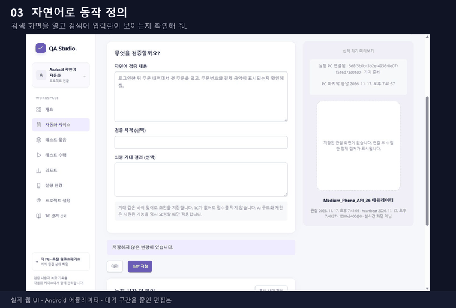

# AI QA

Web과 Android의 테스트를 자연어로 녹화하고, 저장된 동작을 반복 실행하는 QA 플랫폼입니다. 녹화 기록과 실행 결과를 축적하고, 사람이 단계별 증거를 검토한 뒤 테스트에 사용할 버전을 승인하는 것을 목표로 합니다.

아래는 프로젝트가 목표로 하는 제품 방향과 사용 흐름입니다. 구현 현황과 검증 결과는 [개발 진행 문서](WORK_PROGRESS.md)에서 확인할 수 있습니다.

## Android 실시간 화면

웹의 녹화·시범 재생 화면에서 실제 Android 에뮬레이터 영상을 실시간으로 볼 수 있습니다. Android 기기를 선택하고 **실시간 보기**를 누르면 연결되며, 같은 기기의 녹화 상세와 시범 준비 화면으로 이동해도 이어 볼 수 있습니다.

웹에서 자연어·Assertion 입력 → Mobile-Agent의 실제 에뮬레이터 조작 → 저장본 시범 재생을 연속 촬영했습니다. 아래 GIF를 누르면 전체 MP4를 볼 수 있습니다. 약 96초이며 대기 구간은 빠르게 편집했습니다.

[](docs/media/android-no-code-demo.mp4)

[MP4 영상](docs/media/android-no-code-demo.mp4) · [촬영·실행 근거](docs/media/README.md)

녹화와 저장된 탭의 재생을 확인했습니다. 시범의 최종 Assertion 평가 연결은 아직 없어 QA 결과는 **INCONCLUSIVE**입니다.

샘플 시나리오:

- 자연어: G마켓 홈에서 베스트 탭을 열고 상품 이미지와 가격이 한 개 이상 표시되는지 확인해 줘. 표시되면 성공으로 종료해 줘. 스크롤, 구매, 로그인은 하지 마.
- 사전조건: G마켓 앱이 설치되어 있고 홈 화면이 열려 있다.
- Assertion: 베스트 화면에 상품 이미지와 가격이 있는 상품이 한 개 이상 표시된다.

## 목표 사용 흐름

1. **녹화 준비:** Web 또는 Android 실행 자원과 대상 앱/URL을 선택하고, 필요한 설정과 검증 목표를 입력합니다. TC 연결은 선택 사항이며 검증 목표와 녹화 기록은 자동화 케이스에서 함께 관리합니다.
2. **AI 녹화:** 에이전트가 화면을 보고 동작을 선택합니다. 각 단계의 동작·전후 스크린샷·로그를 저장합니다.
3. **저장·검토·승격:** 녹화가 완료되면 녹화본과 단계별 증거를 저장합니다. 사람이 저장본을 검토하고 승인하면 해당 버전이 테스트용으로 승격됩니다. 재녹화하면 기존 승인본을 유지한 채 새 후보를 저장하며, 새 후보도 검토·승인을 거쳐 테스트용으로 승격합니다.
4. **승인본 실행:** 테스트용으로 승격된 버전의 코드나 물리 동작을 기반으로 테스트를 실행합니다. 기본 동작 재생에는 AI를 호출하지 않고, 필요한 검증과 정책상 허용된 예외 처리에서만 호출합니다.
5. **결과 확인:** 단계별 증거와 실행 결과를 확인하고 이력을 비교합니다. 셀프힐링은 ON/OFF와 호출 한도를 따르며, 실행 여부가 불명확한 동작을 임의로 재전송하지 않습니다.

## 실행 구조

웹 관리 서비스와 테스트를 수행하는 실행 자원을 분리합니다. 등록된 PC를 실행 자원으로 사용하고, 추가 PC나 클라우드 실행 자원으로 확장할 수 있는 구조를 목표로 합니다.

- **관리 서버:** 웹 UI/API, 프로젝트·케이스·버전, 작업 큐, 승인, 결과와 증거를 관리합니다.
- **실행 PC의 worker:** 서버에서 작업을 받아 Android 드라이버 또는 Web 실행 환경을 제어하고 증거를 전송합니다.
- **접속 브라우저:** 사용자가 관리 화면을 이용합니다. 기기 제어는 등록된 실행 자원의 worker가 담당합니다.

실행 PC가 꺼져 있어도 **관리 서버가 가동 중이고 필요한 증거가 서버에 저장·ACK된 경우** 저장본 조회·검토·승인이 가능합니다. 재녹화와 테스트 실행은 실행 자원이 연결돼 있어야 가능합니다. 관리 서버까지 같은 PC에서 껐다면 관리 화면도 사용할 수 없습니다.

상세 기준은 [Fly.io · Supabase · 워커 PC](docs/superpowers/specs/2026-11-20-render-supabase-worker-design.md)를 따릅니다.

## 에이전트와 AI 사용 원칙

- **Android:** Mobile-Agent가 녹화 과정에서 화면을 해석하고 동작을 선택합니다.
- **Web:** CUAWright를 활용해 동작과 재생 가능한 코드를 기록합니다.
- **반복 실행:** 승인된 코드나 좌표·입력 동작을 재생해 매 단계의 AI 호출을 줄입니다. 필요한 검증에서만 AI를 호출합니다.
- **셀프힐링:** 실패 시 AI 개입 여부는 ON/OFF 설정과 허용 범위·호출 한도를 따릅니다. 변경된 동작을 기존 승인본에 자동 반영하지 않습니다.

녹화 결과에는 재생에 필요한 동작 원본과 사람이 확인할 증거를 함께 남깁니다. 이를 통해 AI의 녹화 판단을 검토하고, 승인한 테스트를 반복 실행하며 결과와 호출 비용을 추적할 수 있도록 합니다.

## 기술 구성

- Python 3.11 이상, FastAPI, Uvicorn
- Jinja2 템플릿, CSS, JavaScript 기반 웹 UI
- 로컬 SQLite·파일 저장소, hosted Postgres·private Supabase Storage
- HTTPX 기반 서버/worker·모델 통신
- Android ADB 및 고정 Mobile-Agent 원본, Web CUAWright 어댑터

의존성 선언은 [pyproject.toml](pyproject.toml), 버전 제약은 [requirements.lock](requirements.lock)에 있습니다. Android SDK/ADB, 에뮬레이터와 Web 실행 환경은 별도로 준비해야 합니다.

## 로컬 개발 빠른 시작

아래 명령은 **Windows PowerShell, 저장소 루트** 기준입니다. 기본 UI/API를 시작하는 절차이며 기기 연결이나 유료 모델 호출을 자동 설정하지 않습니다.

### 1. 가상환경과 의존성 설치

```powershell
python -m venv .venv
.\.venv\Scripts\python.exe -m pip install -e ".[dev]" -c requirements.lock
.\.venv\Scripts\python.exe -m pip check
```

Android 실시간 화면을 보려면 실행 PC에서 `pip install -e ".[android-video]"`도 설치하세요. Android 기기 선택 후 **실시간 보기**를 누르면 실제 기기 영상이 웹에 표시됩니다. 녹화 상세와 시범 준비 화면에서도 같은 연결을 이어 볼 수 있습니다. **연결 종료**를 누르면 캡처와 메모리 재생 버퍼를 비우며, 영상 파일 저장·다운로드 기능은 제공하지 않습니다.

`dev`에는 테스트 도구와 Mobile-Agent 이미지 처리에 필요한 Pillow가 포함됩니다. 기존 가상환경이 있다면 재사용할 수 있습니다.

Fly.io 배포는 [배포 안내](docs/managed-pc/FLY_HOSTED_RUNBOOK.md)를 따릅니다. [Postgres 저장 계약](docs/managed-pc/POSTGRES_STORE.md)과 [private 파일 저장 계약](docs/managed-pc/PRIVATE_STORAGE.md)은 로컬 실행과 별도로 적용합니다. 환경 변수 형식은 [hosted 예시](deploy/hosted.env.example), 실행 PC 설정은 [worker 예시](deploy/worker.env.example)를 참고하세요. hosted 모델 연결은 서버에 등록된 키 참조를 설정 화면에서 선택합니다.

### 2. API/UI 실행

```powershell
.\.venv\Scripts\python.exe -m uvicorn aiqa.api.app:create_app --factory --host 127.0.0.1 --port 8000
```

| 주소 | 용도 |
| --- | --- |
| <http://127.0.0.1:8000/> | 기본 실행 환경과 API 상태 확인 |
| <http://127.0.0.1:8000/ui/projects> | 프로젝트 관리 진입점 |
| <http://127.0.0.1:8000/api/v1/health> | API liveness 확인 |

관리 기능은 프로젝트·세션·권한 설정을 따릅니다. health 응답 `{"status":"ok","component":"api"}`는 API 프로세스가 살아 있다는 의미이며, 기기·모델 준비나 테스트 합격을 뜻하지 않습니다.

이 명령은 API 프로세스만 시작합니다. 등록 worker와 기기/VM은 별도로 준비합니다. 로컬 launcher와 환경 설정은 [환경·launcher 작업서](docs/execution/04b-environments-and-launcher.md)를 참고하세요.

직접 실행한 서버를 중지하려면 해당 터미널에서 **Ctrl+C**를 누릅니다.

### 3. 데이터와 설정

런타임 데이터의 기본 위치는 `%LOCALAPPDATA%\AIQA`입니다. 관리 기능이 이 위치의 DB·증거 저장소를 사용하며, 소스 저장소나 OneDrive 동기화 폴더에 런타임 DB를 두지 않는 구성을 사용합니다.

별도 위치가 필요하면 서버를 시작하기 전에 지정합니다.

```powershell
$env:AIQA_RUNTIME_ROOT = Join-Path $env:LOCALAPPDATA "AIQA-dev"
```

설정은 프로세스 환경변수에서 읽습니다. 저장소 루트에 `.env` 파일을 만드는 것만으로 서버 설정이 자동 적용되지는 않습니다. 전체 항목은 [src/aiqa/config.py](src/aiqa/config.py)를 참고하세요.

기본 모델 provider는 `fixture`입니다. UI/API 기본 확인에는 AI API 키가 필요하지 않습니다. 실제 모델 녹화에는 서버 측 비밀 저장소와 프로젝트 모델 binding·권한·가격 정책 설정이 필요합니다. 키 원문은 worker, 생성 코드, README 또는 Git에 넣지 않습니다. [모델 요청 설정](docs/managed-pc/MODEL_REQUEST_CONFIGURATION.md)을 참고하세요.

## 검사

기본 API/페이지 검사는 다음과 같이 실행할 수 있습니다.

```powershell
.\.venv\Scripts\python.exe -B -m pytest tests/unit/test_bootstrap.py tests/integration/test_bootstrap_http.py tests/acceptance/test_bootstrap_page.py -q
```

전체 검사는 다음 명령을 사용합니다.

```powershell
.\.venv\Scripts\python.exe -B -m pytest
```

변경한 영역에 맞는 검사를 수행합니다. 모의 포트 검사와 실제 기기·유료 API·운영 환경 검증은 각각 구분해 기록합니다. 실행 결과와 회귀 기준선은 아래 개발 진행 문서에서 확인하세요.

## 저장소 구조

```text
src/aiqa/
  api/          API와 인증·권한 진입점
  web/          UI 템플릿과 정적 파일
  domain/       케이스·승인 등 도메인 규칙
  store/        DB·작업 큐·증거 저장
  worker/       등록 실행 PC의 작업 처리
  adapters/     Mobile-Agent·CUAWright 연결
  recording/    녹화와 저장 원본 처리
  replay/       저장 동작·승인본 재생
  models/       모델 포트·권한·사용량
third_party/    고정 공개 원본·출처·라이선스
patches/        공개 코드 변경 관리
prototype/      초기 인터랙티브 샘플 UI
tests/         단위·통합·수용·웹 검사
tools/         개발·실제 시험 보조 도구
docs/          작업서·계약·검증 근거
```

`prototype/`은 초기 화면 검토용 모의 샘플입니다. 제품 UI는 `src/aiqa/web/`에 있으며, 샘플 실행 방법은 [prototype/README.md](prototype/README.md)에 있습니다.

## 설계 문서

| 내용 | 문서 |
| --- | --- |
| 관리 서버·실행 자원 구조 | [Fly.io · Supabase · 워커 PC](docs/superpowers/specs/2026-11-20-render-supabase-worker-design.md) |
| 제품·실행 설계 | [DESIGN.md](DESIGN.md) |
| UI와 사용자 흐름 | [UI_SPEC.md](UI_SPEC.md) |
| 녹화·승인·버전·누적 결과 데이터 | [DATA_DESIGN.md](DATA_DESIGN.md) |
| 공개 코드 기술 조사 | [RESEARCH.md](RESEARCH.md) |
| API·DB·승인·실행 공통 계약 | [CONTRACTS.md](docs/execution/CONTRACTS.md) |

## 개발 진행 문서

구현 현황, 남은 작업, 검증 결과는 다음 문서에서 관리합니다.

| 내용 | 문서 |
| --- | --- |
| 전체 개발 진행도 | [WORK_PROGRESS.md](WORK_PROGRESS.md) |
| 현재 작업과 다음 작업 | [NEXT_ACTION.md](NEXT_ACTION.md) |
| Fly.io 배포를 위한 사용자 준비 | [HOSTED_SETUP_CHECKLIST.md](docs/managed-pc/HOSTED_SETUP_CHECKLIST.md) |
| 작업 단위와 개발 절차 | [docs/execution/README.md](docs/execution/README.md) |
| 구현 경계 | [RUNTIME_BOUNDARIES.md](docs/managed-pc/RUNTIME_BOUNDARIES.md) |
| 검증 기록 | [docs/validation](docs/validation) |
| 전체 회귀의 실패 기준선 | [회귀 기준선](docs/validation/tasks/REGRESSION_BASELINE_2026-11-09.md) |

개발을 이어갈 때는 `NEXT_ACTION.md`의 Current와 해당 작업 카드·필요한 계약부터 읽습니다.

## 공개 코드와 라이선스

Mobile-Agent와 CUAWright의 사용 범위·고정 버전·변경점은 해당 출처 기록을 따릅니다. 저장소에 포함된 공개 코드의 라이선스는 각각의 파일을 확인하세요.

- Mobile-Agent: [연동 안내](third_party/mobile_agent/README.md), [원본 라이선스](third_party/mobile_agent/upstream/LICENSE)
- CUAWright: [공개 원본](third_party/cuawright/upstream/README.md), [변경 관리](patches/cuawright/README.md)
