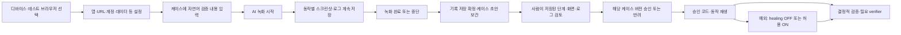
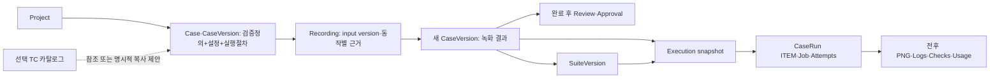

# AI QA 플랫폼 UI 설계 v0.6

개정일: **2026-10-31 (Asia/Seoul)** · 상태: 검토용 설계, 제품 코드 미구현.

기준: 첨부 UI 문서보다 최신인 사용자 결정 — 검증 내용과 녹화 기록을 자동화 케이스 하나에 보관하고 TC 관리는 선택적으로 둔다. [DESIGN.md](DESIGN.md)는 중심 설계, [RESEARCH.md](RESEARCH.md)는 공개 엔진 근거, [IMPLEMENTATION_PLAN.md](IMPLEMENTATION_PLAN.md)는 구현 준비 문서다. [v0.3 UI](docs/history/v0.3/UI_SPEC.md)와 [v0.4 UI](docs/history/v0.4/UI_SPEC.md)는 보관했다. DB 제약·원자 승인·전체 재녹화·장기 분석/보관은 [DATA_DESIGN.md](DATA_DESIGN.md)가 상세 규범이다. 아래 화면/API는 제안 플랫폼 계약이며 현재 엔진에 이미 있는 제품 기능이 아니다.

v0.6 실행 방향은 **AI 녹화 → 저장된 코드/동작 재생 → 필요 검증 AI → 예외 시 선택 셀프힐링**이다. Web은 CUAWright 코드 authoring/replay, Android는 Mobile-Agent authoring/플랫폼 action replay다. [실행 상세](docs/superpowers/specs/2026-10-31-replay-and-self-healing-design.md)가 package/격리/healing 규범이며 [v0.5 UI](docs/history/v0.5/UI_SPEC.md)는 보관했다. 기존 샘플은 v0.5 모의 화면이며 이번 문서 수정으로 기능이 구현된 것은 아니다.

## 1. 검토 결론과 저장·승인 순서

**동작 체험용 샘플:** [로컬 프런트 실행·체험 안내](prototype/README.md), [샘플 HTML](prototype/index.html). 화면·기기·모델 결과는 모의 데이터이며 제품/DB 구현과 구분한다. 검증한 동선은 [샘플 확인 기록](prototype/VALIDATION.md)에 남겼다.

**자동화 케이스 하나가 검증 정의·실행 설정·녹화된 단계·동작별 증거를 함께 소유한다.** 사용자는 TC를 먼저 등록하지 않고 디바이스/테스트 브라우저 선택→필요 정보→자연어 검증 내용→AI 녹화→저장본 검토/승인으로 진행한다. 별도 TC 관리는 선택 기능이며 케이스 생성·녹화·저장·시범·승인·정식 실행의 선행 조건이 아니다. 시범/회귀는 recorded_replay가 기본이고 일반 actor 호출0, 검증과 healing은 각각 명시 정책을 따른다.

**사용자가 명확히 정한 흐름:**



**녹화 중 승인 버튼·승인 대기 정지는 없다. 승인은 저장의 선행 조건이 아니다.** 정상·실패·중단·미완성 기록도 먼저 보존한다. 저장된 초안은 승인 전에도 조회·편집·복제·시범 실행이 가능하다. 승인은 그 버전을 정식/회귀 실행에 사용하도록 허용하는 절차다.

| 첨부 초안 검토 항목 | 채택/보완 결정 |
|---|---|
| 기본 관리 단위 | 검증 정의와 녹화 절차를 케이스 버전 하나로 관리. REC/RUN/ITEM은 이 케이스의 보관/실행 이력 |
| 별도 TC 관리 | 선택 참조·명시적 내용 가져오기만 제공. TC 없음/수정/보관이 케이스를 차단하지 않음 |
| 녹화 의미 | AI authoring으로 동작/code/plan·변수·검증·화면/로그를 먼저 저장, 승인 package를 이후 직접 재생 |
| AI 호출 구분 | 녹화 authoring / 명시 verification / 예외 healing / 유지보수. 기본 동작 replay actor0 |
| 셀프힐링 | default OFF·승인 capability 안에서 접수 시 ON, runtime snapshot 고정·동일 대상/미dispatch만 허용 |
| 수동 조작 녹화·pause | 엔진 지원 미확인으로 후속. 작동하는 버튼으로 노출하지 않음 |
| 동작별 확인 | 탭·스와이프 등 전후 PNG·로그를 저장한 뒤, 완료 후 검토 화면에서 사람이 확인 |
| 저장과 승인 | 불완전 기록도 저장. 부족한 증거는 승인만 차단 |
| 마지막 재시도 결과 | 첫/마지막 시도는 함께 표시하되, 확인된 필수 검증 실패를 후속 PASS로 덮지 않음 |
| 7개 리포트 결과 | QA 판정 4종과 실행 disposition을 분리하고 중복 없는 display_result로 집계 |
| 내보내기 | CSV·인쇄 가능한 HTML을 MVP, PDF 생성·예약 배포는 후속 |

## 2. 케이스 중심 관리 단위·버전

| 단위/표시 ID | 의미·기록 규칙 |
|---|---|
| 프로젝트 SHOP | 제품별 케이스·환경·수행 공간, 모든 조회/변경에 project scope 검사 |
| AUT-041 / 케이스 버전 | **검증 정의+실행 설정+녹화 절차/검증 binding+근거 참조**의 단일 관리/승인 단위 |
| REC-018 녹화 세션 | 케이스의 입력 버전을 기반으로 생성한 동작·전후 PNG·로그 원본. 실패·중단도 보존 |
| SUITE-01 / 구성 버전 | 정확한 승인 케이스 버전·data·순서·환경. 새 승인 버전 자동 추종 금지 |
| RUN-012 수행 / ITEM-1 | 단일/선택/묶음 공통 수행과 케이스 버전×data 행×대상별 실행 |
| 선택 TC-104 | 독립 TC 카탈로그의 참고 자산. 케이스의 검증 정의를 대신하는 필수 부모가 아님 |

케이스 버전은 다음을 한 묶음으로 보존한다.

- **검증 내용:** 자연어 원문·목적·사전 조건·입력 변수/비밀 참조·수행 의도·단계/최종 기대 결과·필수 경로.
- **실행 설정:** Web/Android target·environment profile·앱/URL·계정/data·reset/cleanup·시간/행동/호출/비용 한도·engine/model/config.
- **녹화 절차:** 실제 action·대상/locator/좌표/대기·검증 binding과 canonical 단계.
- **증거 연결:** source REC·action별 전후 PNG/로그·trial·검토/승인 digest. 파일은 artifact에 두고 케이스에서 함께 조회한다.

REC/사용량/파일을 케이스 JSON에 전부 중복 저장하지는 않는다. 저장소 책임은 나누되 사용자·버전·승인 단위는 케이스 하나다. 의미를 바꾸는 검증 내용/실행 절차/핵심 설정 수정은 새 케이스 버전이며 재검증/재승인한다. 원본 REC와 과거 수행은 불변이다.

새 녹화는 먼저 케이스 초안과 검증 정의/설정 snapshot을 저장하고 REC가 `input_case_version_id`를 참조한다. 완료·중단 시 수집된 절차/근거를 붙인 **새 케이스 초안 버전**을 자동 저장하고 manifest별 materialization receipt의 `produced_case_version_id`로 연결한다. 입력 버전 내용을 나중에 덮지 않는다. 기대 결과가 불명확해도 draft 저장은 허용하지만 AI가 실행하기에 모호하면 구조화 제안/보완을 요구한다. **tc_reference=null이어도 동일하게 녹화·저장·시범·승인·실행 가능**하다.

TC를 사용하려면 UI-16에서 별도 관리하고 케이스 metadata에 선택 `tc_reference`를 붙인다. 연결/해제는 참고 관계·감사 이력이며 승인된 케이스 의미를 바꾸지 않는다. TC 변경은 정보성 ‘참조 TC에 새 버전 있음’ 안내만 하고 케이스를 자동 변경하거나 실행 차단하지 않는다. TC 내용을 반영하려면 사용자가 명시적으로 가져오기→diff 확인→케이스 검증 내용에 복사→새 케이스 버전 저장→시범/재승인한다. TC가 보관되거나 모듈을 쓰지 않아도 케이스는 자체 정의로 동작한다.

이 설계에서는 v0.3의 필수 주 TC·TC version FK·current/historical 실행 모드·TC 변경 영향 검토 gate를 제거한다. 과거 케이스 재현은 exact case_version 선택과 사유로 충분하며 별도 TC 상태를 요구하지 않는다.

## 3. 정보 구조·공통 상태

전역: 프로젝트 목록/전체 연결/공통 설정. 기본 프로젝트 메뉴는 **개요 / 자동화 케이스 / 테스트 묶음 / 테스트 수행 / 리포트 / 실행 환경 / 프로젝트 설정**이다. 새 녹화는 디바이스 선택으로 시작한다. 검토 대기/초안/미완성 REC는 케이스 영역의 탭이고, TC 관리는 원하면 여는 별도 선택 메뉴(UI-16)다. 기기·앱 빌드·data는 환경 탭으로 묶는다.

상단은 프로젝트 전환·breadcrumb·프로젝트 검색·‘이 PC’ 연결 상태다. 데스크톱 1440px 기준으로 목록은 밀도 높은 테이블, 편집·증거는 전체 폭 작업 공간이다. 1024px에서는 보조 패널을 접되 ID·대상·버전·판정·핵심 버튼은 유지한다. 색 외 상태 문구/아이콘, 키보드 탐색·focus·읽을 수 있는 오류를 제공한다.

| 상태 | UI·조작·복원 규칙 |
|---|---|
| 빈 데이터 | 첫 프로젝트/디바이스 선택·새 녹화 안내. 예시 성과를 실제 수치로 표시하지 않음 |
| 로딩 | 기존 값·갱신 시각 유지, 중복 제출 비활성 |
| 입력 오류 | 422 필드 오류·입력 보존. 비밀 원문을 응답/브라우저 저장에 재노출하지 않음 |
| 연결 끊김 | stale·마지막 수신·로컬/서버 보관 구분. mutation 자동 반복 금지 |
| 권한 부족 | 403·읽기 가능 범위. 서버도 project scope 확인 |
| 미저장 편집 | 저장/버리기/이동 취소. 미저장 내용의 재접속 복원은 보장하지 않음 |
| 동시 수정 | expected revision/If-Match 불일치 409·서버본 비교 후 새 버전 |
| 실행 불가 | 미승인/케이스 정의 불명확/미지원/기기·앱·변수 사유와 조치 링크. 조용히 제외하지 않음 |
| 증거 누락·만료 | 동작/원인/보관 기간·재검증 안내. 빈 화면·성공 추정 금지 |

목록→상세→뒤로가기는 filter/sort/page/scroll을 유지한다. ID는 링크/복사 가능하다. 새로고침은 서버 snapshot과 URL selected item/action을 읽고 job을 다시 만들지 않는다. 승인/실행 snapshot은 읽기 전용이며 수정은 새 draft다. 관리 탭 종료는 녹화/수행 취소가 아니다. PC 종료·절전 중 지속 실행/자동 재개는 보장하지 않는다.

## 4. 화면별 명세·와이어프레임

아래 경로는 UI route다. 각 조작의 API/저장·worker 연결은 §7–8을 따른다. 저장/승인/정식 실행은 별개 버튼·상태다.

### UI-01 프로젝트 목록·생성

`/projects`. 이름/키/설명/대상, 전체 케이스 수·승인/초안/검토 대기 수, 진행 수행/검토 대기, 마지막 수행의 범위·결과를 표시한다. 생성·검색·활성/보관 필터·열기를 제공한다. 이름·고유 key·대상 필수, 중복 key는 409다. 생성 후 UI-14 환경 준비로 안내한다. 보관은 진행 REC/RUN 종료·취소/정리를 먼저 처리한 뒤 허용하고 이력은 읽기 가능하다. 보관 복구도 감사 기록을 남긴다.

### UI-02 프로젝트 개요

`/projects/{p}`. 미완성 REC/검토 대기 케이스/미분류 실패, 진행·대기 수행, 최근 결과, 실제 환경 차단 사유를 보여준다. 빠른 작업은 **새 녹화(디바이스 먼저)** / 저장 케이스 실행 / 묶음 실행이다.

케이스 전체/승인/초안/검토 대기 수와 최근 수행 범위·결과를 보여주며, 별도 TC 연결 비율을 기본 지표로 요구하지 않는다. 케이스 개수나 승인 비율을 제품 테스트 커버리지라고 부르지 않는다.

### UI-03 자동화 케이스 목록 — 와이어프레임 1

```text
+ SHOP / 자동화 케이스 --------------------------------------------+
| [새 녹화] 검색 [ID·이름·검증내용·태그 ] [검색] [필터 초기화]     |
| [전체] [실행 가능] [초안] [검토 대기] [미완성 녹화] [보관]        |
+ 분류 폴더 -----+-------------------------------------------------+
| 로그인         | 선택 케이스   검증 요약    대상  버전/승인 결과 |
| 장바구니       | [ ] AUT-041  로그인 이름표시 Android v2승인 PASS |
| 주문           | [ ] AUT-052  상품 추가검증   Web  v1초안 미실행 |
|                | [컬럼 설정] [정렬] [이전] [다음]                |
+----------------+-------------------------------------------------+
| 선택2 [실행 설정] [묶음에 추가] [복제] [보관]                    |
+-----------------------------------------------------------------+
```

컬럼은 케이스ID/이름·검증 요약/대상/폴더·태그·우선순위·담당자/최신 draft와 approved/동작 수·모드/최근 결과·환경·build·일시/수정일이다. 선택 TC 참조는 추가 컬럼일 뿐 기본 필수 컬럼/실행 조건이 아니다. 필터·정렬·page·검색과 이전 위치 복원을 제공한다.

새 녹화는 UI-05의 디바이스 선택으로, 열기는 UI-04로 간다. 단일/선택 실행은 UI-09, 검토는 UI-07, 묶음 추가는 UI-08로 연결한다. 초안/미승인은 정식 실행 차단 사유를 표시하지만 저장본 조회/시범은 가능하다. TC가 없다는 이유로 제외하지 않는다.

### UI-04 케이스 상세·통합 편집 — 와이어프레임 2

```text
+ SHOP / AUT-041 정상 로그인 / v2 / Android ------------------------+
| [검증 내용] [녹화 단계·코드] [실행 설정] [실행 이력] [검토·버전]     |
+------------------------------------------+------------------------+
| 자연어 검증 내용 [                    ]  | 앱·대상·담당자·태그    |
| [AI 구조화 제안] [제안 diff]              | 저장/승인 상태         |
| 목적·사전조건·데이터/비밀참조             | 선택 TC 참조: 없음     |
| 단계 의도 | 기대 결과 | 필수 경로        | [참조 연결: 선택]      |
| S1 로그인 | 사용자 이름 표시 | 로그인버튼 |                        |
| [추가/복제/삭제/위로/아래로]              |                        |
+------------------------------------------+------------------------+
| [초안 저장] [재녹화] [시범 실행] [저장본 검토]          |
+------------------------------------------------------------------+
```

검증 내용 탭은 원문/목적/조건/변수·secret refs/기대 결과·필수 경로를 직접 편집한다. 녹화 단계·코드 탭은 원본/승인 Web script 또는 Android action plan·runtime/lock/package hash·source/action/line mapping과 전후PNG/로그·검증을, 실행 설정은 환경/앱·URL/reset/cleanup·한도를 같은 케이스에서 보여준다. 실행 이력·검토/버전 탭도 같은 AUT에 귀속된다.

AI 구조화는 이 케이스 안의 제안이며 diff 확인 후 적용한다. 원문/기대가 불완전해도 draft 저장은 가능하며 needs_review로 안내한다. 검증/절차/핵심 설정 변경은 새 케이스 version, 이전 근거는 ‘수정 전’ 표시·새 trial/승인이다. TC를 만들거나 선택할 필요는 없다. 선택 참조만 바꿀 때는 감사 metadata만 변경한다.

‘최신 초안’과 ‘기본 승인 실행본’을 나란히 표시한다. **재녹화**는 기준 case version·사유·검증 의도 유지(기본)/명시 변경 diff·device/앱·URL/data/reset 확인창을 연다. 새 input draft/REC를 같은 AUT 아래 만들며 기존 승인본을 유지한다. AI가 기대 결과를 자동 완화하지 않는다. MVP는 전체 흐름을 다시 녹화하며 부분 action 병합/중간 재개는 후속이다. 실패/중단/반려에서도 기존 기본본이 바뀌지 않음을 안내한다.

실행 설정 탭은 검증별 deterministic/ai_visual/허용 unknown 보완·모델 binding과 healing capability/scope/상한·기본OFF를 같은 버전에 보여준다. 일반 동작 replay actor0를 설명하며 모델 key 없는 결정적 재생도 허용한다. 코드/검증/정책 권한 확대는 새 version/trial/승인이고 기존 package를 직접 편집하지 않는다. package 없음·컴파일/계측/격리 불가·mapping 누락은 저장 유지/승인 차단 사유다.

### UI-05 녹화 시작·진행 — 와이어프레임 3

```text
+ SHOP / 새 녹화 ---------------------------------------------------+
| 1 대상 선택 → 2 필요 정보 → 3 자연어 검증 → 4 AI 녹화             |
+------------------------------------------------------------------+
| 1 [Android 기기A: ready] 또는 [이 PC 테스트 Chromium] [다음]       |
| 2 앱/URL [ ] 빌드[설치앱사용] 계정ref[ ] data[ ] 초기화[없음]     |
| 3 무엇을 검증할까요? [정상 계정으로 로그인 후 사용자명 확인...]   |
|   [AI 구조화 제안 보기] [초안 저장] [AI 녹화 시작]                 |
+ 녹화 시작 후: AUT-041 / REC-018 ---------------------------------+
| 케이스 검증 목표 | 현재 화면·마지막 수신 | A001탭/A002입력/A003swipe|
| [목표/기대결과]  | [맞춤/확대]          | 각각 전후PNG·로그 상태  |
| 기록3 / 서버보관2 / 전송대기1 / 오류0 [메모] [녹화완료] [중단]     |
| TC 등록/선택 없음. 기록 먼저 저장·녹화 완료 후 검토/승인.         |
+------------------------------------------------------------------+
```

진입은 UI-02/03의 새 녹화 또는 기기 화면의 이 기기로 녹화다. **1단계 디바이스/테스트 브라우저 선택 → 2단계 앱·URL/빌드·계정/data·초기화/한도 설정 → 3단계 자연어 검증 내용/기대 결과 입력·AI 구조화 확인 → 4단계 AI 녹화**다. Android는 연결 기기를, Web은 해당 PC의 테스트용 Chromium/profile을 선택한다. ‘브라우저 선택’은 관리 UI 탭 선택이 아니다. Web은 이 PC의 격리 Linux VM 내 테스트 Chromium이고 VM 준비/driver/broker 상태를 함께 표시한다. 클라우드 가입은 필수가 아니다.

TC 선택/등록 단계는 없다. 사용자가 원하면 선택 TC 내용 가져오기를 보조 기능으로 쓸 수 있지만 건너뛰어도 동일하게 진행한다. 시작 전 케이스 초안 version과 정의/설정 digest를 저장한다. 녹화 시작 요청은 이 input_case_version_id/hash·선택 resource로 preflight 후 REC/job을 만들며 AI는 이 케이스의 내용을 사용한다.

녹화 중 **각 동작 전후 PNG·실행 로그는 승인 없이 계속 저장**한다(§5). 목표 수정/승인/정식 실행 버튼은 없고 메모는 append-only다. 완료는 새 행동 중지→기록 flush/정리→보관 확정이다. 중단/단절/비정상 종료도 수집 기록을 보존한다. 저장을 버릴지 승인자에게 묻거나 반려 시 폐기하는 흐름은 없다.

완료 후 raw script/plan·source manifest를 seal하고 package compile/계측 검사·artifact ready를 거쳐 새 version/package를 원자 materialize한다. 컴파일 실패도 package 없음/사유 있는 draft로 저장한다. 나중 컴파일은 package_rebuild receipt·새 version이다. 검증 정의·실행 설정·실제 절차·근거가 함께 있는 AUT draft를 자동 저장하고 UI-04의 녹화 단계 탭으로 이동한다. 검토는 완료/보관 후 UI-07에서 한다. TC 참조가 없어도 완전히 동일하다. 서버 ACK 전에는 ‘이 PC 임시 보관·서버 전송 대기’이며 저장 완료/승인 가능으로 표시하지 않는다. 녹화 중 사람이 동작을 승인해야 다음 행동/저장을 하는 구조가 아니다.

### UI-06 케이스별 녹화 이력·미완성 기록

`/cases/{c}/recordings`. UI-04의 녹화 단계/이력에서 REC 목록을 조회한다. REC ID·input/produced case version·대상/resource·시각·동작 수·저장/전송 상태·종료 이유를 표시한다. 모든 케이스 기본 진입은 UI-03이고 별도의 ‘TC를 자동화로 변환’하는 목록은 없다.

미완성 REC도 전후PNG/로그·수집 범위·중단 사유를 조회하고 새 녹화/새 draft 편집으로 이어간다. 반려/미승인 때문에 기록을 숨기거나 지우지 않는다. 새 녹화는 기존 케이스 정의를 복사한 새 입력 version에서 시작하고 이전 프로세스를 재개하지 않는다.

이력에 **보관 상태(local/spooling/stored)·수행 종료(completed/interrupted/error)·절차 완결성·필수 증거 상태·검토/승인**을 각각 표시한다. stored는 성공/완성/승인을 뜻하지 않는다. manifest receipt별 input/produced version·복구 출처를 열 수 있다. 미완성 후보의 재녹화 버튼은 같은 case의 새 전체 녹화로 이어지고 원본은 보존한다.

### UI-07 케이스 편집·완료 후 검토·승인 — 와이어프레임 4

```text
+ SHOP / AUT-041 v2 / 검증 정의·녹화 절차 / 저장됨·미승인 -------------------+
| [단계] [입력·설정] [시범 결과] [저장 기록 검토] [버전 이력]    |
+ 단계·동작 -----+------------------------+-----------------------+
| S1 A001 탭     | 동작 전 PNG / 후 PNG   | 의도·실제 명령        |
|    검토함      | [맞춤][100%][확대]     | 좌표/스와이프 경로    |
| S1 A002 입력   | 캡처 시각·해상도       | 전달/화면/검증        |
|    미검토      | 마스킹·근거 ID         | 로그·오류·재시도      |
| S2 A003 탭     |                        | [검토함][수정 필요]   |
+----------------+------------------------+-----------------------+
| REC 완료·저장됨 / 필수 증거6/6 / 현재 trial PASS / 검토2/3      |
| [새 초안 저장] [재녹화] [시범 실행] [검토 요청]                           |
| 의견 [          ] [승인 및 기본 실행본으로 사용: 미검토1건으로 비활성] [반려]            |
| 저장은 이미 완료됨. 승인 대상은 AUT v2입니다.                  |
+----------------------------------------------------------------+
```

좌측 step/action, 중앙 편집 또는 전후 캡처, 우측 명령·기대/관찰·검증·오류, 하단 로그를 쓴다. 탭은 단계/입력/설정/시범/저장 기록 검토/이력이다. 좌표·locator·생성 코드는 고급 상세이며 engine capability 없는 편집 기능은 제공하지 않는다.

추가/삭제/복제/정렬·변수화·검증 변경은 새 draft로 저장한다. 증거/검증 부족도 저장하며 needs_review다. REC 원본은 불변이다. 새 trial은 현재 exact replay package의 별도 수행이고 자동 승인하지 않는다. 승인 근거 trial은 healing OFF·일반 동작 actor0이며 필요한 AI verifier는 허용한다.

**검토는 녹화 완료·서버 보관 확정 이후에만** 한다. action별 전후 PNG/로그·오류/우회/검증을 보고 `reviewed/needs_change/evidence_missing`을 남긴다. 검토 표시는 QA 판정을 수정하지 않는다. 필수 검증 정의/근거/동작 검토 누락, 현재 PASS trial 없음, 다른 hash/오래된 증거는 승인 차단이다. 승인/반려는 actor/time/reason·version/evidence digest에 결합한다. 수정하면 이전 review/approval을 자동 복사하지 않는다. 반려해도 저장된 기록은 유지하고 새 수정본으로 이어진다.

재녹화 후보는 기준 승인본↔후보의 **검증 정의/필수 경로·절차/대상·설정·오류/증거 diff**와 새 trial을 함께 검토한다. completed source·완결 절차/증거·현재 PASS trial·필수 action 검토가 필요하다. 부분 저장본은 조회/편집되지만 승인할 수 없으며 새 전체 녹화를 안내한다.

승인 버튼은 **‘이 버전 승인 및 기본 실행본으로 사용’**이다. exact review/hash·expected_current_approval_id로 요청하고 승인·증거 보호·기본 pointer·audit를 한 transaction에서 확정한다. 충돌409는 새 기본본/diff를 보여주고 재확인한다. 이전 승인은 자동 철회하지 않는다. 기존 suite와 queued/running RUN은 exact 이전 version을 유지하고 묶음 갱신은 UI08에서 새 suite revision으로 명시한다. 별도 철회 시 미시작 차단/진행 취소 영향을 보여주며 current 철회 시 이전본 자동 fallback 없이 실행본 선택 필요로 표시한다.

승인 패널에 package ready/승인 script·plan/runtime/lock hash·동작 mapping·OFF trial actor0/현재 검증 PASS를 추가로 표시한다. 미완성/없는 package나 hidden model helper·raw action 우회 산출물은 승인 불가다. 승인 digest에는 재생 자산과 verifier/healing capability·scope/한도를 포함한다. 치유를 사용한 실행의 PASS는 원본 package 승인용 clean trial을 대체하지 않는다.

### UI-08 테스트 묶음 목록·편집

`/projects/{p}/suites`. 묶음 ID/이름/설명/대상/구성 수/담당자/최근 수행/수정일. 왼쪽 승인 AUT 검색, 오른쪽 순서/정확한 케이스 버전·검증 요약/data/환경/준비 상태다. 추가/제거/정렬/복제/기본 환경·continue/stop 정책/초기화·데이터 행/저장/실행/이력을 제공한다.

새 approved 버전은 업데이트 가능·diff만 표시하고 명시 교체·새 suite revision을 요구한다. 같은 AUT의 다른 data는 행 이름으로 구분한다. mixed는 대상별 자원 필수·순차이며 다른 항목의 로그인/데이터에 암묵 의존하지 않는다. 분기/병렬 의존성은 후속이다. 실행/제외 확인은 UI-09다.

### UI-09 수행 생성·실행 설정 — 와이어프레임 5

```text
+ SHOP / 새 테스트 수행 -----------------------------------------+
| 1대상 확인 → 2환경·데이터 → 3사전 점검 → 4최종 확인            |
| 이름[로그인 회귀] 목적[정식] 셀프힐링[OFF] 릴리스[선택]                       |
+------------------------------------+---------------------------+
| AUT-041v2 / 로그인 검증 / data-A       | Android: 이 PC·기기A       |
| AUT-052v1 / 로그아웃 검증 / data-B       | 요청앱v12 / 설치앱v12      |
| 차단1: AUT-060 미승인          | 초기화 없음·시간/비용 한도 |
| [제외 목록/사유 확인]              |                           |
+------------------------------------+---------------------------+
| 선택3 / 확정 실행2 / 명시 제외1 [이전] [취소] [새 수행 시작]    |
+----------------------------------------------------------------+
```

단일/선택/묶음/재실행 공통4단계다. exact 케이스 version/data/env revision·요청/실제 build·모드·한도/reset·failure policy·원본 수행/사유를 확인한다. busy는 점유 링크+대기 등록/돌아가기다. preview는 자원 예약이 아니며 claim 직전 재검사한다.

필수 검증 정의·변수·모델/정책 오류는 차단한다. **purpose=trial은 케이스 승인 검사를 제외해 미승인 초안도 접수한다. 정식 regression/reverification만 선택한 exact case version의 유효 승인을 요구한다.** 일부 제외는 항목/사유 확인 후 snapshot에 남기며 조용히 빼지 않는다. 시작은 Idempotency-Key로 RUN을 1개 만들고 UI-10으로 이동한다. 이후 편집은 snapshot을 바꾸지 않는다. 시범/정식 항목은 같은 RUN에 섞지 않는다. 시범은 healing OFF로 고정한다.

UI09의 릴리스 표시는 release_label로 접수 snapshot에 저장하고 UI12/13의 누적 필터에 연결한다. RUN당100 ITEM 상한을 유지하므로 월3,000 TC는 최소30개 RUN의 workload이며 단일 RUN 지원을 의미하지 않는다.

UI09에 **기본 실행: 저장 package 재생 / 일반 actor0 / verifier 조건·예상 호출 / 셀프힐링 OFF·ON / 최대 episode1·2호출·30초 / 전체 상한**을 표시한다. ON은 승인 capability·healer binding/예산이 있는 항목만 허용하고 나머지는 차단 사유를 명시한다. 대상/입력/경로/expected 변경이나 불명 결과 재클릭은 범위 밖이다. 실행 접수 때 resolved ON/OFF·scope/package hash를 snapshot하며 진행 중 토글하지 않는다. 필요한 AI 검증의 키가 없으면 preflight 차단/근거 불명이지 검사 생략 PASS가 아니다. 결정적 검사+OFF라면 모델 키 없이 실행 가능하다.

### UI-10 수행 목록·진행 현황

`/projects/{p}/executions`, `/executions/{e}`. 대기·진행/완료/전체 탭, RUN ID·이름/purpose·출처/요청자/환경·빌드/진행/종료 수·PASS 수/분포/시각·기간. 상태·결과·기간·환경/build·suite/AUT·작업자·trial/정식 필터다.

진행 상세는 좌측 ITEM 목록·중앙 현재 케이스/화면·우측 최신 이벤트/연결·상단 종료 수/전체/경과/자원이다. 완료 수와 PASS 수는 별도다. 상세/취소/리포트/같은 구성 새 실행을 제공하고 취소 요청/정지/정리를 구분한다. ITEM 취소는 완료 결과를 바꾸지 않으며 stop 정책을 적용한다. 수신 시각·stale·재접속 복원이 보인다.

job status는 기존 running을 유지하고 UI phase로 replaying/verifying/healing/finalizing과 현재 actor/verifier/healer 호출수를 표시한다. ON이어도 정상 동작에는 healer 호출이 없고, 예외 시 eligibility/한도·짧은 정책 판단·제안/거부/복구 진행을 보여준다. 이미 terminal인 실패의 치유는 원본을 바꾸는 버튼이 아니라 새 수행/수정 제안으로 연결한다.

### UI-11 케이스 실행 상세·실패 분석 — 와이어프레임 6

```text
+ SHOP / RUN-012 / ITEM-1 / AUT-041v2 / attempt1 -------+
| 진행 completed | QA FAIL | 분석 미분류 | 실제 기기·빌드         |
+ 단계·동작 -----+------------------------+-----------------------+
| S1 A001 탭     | 동작 전 / 동작 후      | 의도·실제 명령        |
| S2 A003 FAIL   | [맞춤][100%][확대]     | 전달 성공             |
| [첫 실패로]    | 캡처 시각/증거 상태    | 기대≠관찰 → FAIL     |
+----------------+------------------------+-----------------------+
| [로그] [설정] [시도·복구] [근거] [분석 메모]                    |
| 분류[제품/자동화/환경/데이터/미분류] 담당자[ ] 이슈URL[ ]        |
| [분석 저장] [새 수행으로 재실행] [새 버전/재녹화]                |
+----------------------------------------------------------------+
```

정확한 AUT version/검증 정의 digest/attempt/data/env/build/engine/model을 고정 표시한다. 목표 step 안의 실제 탭·스와이프 등을 펼친다. fit/100%/zoom/pan/전체 보기·전후/이전다음/첫 실패로 이동과 action별 로그/시도를 연결한다. 근거는 실제 대상 캡처의 마스킹 보관본이며 모델 렌더 요약이 아니다.

분석 상태(unclassified/in_progress/resolved)와 분류(product/automation/environment/data/unclassified)는 QA/진행과 별개다. 담당자·메모·외부 issue URL은 append-only다. 정정 의견은 원본 판정 옆에 표시하고 통계를 덮지 않는다. 외부 이슈 자동 생성은 후속이다. 영상은 수집된 경우만 탐색 링크, MVP는 PNG/로그다.

ITEM 상세에 **원래 lookup 오류 → AI target 제안 → 결정적 동일 target/정책 검사 → 임시 override → 실제 원래 동작 → 후속 QA**를 펼친다. original/package/policy hash·dispatch journal·모델 역할별 usage/계측 상태를 보존한다. 클릭/입력 결과 불명·navigation timeout·필수 위반에서는 ‘치유 금지’와 사유를 표시한다.

치유 후 PASS는 **PASS · 셀프힐링 사용** badge로 표시하고 원래 오류를 숨기지 않는다. ‘수정 제안 저장/보기’는 immutable repair proposal이며 원본 code/default/suite를 고치지 않는다. ‘제안을 적용해 전체 재녹화’는 diff/사유·새 input/REC→OFF trial→사후 승인으로 연결한다. 한 step만 덮어쓰기·검증 FAIL을 PASS로 수정하는 조작은 없다.

### UI-12 리포트 목록·수행 리포트 — 와이어프레임 7

```text
+ SHOP / RUN-012 리포트 [CSV] [인쇄용 HTML] [새 재실행] ----------+
| 목적·버전·data·환경·요청/실제 build·기간·요청자                 |
| 상태 completed | 실패 포함 + 검증 미완료 | 중간 보고 여부       |
+----------------------------------------------------------------+
| 총10 / PASS6 FAIL2 BLOCKED1 NOT_RUN1 / 나머지0 / 진행0           |
| 완료100% | 검증 통과75% | 전체 대상 대비 통과60% | 미검증2      |
| 확정 전 제외1 / 미분류 실패2                                   |
+----------------------------------------------------------------+
| 케이스·data | 결과 | 첫/마지막 시도 | 실패 단계 | 근거          |
| [결과 필터] [선택 항목 새 수행] [비교]                          |
+----------------------------------------------------------------+
```

단일1개 RUN도 같은 리포트다. 범위/분포/미검증 사유·실패 근거/분석·issue/실제 설정/계측 범위·증거 보관/재실행 원본을 제공한다. REC는 정식 통계에 없고 trial은 기본 제외다. 진행 export는 중간 보고서·as_of를 표시한다.

CSV는 목록, HTML은 인쇄용 보고서로 생성 시각/RUN/snapshot/집계 기준을 포함한다. secret/hidden reasoning 제외·CSV 수식 안전화를 적용한다. PDF/예약 발송은 후속이다. localhost 링크가 외부에서도 열린다고 표시하지 않는다. 집계는 §6을 따른다.

UI12의 **누적 분석** 탭은 기간(KST입력→UTC [from,to), parent requested_at 기준)·purpose·case/version/verification_digest·data/env/build/model 조건을 제공한다. REC/관리 작업·trial 기본 제외를 표시하고 전체 관측 이력(기본)과 조건별 최근 완료 결과(선택)를 구분한다. 재실행 PASS가 과거 FAIL을 지우지 않으며 attempt retry는 관측 수를 늘리지 않는다. 7결과/진행·분모·미검증·표본수·as_of/criteria_version을 항상 표시한다. 날짜별 추세·첫 시도 통과·복구/반복 실패 check·원인 분류·시간 p50/p95·계측 상태/비용·저장량을 조회한다. 상세/PNG 만료 이후에도 최소 결과 facts를 조회하고 파일 만료 이유를 구분한다. [DATA_DESIGN §8–9](DATA_DESIGN.md#8-누적-분석결과-사실)를 따른다.

리포트에 PASS 전체와 그 안의 **정상 재생 통과(unassisted) / 셀프힐링 후 통과**, 치유 발생/성공/거부/실패·호출/비용을 병기한다. 치유 후 PASS를 별도8번째 terminal 결과로 만들지 않는다. verifier 사용은 동작 assistance와 별도 축이다. 최초녹화/반복검증/예외치유/수정·전체재녹화 비용과 계측 null/미사용0을 구분하고, 월1회3,000 TC의 표본 기반 예상·조건·저장량을 표시한다. 고정 월 예산/실측 성공률을 꾸며내지 않는다.

### UI-13 수행 비교·케이스 이력

기준/비교 RUN을 선택하고 같은 AUT·data·대상 기준으로 변화/지속 실패/추가·제외를 정렬한다. 케이스 version/env/build/data가 다르면 먼저 조건 차이를 보여준다. 단계/PNG/기대·관찰/시간·비용은 나란히 확인한다. 최초 실패·새 재실행 통과/작은 표본의 변동 이력을 함께 표시하고 다른 조건을 자동 개선/회귀 결함으로 확정하지 않는다.

검증 기대/필수 경로가 바뀐 version은 verification_digest별 다른 series로 표시한다. 같은 검증 의도에서 절차만 바뀐 경우 조건을 확인해 비교한다. 실제 build/device/browser/viewport/OS/engine/model/prompt·data/oracle 차이는 기본 분리하며 합쳐 볼 때 혼합 조건 배너/분포를 보여준다. ‘조건별 최근 완료 결과’는 조회 방식이며 원본 결과나 전체 통계를 수정하지 않는다.

비교 필터에 package/runtime/lock·요청 healing ON/OFF·승인 scope·verifier method/binding을 추가한다. 코드/검증/치유 정책이 다른 집단을 같은 조건 성공률로 합치지 않는다. 순수 재생의 model not_used와 누락 usage unknown을 구분한다.

### UI-14 실행 환경·기기·앱 빌드·데이터

환경/연결/기기/앱 빌드/데이터 탭. 초기 위치는 이 PC다. installed package 기본 선택, 선택 APK 해시/버전·OS/ABI 검사·명시 설치, 권한/offline/busy/quarantine·조치, worker/browser·시각을 표시한다. 설치/초기화/logout은 영향/대상을 명시 확인하며 매 수행 재설치를 강제하지 않는다.

data는 이름/version/schema·행·케이스 연결/유효성·secret refs를 관리하고 행 값은 수행 snapshot에 고정한다. key 원문은 읽기 응답에 없다. 진단/설치는 관리 job이고 QA PASS를 만들지 않는다. 클라우드·직접 조작·pause/resume 미지원 버튼은 제공하지 않는다.

Web 환경에 같은 PC의 격리 VM/Chromium·신뢰 driver/IPC·모델 broker·차단된 script credential/endpoint 상태를 표시한다. VM/driver/계측 불가면 Web package readiness를 차단하며 격리 없는 native 실행으로 조용히 대체하지 않는다. Android USB/ADB는 호스트에 유지한다.

### UI-15 프로젝트 설정·활동 이력

project·폴더/태그·기본 제한/보관·실패 정책, model/key ref·비용 안내 연결 확인, worker 범위, 공간/삭제 예정, 케이스/선택 TC/묶음/검토/녹화/수행/환경 변경 이력을 제공한다. 개인형은 한 사람이 작성·승인할 수 있으나 actor/time을 남긴다. 팀 role/SSO는 후속 필요에 맞춘다. 진행 작업이 있으면 보관 전 종료/취소·정리를 안내한다.

모델 설정은 authoring/verification/healing/maintenance binding·endpoint 종류/model·OS secret 참조를 구분한다. key는 일회 입력 후 원문 재반환/브라우저 저장을 하지 않는다. 모델 테스트 호출은 별도 관리 job/비용이며 정상 replay의 필수 준비가 아니다. global 예산/권한은 case 승인 범위를 더 제한할 수 있으나 기존 version의 허용 scope를 자동 확대하지 않는다.

### UI-16 선택 TC 관리 — 기본 녹화 동선과 분리

`/projects/{p}/tcs`. 기존 TC를 관리하려는 사용자가 별도 메뉴에서 여는 선택 기능이다. TC 목록·원문/단계/기대·폴더/태그/담당자·revision·검색/복제/보관을 제공한다. 케이스는 TC 없이도 완성할 수 있다.

‘케이스에 참조 연결’은 metadata/audit만 추가하며 검증 정의/승인 hash를 바꾸지 않는다. ‘내용 가져오기’는 케이스 편집 buffer에 **복사할 제안**을 만들고 diff 확인→새 케이스 version 저장을 요구한다. TC 편집·보관·연결 해제는 케이스 실행을 막거나 정의를 자동 동기화하지 않는다. 실행·승인 화면의 ‘TC 연결 필수’ 오류/강제 생성 버튼은 제공하지 않는다.

## 5. 동작별 기록·저장·완료 후 승인 계약

### 5.1 각 동작의 증거

S1 안에 탭 A001·입력 A002·스와이프 A003이 있으면 **action3개와 각각의 PNG/로그**를 만든다. 목표 step 대표 화면 하나로 대체하지 않는다. trusted action executor가 계측하며 모델의 완료 보고/stdout 분석만으로 성공을 만들지 않는다.

| 필드 | 내용 |
|---|---|
| ID/시간 | project·REC 또는 ITEM·attempt·step·action·local_seq, 명령 시작/반환·전후 캡처 시각·duration |
| 의도/행동 | 목표 요약·type·대상/locator/label·실제 tap 좌표 또는 swipe start/end/duration |
| 좌표/입력 | 원본·모델 해상도/rotation/transform, 비밀값 대신 변수·ref |
| 로그 | 정제 tool request/result·exit/timeout·관찰·오류·retry/우회/원래 실패 연결 |
| 전 PNG | 실제 명령 직전 artifact ID/hash·캡처 metadata·마스킹 정책 |
| 후 PNG | 명령 반환 후 현재 화면/승인 상태 대기 뒤 화면·각 캡처 시각·action ID |
| 결과 분리 | command delivered/rejected/error, 화면 observed/unknown, check satisfied/violated/unknown/not_run |
| 증거 상태 | ready/pending/missing/expired/redacted·지연 캡처·오류 사유 |

tap/click, swipe/scroll, type, long press, back/home, 앱 실행/페이지 이동, 명시 wait에 적용한다. reset/install은 setup 이벤트/로그로 연결한다. 실패한 명령도 오류/전 PNG·가능한 후 PNG를 남긴다. 모델 timeout·거부 proposal은 실행 안 한 관찰/오류 이벤트이며 fake action이 아니다. 복합 호출을 하위 action으로 계측할 수 없으면 해당 recorder capability를 승인 가능으로 광고하지 않는다.

전 캡처 불가면 새 action을 실행하지 않고 사유를 저장한다. 후 캡처 실패는 이미 동작했을 수 있어 재관찰/불명 상태를 기록하며 무조건 재동작하지 않는다. 지연 캡처를 즉시 후 화면으로 바꾸지 않는다. 이 경우도 **REC/로그/미완성 AUT 저장은 허용**하고 필수 근거가 완성된 새 trial 전 승인을 차단한다. swipe 중간 프레임/영상은 후속, 전후 PNG·경로/duration은 MVP다.

### 5.2 저장 수명·출처

정제 action record는 local journal/spool에 먼저 쓰고 server event/artifact ACK를 받는다. 전송/디스크 전에 화면/로그·입력/DOM을 마스킹한다. 비밀값 있는 원본 PNG를 임시 파일로 먼저 저장하지 않는다. 같은 seq/hash 재전송은 중복 추가하지 않는다. REC 완료 manifest는 artifact/check/hash를 연결한다. hash는 보관 변조/혼합 검출용이며 화면 정답 보장은 아니다.

녹화 단계는 `created→queued→preparing→recording→stopping→storing→stored`다. 중단/오류는 termination_reason을 남기고 가능한 기록을 storing→stored로 보존한다. server 미접속은 storing·로컬 보관/전송 대기다. 녹화 저장 상태와 AUT review status는 별개다. 녹화 중 승인·자동 폐기·반려 시 삭제를 하지 않는다.

정상 finish는 REC를 seal하고 케이스의 검증 정의/설정과 수집 절차·근거를 결합한 새 AUT draft/source manifest를 **자동 저장**한다. 저장 초안은 목록에 즉시 나타난다. 증거 누락/불완전 검증은 readiness이며 REC와 케이스 draft 보존을 막지 않는다. TC는 readiness 검사 대상이 아니다. 중단본도 보존하고 후속 새 녹화/편집으로 이어간다.

저장 장치 자체 장애·용량 부족에는 수집하지 못한 파일을 저장했다고 표시하지 않는다. 마지막 보관 성공 범위와 실패 사유를 남긴다. 원본 job이 lost/terminal인 뒤 local spool이 돌아오면 새 제어 lease를 주지 않고 **별도 evidence_sync 작업으로 읽기 전용 업로드**한다. 이전 job terminal/QA는 변경하지 않고 REC의 복구 보관 revision·출처를 추가한다. artifact/digest가 바뀌면 새 source manifest와 검토가 필요하다. 복구할 수 없는 필수 source PNG/로그는 evidence_missing이며 새 녹화를 안내한다.

### 5.3 저장 후 검토·승인

검토 대상은 **sealed REC 출처의 저장 AUT version + 같은 manifest의 완료 trial evidence**다. 원본 탐색/실패/제외 행동도 볼 수 있고 canonical에서 제외한 사유를 남긴다. 필수 동작에 매핑한 source action과 해당 trial의 실제 행동 전후 PNG/로그·policy/QA 근거를 확인한다. 출처 REC와 현재 trial은 각 ID로 구분한다.

review record는 reviewer/time/comment, case_version_hash/source_manifest_id/hash(기존 source_recording_digest의 exact 의미)/trial_evidence_digest, action별 reviewed 상태를 저장한다. 녹화 recording/storing·interrupted/error·불완전 절차, 필수 PNG/로그 missing/pending, 미검토/needs_change, 케이스 정의/증거 digest 불일치, trial non-PASS는 승인 비활성이다. 반려해도 보관 유지, 수정 후 이전 review/approval 자동 복사 금지다. 검토 중 manifest/evidence가 바뀌면409·새 검토다. 승인 근거는 pin하며 공간 부족이면 새 작업을 차단·안내한다.

검토 화면은 `출처 REC`와 `현재 trial ITEM` 범위 선택을 제공하고 각 범위의 검토/증거 개수를 따로 표시한다. action_review는 review_request/review_evidence_entry에 묶이고 evidence membership은 `(case_version_id, evidence_owner_kind, evidence_owner_id, attempt_id, action_id, evidence_digest)`로 구분한다. 다른 ITEM/attempt의 action/PNG를 같은 케이스라는 이유로 섞지 않는다. 검토 의견 수정은 append 기록이며 최신 의견을 표시한다. case version의 required_action_ids는 source REC의 canonical 매핑 ID이고, trial의 실제 action IDs는 trial evidence manifest에 둔다. 서로 다른 실행에서 같은 A001 문자열을 사용해도 검토가 섞이지 않는다. 녹화 원본의 탐색·실패·제외 동작은 숨기지 않으며 canonical에 포함하지 않은 사유를 보여준다.

승인 전 trial은 허용, **정식/회귀는 승인된 유효 버전만** 허용한다. 이후 실행도 동작별 증거/현재 QA를 다시 수집한다. 과거 승인/PASS 화면은 새 실행 근거가 아니다.

## 6. 상태·결과·리포트 집계

| 축 | 채택 상태/의미 |
|---|---|
| 선택 TC 카탈로그 상태 | draft/ready/archived. 케이스 readiness·승인/실행과 무관 |
| AUT review | draft/needs_review/review_pending/approved/rejected/revoked + asset archived |
| AUT validity | valid/definition_incomplete/environment_incompatible/unsupported. 선택 TC 상태와 독립 |
| 저장 | local/spooling/stored. 승인 여부와 무관 |
| 녹화 수행/완결/증거 | completed/interrupted/error; complete/incomplete/needs_review; evidence complete/incomplete. stored와 별개 |
| job 진행 | queued/preparing/running/cancel_requested/finalizing/completed/error/cancelled/lost |
| 부모 RUN 진행 | queued/running/cancel_requested/completed/cancelled/error. 모든 ITEM terminal 후 확정하며 부모 자체가 기기 lease를 소유하지 않음 |
| QA verdict | PASS/FAIL/BLOCKED/INCONCLUSIVE 또는 null |
| item disposition | executed/skipped/cancelled/not_run. terminal에서 확정 |
| display_result | terminal ITEM의 PASS/FAIL/BLOCKED/INCONCLUSIVE/SKIPPED/CANCELLED/NOT_RUN 중 하나 |
| 분석 | unclassified/in_progress/resolved + product/automation/environment/data/unclassified |

진행 ITEM은 display_result=null·진행 bucket 하나다. terminal 변환은 ①유효 필수 violation 있으면 FAIL ②그 외 skipped/cancelled/not_run이면 해당 결과 ③그 외 executed의 QA verdict다. 취소 직전 이미 FAIL이면 주 결과 FAIL+취소 badge이며 CANCELLED에 중복 집계하지 않는다. 환경 준비 문제는 BLOCKED, 관찰 근거 부족은 INCONCLUSIVE다. 의도적 skip은 미시작 ITEM만 사유와 함께 SKIPPED, policy stop은 NOT_RUN, 사용자 취소는 CANCELLED다.

REC·structure/설치/진단/model check/export job은 **모든 종료 경로에서 QA verdict=null**이며 정식 분모에 없다. 공통 timeout/lease lost/finalize도 purpose를 분기한다. trial/정식 case_run만 QA를 집계한다.

N은 실행 확정 ITEM 수다. 확정 전 제외는 항목/사유/요청자의 exclusions로 남기고 N에서 뺀다. 확정 후 SKIPPED/CANCELLED/NOT_RUN은 N에 포함한다. **7개 terminal 결과+진행 bucket=N**이다.

- 완료율=terminal/N. 통과율이 아니다.
- 검증 통과율=PASS/(PASS+FAIL), 분모0이면 산출 불가. 미검증 수를 바로 옆에 표시한다.
- 전체 대비 통과=PASS/N. N=0 접수는 거부한다.
- 미검증=BLOCKED+INCONCLUSIVE+SKIPPED+CANCELLED+NOT_RUN, 진행은 별도다.
- 예: N10, PASS6/FAIL2/BLOCKED1/NOT_RUN1이면 완료100%·검증통과75%·전체통과60%·미검증2다.

MVP는 모든 ITEM 필수다. 모두 PASS만 전체 검증 통과, FAIL 포함/미검증 존재는 두 안내를 함께 표시한다. 부모 verdict는 FAIL→BLOCKED→INCONCLUSIVE→전부 PASS이며 status와 별개다.

모델 retry/action 재탐색/전체 attempt retry는 구분한다. 기본 전체 attempt 자동 retry는0이다. 향후 허용해도 reset/side effect 안전성·승인 정책이 필요하다. first/latest attempt 결과를 함께 보존하고 **같은 ITEM의 유효 필수 violation은 latch해 최종 FAIL**을 유지한다. 마지막 PASS만으로 바꾸지 않는다. 사용자 재검증은 새 RUN/ITEM이며 원본 실패→새 수행 통과를 연결한다. 사람 이의 의견도 원본 자동 집계를 바꾸지 않는다.

## 7. 데이터·API·워커 — v0.6 규범 계약

DB의 composite FK/UNIQUE/CHECK·불변 content·manifest별 materialization·atomic pointer/pin·retention 규범은 [DATA_DESIGN.md](DATA_DESIGN.md)다. 아래는 화면 연결을 위한 요약이며 상세 제약을 생략한 표다.

### 7.1 케이스 중심 MVP 관계



| 저장 단위 | 필드/결정 |
|---|---|
| projects/environments/resources/workers | 기존 project scope·환경 revision·lease·inventory·app_build 유지 |
| automation_cases | 이름/분류·latest_draft_version_id/current_approval_id(별도 CAS), nullable tc_reference metadata·참조 변경 audit |
| case_versions | 자연어 원문·목적/조건·structured steps/expected/path·변수/secret ref·target/setup/reset/limits·실제 recorded steps/bindings·source REC·manifest/hash를 **함께 보존** |
| recording_sessions | project/case·input version/hash·base version/rerecord reason·job 조회·보관/종료/절차 완결 상태 |
| recording_manifests/recording_materializations | REC별 불변 source revision/hash·original/recovery/package_rebuild receipt, manifest별 produced version1개/멱등. output ID는 digest 바깥 receipt |
| case_steps/case_checks | case version 내부 정의의 stable ID/semantic hash·검색/FK projection. 별도 TC 아님 |
| replay_packages/package_steps | version당0..1·ready일 때1개, source/raw/승인 script 또는 plan/runtime/lock/mapping hash·비순환 materialization |
| healing_episodes/events/runtime_overrides/repair_proposals | exact ITEM/attempt/package·원래 오류/dispatch 이력·bounded episode·임시 target override·새 전체 REC 제안, 원본 불변 |
| review_requests | exact case/source manifest/trial/evidence set/hash·expected current approval의 불변 검토 snapshot |
| approvals/action_reviews | exact case/source/trial digest·동작 검토·approve/reject/revoke·actor/time/reason. TC FK/상태 검사 없음 |
| suites/suite_versions | exact case version/hash·data/환경/순서/defaults·failure policy, TC version 필수 참조 없음 |
| executions/case_runs | RUN과 ITEM·케이스 정의/설정/절차 snapshot·data/환경·job·결과/분모·선택 tc_reference 당시 표시값 |
| jobs/attempts/actions/check_results/model_calls | 제어·세션·증거·nullable usage 책임, REC/ITEM owner 배타 CHECK·owner별 job1개 |
| artifacts/artifact_refs·artifact_protections/releases | 정제 파일 metadata/hash·typed owner FK/실행 소속 검사·출처 ref와 active 보호 분리, 파일 만료 후 identity/hash 유지 |
| detail_payloads/payload_retention_events | 상세90일 만료와 불변 원본 identity/hash·최소 facts 분리 |
| project_commit_clock/item_finalizations/item_lifecycle_events/usage_adjustments | 장기 commit_seq로 당시 진행/확정/비용·과거 as_of 재현 |
| datasets/dataset_versions·analysis/audit | data row/hash·secret refs와 분석·원본 보호 유지 |
| 선택 tcs/tc_versions | 별도 카탈로그. 케이스에 연결/복사할 수 있으나 필수 FK·버전 동기화·승인 gate는 아님 |

case_versions에 tc_id/tc_version_id NOT NULL을 두지 않는다. 케이스에 내용이 복사된 뒤에는 해당 내용 자체가 검증의 기준이다. 입력 버전은 저장 당시 원문/조건/설정을 담고, REC는 이를 불변 snapshot한다. finish는 수집한 절차/근거를 더한 새 version을 만들며 input version을 UPDATE하지 않는다. produced_case_version_id는 source manifest digest의 바깥 materialization receipt에 두어 digest 순환을 피한다. 한 REC의 복구 manifest는 별도 새 version을 만들고 기존 version/source/승인을 변경하지 않는다.

같은 case에서 여러 녹화/편집이 겹치면 output version을 분기로 보존하고 latest pointer는 expected revision CAS로 갱신한다. 뒤늦은 finish가 더 최근 사용자 편집을 덮지 않는다. 반려/중단도 저장되며 복제는 새 case ID·draft와 출처 ref만 만들고 승인은 복사하지 않는다. 파일/이벤트를 물리적으로 분리해도 UI의 단일 케이스/버전 관리 원칙은 유지한다.

### 7.2 API·조작 추적

prefix는 `/api/v1`. project scope/role·CSRF/worker auth·cursor(기본25/최대100)/필터·정렬 whitelist·If-Match·멱등성/오류 계약은 DESIGN을 따른다. v0.6은 케이스에 검증 내용·replay package·healing policy를 직접 받으며 TC가 필요한 v0.3 payload를 사용하지 않는다. 기존 `/tests`, `/runs`, `/suite-runs` 계약을 동시에 구현하지 않는다.

| 화면/조작 | 제안 API | 저장·worker 책임 |
|---|---|---|
| UI01/02 project·개요·보관/복구 | projects GET/POST/PATCH, overview GET, archive/restore POST | scope/집계/진행 작업 점검·보관 mutation 차단 |
| UI03/04 케이스 목록·작성·편집·복제/보관 | projects/{p}/cases GET/POST, cases/{c} GET/PATCH, clone/archive POST, cases/{c}/versions GET/POST, case-version diff GET | 검증 정의/설정/절차의 case revision·metadata. TC 불필요 |
| UI04/05 AI 구조화 | case-versions/{v}/structure POST | 관리 job·케이스 안의 검증 계획 제안, 수락은 새 case revision |
| UI06 케이스 녹화 이력 | cases/{c}/recordings GET, recordings/{r}/manifests GET | receipt별 input/produced version·저장/종료/완결/증거/검토 상태 |
| UI04/06/07 재녹화 | cases/{c}/rerecordings POST | base case version·사유·expected draft/input hash·resource로 새 REC, 기존 승인 유지 |
| UI05 디바이스/필요 정보/검증 정의→녹화 | resources GET, cases/versions POST, projects/{p}/recordings POST, recordings/{r}/actions GET | 케이스 입력 version/hash를 저장해 REC/job 시작·action별 PNG/로그 |
| UI05 완료/중단/메모 | recordings/{r}/finish, /stop, /notes POST | 승인 없이 seal/flush/cleanup·draft 자동 저장 |
| UI05 완료 후 결과 초안 저장 재시도 | recordings/{r}/case-drafts POST | 해당 REC의 input definition+기록으로 새 case version 생성(manifest_id/receipt별 멱등, 같은 REC의 복구 manifest는 새 version). TC 요구 없음 |
| UI05/07 단절 후 증거 보관 복구 | recordings/{r}/evidence-recoveries POST | worker scope를 확인한 evidence_sync job, 제어 불가·새 보관 revision·기존 QA 불변 |
| UI07 검토/승인·반려 | case-versions/{v}/review-requests, /action-reviews, /approvals, /rejections POST | exact stored source manifest·완결 절차·trial/action digest·expected_current_approval_id 검사, 승인/default/pin 원자 확정 |
| UI04/07 재생 package | case-versions/{v}/replay-package GET | code/plan/lock·mapping·ready/불가 이유·OFF clean trial |
| UI11 치유 이력·제안 | case-runs/{i}/healing-episodes GET, repair-proposals/{id} GET | 원래 오류/정책/dispatch/후속검증·role usage·immutable diff |
| UI04/11 제안 재녹화 | cases/{c}/rerecordings POST에 repair_proposal_id | 새 입력/전체 REC, default/원본 package 유지 |
| UI07 승인 취소 | approvals/{a}/revoke POST | 새 정식 claim 차단·진행 취소·current 철회 시 no fallback, 과거/저장본 유지 |
| UI08 묶음/복제 | projects/{p}/suites GET/POST, suites/{s}/versions, /clone, /archive POST | exact AUT·data/defaults·새 구성 hash |
| UI09 preview/수행 | projects/{p}/execution-previews POST, projects/{p}/executions POST | 정의/data/환경·제외 사유 점검, trial은 승인 불필요·정식/회귀만 exact version 승인 검사, 접수/claim 재검증→RUN/ITEM/jobs |
| UI10/11 수행·ITEM·취소/skip | projects/{p}/executions GET, executions/{e} GET, case-runs/{i} GET, executions/{e}/cancel POST, case-runs/{i}/cancel 또는 /skip POST | 순차·미시작 사유·finalizing race·정리 |
| UI10/12 재실행 | executions/{e}/reruns POST | selected ITEM/사유로 새 RUN/ITEM·원본 불변 |
| UI12/13 report/export/비교 | projects/{p}/reports GET, executions/{e}/report GET, executions/{e}/exports POST, execution-comparisons GET | trial 필터·분모 검증·CSV/printable_html·export job verdict null |
| UI12/13 누적 분석 | projects/{p}/analytics GET | 기간/purpose/verification/cohort·all_observations/latest_terminal·as_of/criteria 기준 |
| UI07/15 증거 보관 조회 | artifacts/{a}/retention GET | 보호 사유/기한·refs·만료/missing/corruption·tombstone |
| UI11 분석·이의 의견 | case-runs/{i}/analysis-records GET/POST | 별도 append-only 기록, QA 덮어쓰기 금지 |
| UI14/15 환경/build/data/settings | environments/resources/app-builds/datasets/model-bindings/settings/secret-refs | 기존 진단/설치·versioned data·secret 미반환 |
| UI16 선택 TC 관리·참조 | projects/{p}/tcs GET/POST, tcs/{tc}/versions GET/POST, cases/{c}/tc-reference PUT/DELETE | 선택 카탈로그/참조 metadata·audit, 녹화/승인/실행 gate 없음 |
| UI04/16 선택 TC 내용 가져오기 | cases/{c}/tc-import-proposals POST | tc_version_id에서 내용 복사 diff 제안, 명시 수락 후 새 case revision·재검증/재승인 |

worker claim/heartbeat/attempt events/artifact/finish는 유지하며 job_id와 선택 recording_id/case_run_id를 받는다. `(attempt_id,local_seq)`·generation/hash fencing을 유지하고 display_result는 서버가 계산한다. 미시작 skip만 원자 terminal 처리, 진행 skip은 거부한다. parent RUN은 모든 확정 ITEM terminal일 때만 terminal이다. failure stop은 남은 ITEM NOT_RUN, 사용자 취소는 CANCELLED다. slot1·정리/quarantine도 유지한다. 보조 job에는 모든 오류/취소/lease lost에서 verdict=null이다.

### 7.3 대표 JSON — 설명용 축약

아래는 화면/관계 설명용 축약이며 실제 API fixture가 아니다. AUT/REC/RUN 표시 ID·예시 hash와 생략된 필드는 실제 UUID/hash/DTO schema로 대체한다. 정식 request/response 필드 이름은 [공통 계약](docs/execution/CONTRACTS.md)의 C01/C02/C07–C09 및 요청 필드 보완을 따른다.

**저장된 녹화 동작:**

```json
{
  "recording_id": "REC-018", "attempt_id": "attempt-rec-1", "step_id": "S2", "action_id": "A003", "local_seq": 7,
  "action": {"type": "swipe", "coordinate_space": "device_pixel", "from": [540, 1600], "to": [540, 700], "duration_ms": 600},
  "before": {"artifact_id": "img-before-A003", "captured_at": "2026-10-31T00:10:01.100Z", "state": "ready"},
  "after": {"artifact_id": "img-after-A003", "captured_at": "2026-10-31T00:10:01.950Z", "state": "ready"},
  "log_artifact_id": "log-A003", "command_status": "delivered", "step_progress": "observed", "qa_check_status": "not_run",
  "redaction_policy_version": "mask-2", "evidence_status": "complete"
}
```

**저장 완료된 AUT 초안, 승인 전:**

```json
{
  "case_id": "AUT-041", "case_version_id": "case-v2", "tc_reference": null,
  "definition": {"raw_text": "정상 계정으로 로그인하고 사용자 이름 표시를 검증", "final_expected": [{"id": "C1", "statement": "사용자 이름이 QA Tester로 표시됨", "required": true}]},
  "execution_settings": {"target_kind": "android", "execution_mode": "recorded_replay", "environment_revision_id": "env-v3", "healing_policy": {"allowed": true, "default_enabled": false, "max_episodes_per_item": 1, "max_model_calls_per_item": 2, "max_seconds": 30}},
  "recorded_steps": [{"step_id": "S2", "source_action_ids": ["A003"], "check_ids": ["C1"]}],
  "manifest_hash": "sha256:example-case-v2",
  "replay_package": {"id": "pkg-v2", "hash": "sha256:example-package", "runtime": "android-action-replay", "status": "ready"},
  "source_recording_id": "REC-018", "recording_storage_status": "stored", "draft_saved": true,
  "review_status": "needs_review", "validity": "valid", "required_action_ids": ["A001", "A002", "A003"], "approval": null
}
```

**디바이스/정보/검증을 케이스에 저장한 뒤 녹화 시작 요청:**

```json
{
  "case_id": "AUT-041",
  "input_case_version_id": "case-input-v1",
  "input_manifest_hash": "sha256:example-input-v1",
  "resource_id": "phone-A"
}
```

이 요청의 정의/앱·URL/계정/data/기대/한도는 저장된 입력 case version에서 가져온다. tc_id/tc_version_id는 요구하지 않는다. 같은 idempotency key/입력은 같은 REC를 반환한다. case_id와 input version의 소유 project/관계·hash를 검사하고 finish는 그 입력으로부터 결과 version을 새로 만든다.

**수행 접수 요청:**

```json
{
  "name": "로그인 회귀", "source": "selection", "purpose": "regression",
  "self_healing_enabled": false, "failure_policy": "stop_on_non_pass", "preview_hash": "sha256:preview-example",
  "items": [{"entry_id": "E1", "case_version_id": "case-v2", "manifest_hash": "sha256:example-case-v2", "replay_package_id": "pkg-v2", "replay_package_hash": "sha256:example-package", "healing_policy_hash": "sha256:approved-policy", "dataset_version_id": "data-v1", "row_id": "account-A", "environment_revision_id": "env-v3", "resource_id": "phone-A", "install_policy": "use_installed"}],
  "exclusions": [{"case_id": "AUT-060", "reason": "승인 버전 없음, 이번 수행 제외 확인"}]
}
```

Idempotency-Key는 header다. preview는 자원 예약이 아니며 enqueue/claim에서 재검사한다. 데이터 확장 후 ITEM 최대100개를 초기 한도로 제안하며 초과는 접수 전422다. RUN은 최신값 대신 exact revisions/hashes·secret refs·요청/실제 환경을 snapshot한다.

## 8. 사용자 동선·화면 간 연결

| 동선 | 저장·API·worker | 완료/오류 뒤 화면 |
|---|---|---|
| 첫 설정 UI01→14→15 | project/env/worker/model/data·진단 | TC 없이도 새 녹화 진입 |
| 새 녹화 UI02/03→05 | 디바이스 선택→필요 정보→케이스 자연어 검증→입력 case version/hash 저장→REC/job | 정보/검증이 불명확하면 draft 유지·보완, TC 생성 요구 없음 |
| AI 녹화 UI05 | action별 전후 PNG/로그 spool·전송 | 녹화 중 승인 없이 진행, 오류/중단도 보존 |
| 완료 UI05→04→07 | finish→stored manifest·동작 기록을 합친 새 case draft 자동 저장 | 동일 케이스에서 정의/기록/설정을 조회한 뒤 사후 검토 |
| 시범·검토 UI04/07 | exact case manifest trial·action review·승인/반려 | 승인 없으면 정식만 차단, 저장·미승인 trial은 허용 |
| 단독/선택·회귀 UI03/08→09→10→12 | exact case/data/env snapshot→RUN/ITEM/jobs | 개별/전체·미실행·제외·중단 이유 보존 |
| 분석·재실행 UI12→11→13 | 분석·근거·원본 ref가 있는 새 RUN | 최초 FAIL/새 결과 병기 |
| 정의/기록 변경 UI04→07→08 | 새 case version→trial·승인→suite 명시 교체 | 과거 케이스/수행 불변 |
| 선택 TC UI16→04 | 선택 참조 metadata 또는 명시 import diff→새 case revision | TC 자체 변경은 자동 동기화·차단하지 않음 |
| 장애 UI10/11→14 | 진단/정리·generation·새 수행 | 탭 복원, PC 복귀 lost·정리/새 시작 |

프런트엔드는 engine/셸/ADB를 직접 호출하지 않는다. 일상 운영은 TC 선행 등록·이중 정의 편집·내부 ID 연결·터미널 입력 없이 가능해야 한다.

## 9. UI 합격 조건 — 향후 시험

이번 작업에서는 실행하지 않았다. 문서상의 기능은 구현/엔진 지원 증거가 아니다.

1. A/B project가 case/REC/RUN/artifact/API에서 분리된다. 선택 TC 참조도 같은 project 범위만 허용한다.
2. TC 0개·tc_reference=null 상태로 디바이스→정보→자연어 검증→AI 녹화→자동 case draft 저장→trial/승인→정식 수행을 Web/Android 각각 완료한다.
3. 탭/입력/swipe/back 각각의 전후 PNG/로그·오류/출처가 저장되고 **녹화 종료 후** 검토된다. 녹화 중/저장 전 승인은 없다.
4. 미승인 정상/중단/실패 REC·AUT draft도 저장된다. 단절은 local/spooling, 재연결은 중복 없는 ACK 보관이다.
5. 저장 기록에서 미승인 trial 접수 성공→동작 검토→승인/반려를 수행한다. 미승인 정식/회귀 접수는 거부한다. 근거/검토 누락·case 정의/증거 digest 불일치는 승인만 차단하고 기록은 남는다.
6. 케이스 목록에서 다른 자산 등록 없이 단독/선택 수행·리포트. 자동화 없음/미승인은 몰래 제외하지 않는다.
7. mixed 묶음 continue/stop·순차·고정 버전/data·취소/skip·제외/재실행이 정확하다.
8. N10 예시·진행·취소 직전 FAIL·분모0·재시작에서도 terminal7+진행=N, 세 비율/미검증 수가 일치한다.
9. 케이스 검증 내용/녹화 절차 변경은 새 case version·trial/재승인을 요구한다. 선택 TC 변경/보관/연결 해제는 케이스 정의·기존 승인·실행을 바꾸거나 차단하지 않는다. 명시 import 수락 때만 새 케이스 버전이 된다.
10. 분석/정정·새 재실행은 원본 verdict를 바꾸지 않는다. CSV/HTML as_of·기준/원본 ID·마스킹·만료 표시가 맞다.
11. 탭 재접속/PC 종료·절전/worker·USB 장애와 lease/정리·quarantine을 구분한다.
12. 필터·페이지·scroll·키보드/문구·미저장/409/403/0건·전송 대기·실패 상태를 검증한다.

13. 승인본에서 재녹화→중단/오류/반려에도 기존 기본본 유지, 새 승인 원자 교체·동시409·기존 suite/RUN 버전 유지·명시 철회/no fallback을 확인한다.
14. 같은 REC finish 재전송은 같은 version, recovery manifest는 새 version이다. 새 source/trial/review 없이 기존 승인 hash를 바꾸지 않는다.
15. 장기 최소 facts/90일 상세/30일 파일·과거 유효 승인 pin/철회90일 유예·분석 기간/cohort·전체 이력 대 최근 완료·만료 안내를 확인한다. 자세한 장애/DB 검증은 DATA_DESIGN §11을 따른다.

16. 승인 Web code/Android plan 직접 재생에서 모델 키/endpoint를 제거하고 결정적 검사+OFF 호출0·매 action 증거를 확인한다. 명시 verifier만 호출된다.
17. healing 기본OFF·승인 scope 안의 ON/한도/접수 snapshot·진행 중 불변·trial OFF를 UI/API/DB에서 확인한다.
18. 미dispatch locator 변경만 결정적 동일 target 검사를 거쳐 치유한다. expected/path 위반·결과 불명/rotation·click navigation timeout에서는 재클릭/우회하지 않는다.
19. 치유 PASS badge/원래 오류·unassisted/역할별 비용·7결과 합계가 일치하고 terminal FAIL을 변경하지 않는다.
20. repair proposal은 원본 code/default/suite 불변·새 전체 녹화/OFF trial/사후 승인으로만 채택한다. package 없음/컴파일 실패는 저장·승인 차단으로 구분한다.
21. Web 격리/driver/broker·키 경계와 월3,000 TC 표본 비용/저장량·조건별 리포트를 확인한다. 자세한 실행 부정 시험은 실행 상세 §9·DATA_DESIGN §11을 따른다.

출시 gate는 이 UI 동선과 양 플랫폼 정상/부정/장애 시험을 모두 포함한다. 보이는 메뉴만으로 완료 처리하지 않는다.

## 10. v0.7 구현 지시·UI 누락 점검 보완

[실행 안내](docs/execution/README.md)에서158개 작업을14개 영역으로 나눈다. [UI_COVERAGE](docs/execution/UI_COVERAGE.md)는 기본15화면+선택TC1화면과 공통 상태를94개 조작·상태 묶음으로 연결한다. 각 묶음의 필드/버튼/이동/성공/거부/빈 상태를 담당 leaf가 구현하며 W28에서 실제 UI로 통합 확인한다. 화면/메뉴 존재만으로 합격하지 않는다. 기존7개 와이어프레임과21개 UI 합격 조건은 유지한다.

- UI04의 case별 실행 설정·verifier method/binding·healing allowed/scope/상한은 W10-11이 편집한다. UI15 global/default 변경과 구별하며 의미 변경은 새 draft/package=null·새 전체 REC다.
- UI04/05 구조화·UI16 TC import diff는 영속 proposal/base/hash로 조회하고 명시 수락만 새 version으로 저장한다. 거부/실패/중복/오래된 base/409의 입력과 사유를 표시한다.
- UI05 메모는 recording_notes의 독립 append이며 worker action 순번이나 검증 목표를 바꾸지 않는다. 녹화 중 승인 버튼은 없다.
- UI14/05의 기기 화면은 최근 권한 있는 정제 capture+시각/상태다. 새 관찰은 읽기 resource_probe/lease/typed owner를 거친다. 다른 project 점유 화면을 노출하거나 raw ADB/CDP/수동 제어로 연결하지 않는다.
- UI06 재컴파일는 recordings/{r}/package-rebuilds이며 관리 작업의 진행/실패·새 manifest/version·기존 version 보존을 표시한다.
- UI07 review 보호 연장·UI11 repair proposal 저장·UI15 worker enrollment/revoke·pin/release·backup/restore의 누락 route는 [공통 계약 C11](docs/execution/CONTRACTS.md#c11--추가-route와-ui-책임-경계)에 담당을 명시했다.
- 새 terminal 취소는409·기존 동일 key 취소 receipt 재전송은 원래 결과다. UI는 취소 요청/정지/정리를 구분하고 terminal FAIL을 바꾸지 않는다.
- UI15 복원은 별도 경로 검사/명시 활성화·key 재설정·옛 실행 재개 금지 안내다. 파괴적 이력 purge는 이번 MVP 버튼으로 제공하지 않는다.

앞선 작업에서 UI shell만 있는 탭은 실제 기능의 담당 ID/미준비 이유를 표시한다. 성공 mock으로 대체하지 않는다. [모델 인계](docs/execution/HANDOFF.md)는 해당 카드/공통 계약 절/직접 선행 근거만 전달하도록 하며 이전 대화 기억을 전제로 하지 않는다. 이 개정은 샘플 제품 코드를 수정하지 않았다.

UI15 백업/복원은 **이 PC 전체 저장소**라는 범위·모든 project에 미치는 영향·진행 작업 정리를 표시한다. local_owner만 접수/조회/다운로드/활성화할 수 있고 project별 백업으로 표시하지 않는다.
