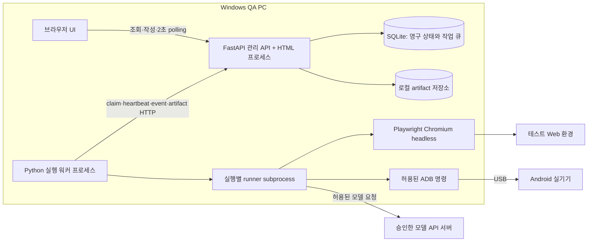
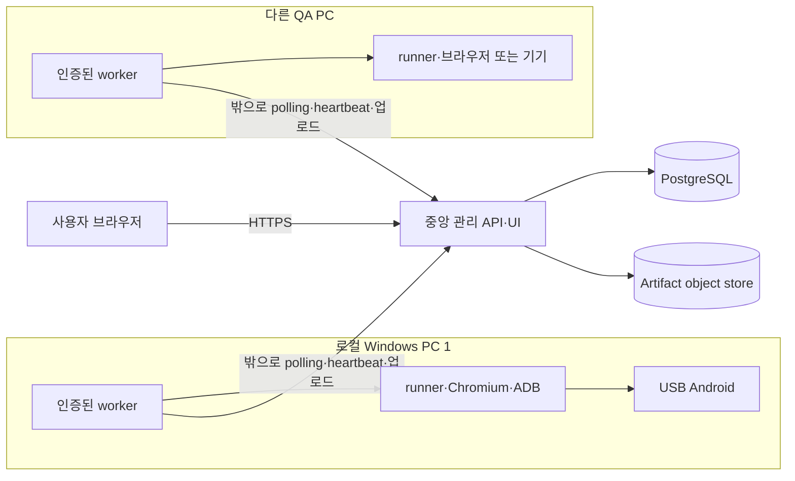
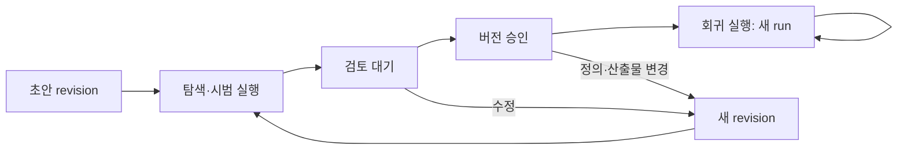

# Web·Android AI QA 플랫폼 설계

문서 버전: 0.1 · 작성일: **2026-10-30 (Asia/Seoul)** · 상태: **설계 검토용, 구현 승인 전**

읽는 순서: [기술 조사](RESEARCH.md) → 이 문서 → [단계별 구현 계획](IMPLEMENTATION_PLAN.md).

## 1. 추천안과 전제

**Web·Android 모두 Mobile-Agent v3.5의 해당 실행 경로를 사용하는 A안을 추천한다.** Web은 Python Playwright, Android는 ADB를 제어한다. 플랫폼이 테스트 정의·승인·불변 버전·작업 관리·검증·증거·비용을 맡는다. 엔진 완료 보고는 참고 정보이며 QA PASS를 결정하지 않는다.

첫 회귀 모드는 **승인된 단계와 기대 결과를 고정하고, 각 단계에서 AI가 현재 대상을 찾는 방식**으로 제안한다. 공개 runner를 감싸는 것만으로 이 모드가 생기지 않는다. 단계 경계·정책 검사·검증·사용량·취소를 넣는 작은 연동 패치가 필요하다. 한도 내에서 호환성을 확보할 수 있는지는 후속 기술 검증 P0의 gate다. 근거와 B안 비교는 [RESEARCH §6](RESEARCH.md#6-ab-구성-비교와-추천-근거)를 따른다.

### 확정된 목표와 임시 가정

| 구분 | 내용 |
|---|---|
| 요청에서 확정 | Web·Android, 자연어 작성, 실행 증거, 사람 검토, 승인 버전 반복 실행, 영구 저장 |
| 임시 가정 | 개인/소규모 QA 팀, Windows PC 한 대와 USB Android 한 대, Chromium 시작, 외부 모델 API 우선, 단계별 PNG 미리보기 |
| 제안하는 제한 | 초기 동시 실행은 Web 1개 또는 Android 1개로 총 1개. 두 플랫폼 모두 제품 기능으로 완성해야 출시 가능 |
| 모델 임시 선택 | Android는 API로 접근 가능한 GUI-Owl-1.5 Instruct 계열을 우선 검증. Web은 해당 SoM/도구 형식에 맞는 vision model을 호환성 시험 후 선택. 구체 제공자/모델은 미확정 |
| 버전 기준 | MobileAgent `81fa28b564ef7a695521500bc15a0e1324b2b394`; 상세는 RESEARCH |
| 운영 저장 위치 | 코드 문서는 이 저장소. 실행 DB/증거/비밀값은 동기화되지 않는 `%LOCALAPPDATA%/AIQA/` 아래 별도 위치. 현재 OneDrive 저장소에 runtime DB를 만들지 않음 |

MVP 포함: 프로젝트·대상·환경, 워커·기기 상태, 자연어/구조화 테스트, Web와 Android 시범/회귀 실행, 필수 기대 결과 판정, 증거 타임라인, 취소, 사람 승인, 실행 비교, 사용량·비용, 기본 권한과 정리.

후속: 무모델 생성 코드 재생·Skill Factory, 고급 파일 업로드/다운로드·여러 탭 테스트, 영상/trace/logcat, API·DB oracle, 중앙 서버와 여러 워커, 여러 브라우저, Jenkins 연계. 제외: iOS, K8s, 대규모 디바이스팜, 멀티테넌트 SaaS, 과금, 모델 학습, 모든 앱의 무인 실행 보장.

## 2. 요구사항과 수용 조건

P0는 MVP 출시 필수, P1은 후속이다. 자세한 시험 표본과 제안 기준은 §13을 따른다.

| ID | 우선순위 | 사용자 가치 | 범위 | 수용 조건 |
|---|---|---|---|---|
| R01 | P0 | 자산 관리 | 프로젝트/대상/환경 | URL·package allowlist와 환경 snapshot을 저장·조회 |
| R02 | P0 | 장치 선택 | 워커·Android/브라우저 상태 | 연결/권한/점유·OS·해상도·앱 버전을 표시하고 부적합 자원 배정 차단 |
| R03 | P0 | 자연어 작성 | 원문+구조화 계획 | 둘을 보존하고 모호한 기대 결과는 `needs_review`로 차단 |
| R04 | P0 | Web 실제 실행 | Chromium 단일 탭 | 승인 경로로 입력·버튼·결과 확인, 실패 주입도 판정 |
| R05 | P0 | Android 실제 실행 | USB 실기기 | 앱 실행·터치·입력·캡처·검증, 연결 해제 시험 포함 |
| R06 | P0 | QA 판정 신뢰 | 단계·필수 검증·경로 | 클릭/agent done만으로 PASS 불가, oracle 위반 시 FAIL |
| R07 | P0 | 검토 가능성 | 화면/행동/검증 타임라인 | 필수 전후 화면과 관찰·판정 근거를 step에 연결 |
| R08 | P0 | 승인 통제 | 불변 version manifest | hash·승인자·시간·근거를 저장하고 수정 시 새 버전 |
| R09 | P0 | 반복 검증 | 승인 버전 회귀 | 같은 hash로 새 run·새 증거·새 검증, 이전 PASS 미재사용 |
| R10 | P0 | 오래 걸리는 작업 | API/worker 분리 | 요청은 202로 반환, UI 종료·API 재시작 후 조회 가능 |
| R11 | P0 | 안전한 중단 | 취소·자원 정리 | 모델 대기 중 취소도 실행을 멈추고 정리/격리 상태 표시 |
| R12 | P0 | 장애/중복 내성 | lease·event·멱등성 | 중복 요청/전달에 추가 행동 없음, 늦은 결과가 확정 결과를 덮지 않음 |
| R13 | P0 | 비용 통제 | 모든 모델 역할 계측 | 누락 usage는 null, 호출/시간/단계/예산 한도 강제 |
| R14 | P0 | 정보 보호 | secrets·대상·도구 권한 | 프런트/원문/로그에 secret 미노출, 범위 밖 행동 거부 |
| R15 | P0 | 운영 복구 | 보관/정리·비교 | 재연결 후 이벤트 복원, 보관 만료 표기, 정리 실패 기록 |
| R16 | P0 | 유효한 MVP 검증 | 정상+오류+장애 | Web·Android 모두 §13 gate 충족, 한쪽만으로 완료 불가 |
| R17 | P1 | 저비용 회귀 | CUAWright 코드 재생 | 승인 코드·격리·모델 차단·현재 assertions 확인 후 제공 |
| R18 | P1 | 여러 PC 실행 | 중앙 API+local workers | outbound 연결·등록 폐기·heartbeat·배정·artifact 업로드 검증 |
| R19 | P1 | 강한 oracle | 선택 API·DB 검사 | 별도 read 권한/허용 endpoint, UI 경로 대체 금지 |
| R20 | P1 | 깊은 디버깅 | 영상/trace/logcat | 선택 수집·용량 한도·비밀값 정책 마련 |

## 3. 아키텍처 결정

| ADR | 결정 | 이유/대안/재검토 조건 |
|---|---|---|
| D01 | A: Mobile-Agent Web+Android | 생성 코드 실행 없이 두 플랫폼의 QA 흐름에 집중. Web 정적 결함을 P0에서 해소 못 하거나 무모델 회귀가 필수가 되면 B 재검토 |
| D02 | FastAPI + Jinja2 + HTMX + 소량 JS/CSS | Python 숙련도 활용. 작성/검토/타임라인은 HTML 부분 갱신으로 충분. React/TS는 복잡한 동시 편집·클라이언트 상태가 실제 필요해질 때 검토 |
| D03 | 별도 Python worker + 실행별 runner subprocess | 웹 요청 수명과 실행 분리, 취소·충돌 범위 제한. FastAPI BackgroundTasks를 장기 실행 큐로 쓰지 않음 |
| D04 | SQLite + SQLAlchemy/Alembic, API만 DB 접근 | 로컬 1 API 프로세스·1 worker에서 추가 broker 최소화. 큐도 transaction으로 저장. 원격 worker는 DB 파일 공유 안 함 |
| D05 | 로컬 파일 artifact + DB metadata/hash | PNG·로그를 DB BLOB로 크게 만들지 않음. 중앙형은 object store로 이전하되 artifact API 계약 유지 |
| D06 | UI 2초 HTTP polling, event cursor 조회 | 영상 요구가 없으므로 SSE/WebSocket 없이 시작. 이벤트는 먼저 DB commit. UI 연결과 실행 수명 독립 |
| D07 | worker는 outbound 2초 polling·10초 heartbeat | 로컬/중앙 동일 프로토콜. Redis/Celery는 도입하지 않음. DB queue 처리량/lock 경합이 문제가 될 때 검토 |
| D08 | 작은 2개 adapter와 공통 정책 | Web/Android capability는 구분. 플러그인 마켓·동적 임의 코드 로딩은 초기 제외 |

중앙형 전환 조건은 여러 PC 또는 공유 팀 운영이다. 이때 관리 DB는 PostgreSQL, TLS·팀 계정·artifact object storage를 도입한다. worker는 동일 claim/lease 프로토콜을 사용한다. SQLite는 로컬 단일 API writer에 한정하며 NAS/OneDrive/원격 파일 공유를 지원하지 않는다. 지속적 DB lock 대기 p95가 100ms를 넘거나 작업/이벤트 적체가 발생하면 먼저 batch/인덱스를 확인하고 PostgreSQL 전환을 검토한다. 이는 제안 운영 기준이며 측정값이 아니다.

기술 선택의 공식 근거: [FastAPI의 장기 작업 고려사항](https://fastapi.tiangolo.com/tutorial/background-tasks/), [HTMX](https://htmx.org/docs/), [SQLite WAL의 같은 호스트 조건](https://www.sqlite.org/wal.html), [Playwright context 격리](https://playwright.dev/python/docs/browser-contexts). 라이브러리 설치 버전은 P0 lock 단계에서 확정하며 이 문서는 설치를 수행하지 않는다.

### 로컬 배치도 — MVP



DB·파일 경로는 API가 관리한다. worker/runner는 run별 spool에 쓰고 artifact API로 업로드한다. 같은 PC여도 저장소를 직접 공유하는 특수 경로를 만들지 않는다. API 재시작 동안 spool을 보존하며 lease를 갱신할 수 없으면 행동을 멈춘다.

### 중앙 관리 배치도 — 후속



서버가 USB 기기를 직접 제어하지 않는다. 일반 웹 호스팅은 이 UI/API를 제공할 수 있을 뿐, 로컬 장치·지속 워커·GUI 세션이 자동으로 생기지 않는다. PyAutoGUI desktop 경로는 MVP에서 쓰지 않는다. Web headless와 ADB 실기기는 Windows 화면을 마우스로 조작하지 않지만, Android는 잠금 해제·앱 화면 상태가 필요하다. headed browser는 로그인된 사용자 desktop session이 필요하며 서비스 session에서 동작한다고 가정하지 않는다.

## 4. 컴포넌트와 데이터 흐름

관리 API 책임: 정의/버전/승인 저장, 정책 validation, 작업 등록/claim, 상태 전이, lease, 이벤트·증거 ingest, 판정 집계, 비용 조회, 보관·감사. 테스트를 직접 실행하지 않는다.

worker 책임: 등록/인증, device inventory, claim, 설정·artifact manifest 확인, 자원 준비, runner 시작·취소·정리, spool 재전송, heartbeat, 로컬 watchdog. 모델 키는 worker의 OS secret store에서 참조한다.

runner 책임: 한 attempt만 수행. adapter가 observation→model→action proposal을 받고 정책 gate가 tool 실행을 허용한다. 동작 후 관찰과 validator 결과를 event로 보낸다. 사용량은 공통 model gateway client를 통해 기록한다. upstream loop에서 정책 우회로 직접 실행하는 길은 제거한다.

순서:

1. 원문 입력 → 구조화 제안 저장. 정보가 부족하면 `needs_review`; 사용자가 보완한다.
2. 시범 실행은 `purpose=trial`로 불승인 버전 사용 가능. 검증 조건을 자동 변경할 수 없다.
3. run 요청 transaction에서 idempotency와 버전·환경·capability를 검증하고 queued row 생성, 202 반환.
4. worker claim transaction에서 resource lease와 attempt를 함께 배정. manifest digest를 검증한 worker가 preparing 시작.
5. 준비 후 running. 매 단계 proposal→scope/path/budget 확인→전 캡처→행동→후 관찰→검증→이벤트 persist.
6. finalizing에서 필수 검사·evidence completeness·환경 정리 결과를 모아 확정. UI는 DB의 확정 결과를 표시한다.
7. 사람이 정의·단계·assertion·prompt/config·engine patch manifest와 시범 증거를 검토해 승인한다.
8. 회귀 요청은 정확한 승인 version_id와 manifest hash를 참조하고 새 run을 시작한다.

## 5. 테스트 정의·판정·버전

### 5.1 테스트 정의 계약

모든 JSON은 **제안하는 플랫폼 계약**이다. upstream Mobile-Agent/CUAWright API가 아니다. 아래 ID는 읽기 쉬운 예시이며 실제 ID는 UUID다. 원문·계획은 모두 revision으로 보존한다. schema version은 1이다.

```json
{
  "schema_version": 1,
  "test_id": "test-cart",
  "raw_text": "테스트 상품 QA-100을 검색하고 상품 상세의 장바구니 버튼으로 한 개 담는다. 장바구니에서 상품 코드와 수량 1을 확인한다.",
  "objective": "상품 상세의 장바구니 버튼과 장바구니 반영 검증",
  "target": {"kind": "web", "environment_id": "env-staging", "url": "https://qa.example.test/catalog"},
  "preconditions": ["QA 전용 계정 사용", "장바구니가 비어 있음", "QA-100 재고 존재"],
  "variables": {"sku": "QA-100", "run_data_key": "${run_id}"},
  "secret_refs": {"login": "worker-secret://qa-account"},
  "steps": [
    {"id": "S1", "instruction": "검색창에서 ${sku} 검색 후 상세 열기", "expected": [{"id": "C1", "kind": "text_equals", "subject": "product-sku", "value": "${sku}", "required": true}]},
    {"id": "S2", "instruction": "상세 화면의 장바구니 버튼을 누르기", "expected": [{"id": "C2", "kind": "visual", "statement": "현재 상품이 장바구니에 추가되었다는 확인이 보인다", "required": true}]},
    {"id": "S3", "instruction": "장바구니 열기", "expected": [{"id": "C3", "kind": "value_equals", "subject": "cart-row:${sku}:quantity", "value": 1, "required": true}]}
  ],
  "final_expected": [{"id": "C4", "kind": "text_equals", "subject": "cart-product-sku", "value": "${sku}", "required": true}],
  "path_policy": {"must_use": ["S2:product-detail:add-to-cart-button"], "allowed_auxiliary": ["scroll", "dismiss-approved-cookie-banner"], "forbidden": ["api-state-mutation", "alternate-add-to-cart-route"]},
  "reset": {"policy": "approved-ui-empty-cart", "destructive_app_reset": false},
  "cleanup": {"policy": "approved-ui-remove-run-items"},
  "limits": {"timeout_seconds": 600, "max_actions": 50, "max_model_calls": 80, "max_action_retries": 1, "max_model_retries": 2, "budget": {"amount": "2.00", "currency": "USD"}},
  "execution_mode": "fixed_steps_ai",
  "review_status": "needs_review"
}
```

`subject`는 승인 버전에 매핑되는 의미상 대상 ID다. Web locator/OCR/화면 영역 binding은 별도 manifest에 저장한다. AI가 locator를 새로 찾았다는 이유로 기존 기대 결과를 수정하지 않는다. Android 정의는 `target.kind=android`, `package`, 승인 activity/app version 조건을 사용하며 나머지 공통 구조는 같다. locator binding이 없는 `text_equals/value_equals`는 실행 전 차단한다. Android에서 값 추출을 시각 모델로 했다면 결정적 검사가 아니라 `visual`로 기록한다.

모호함 예: “정상적으로 표시된다”는 구체 문구·값·화면 근거가 없어 `needs_review`. AI는 제안만 하고 필수 기대 결과를 제거·완화할 권한이 없다. 변수 schema와 secret reference를 검증하고 템플릿 치환은 shell 실행과 분리한다.

### 5.2 세 종류의 성공과 최종 판정

| 층위 | 예 | PASS와의 관계 |
|---|---|---|
| 명령 전달 | ADB exit=0, Playwright click 반환 | 버튼 반응을 증명하지 않음 |
| 단계 진행 | 다음 화면/상태가 예상대로 관찰됨 | 단계 기대 결과의 일부 |
| QA 검증 | 상품 코드·수량·필수 UI 경로가 모두 충족 | 현재 실행의 필수 검사 집계로만 PASS |

검증 `status`: `satisfied`, `violated`, `unknown`, `not_run`. 각 결과에 check ID, expected snapshot, observed value/text, 판정 method/version, artifact hash, 관찰 시각, 짧은 이유, 오류 분류를 남긴다. AI 검증은 관찰·기대·실제 화면·판정 이유를 모두 요구하며 parse 실패·가림·누락 화면은 unknown이다. 모델 confidence는 보정 확률로 표시하거나 threshold 근거로 사용하지 않는다. 별도 verifier 모델도 독립 정답을 보장하지 않는다.

최종 집계 순서:

1. 현재 attempt의 검증 가능한 증거에서 필수 기대 결과 또는 필수 경로가 위반되면 **FAIL**. 인프라 오류와 섞이면 root cause와 나머지 unknown을 함께 표시한다.
2. 유효한 위반 증거가 없고, 실행 전/중 필수 환경·권한·사람 입력 문제로 진행 불가면 **BLOCKED**.
3. 위 둘이 없고, 취소·worker lost·모델 한도·증거 손실·불명확 외부 상태·미실행 필수 검사면 **INCONCLUSIVE**.
4. 모든 필수 step/check/path가 satisfied, 필수 evidence 존재, 한도/정책 위반 없음, 승인한 초기/정리 조건 충족이면 **PASS**. 필수 검사가 0개인 정의는 실행 전 거부한다.

필수 정리는 test의 expected lifecycle에 포함한다. 로그 업로드 등 운영 정리만 실패하면 `cleanup_status=failed`로 별도 표시하고 해당 자원은 quarantine한다. 운영 정리 실패만으로 이미 관찰한 제품 assertion을 바꾸지는 않는다. 필수 evidence 미전송은 INCONCLUSIVE로 판정하며 PASS를 확정하지 않는다.

고장 난 버튼을 다른 버튼·API로 우회한 경우 path check가 violated다. 제품 버그를 복구로 숨기지 않는다. action retry 전 원래 실패·근거를 남기고 `recovery_used=true`로 기록한다. 필수 버튼 실패 후 동일 검증 목적을 우회해 성공해도 최종 FAIL을 지운다거나 덮지 않는다. 단순 일시적 로딩 재관찰은 실패 assertion 전의 허용된 wait로 취급한다.

결정적 Web oracle은 승인 locator의 visible/text/value 비교와 Playwright 상태 대기를 우선한다. Android는 가능하면 승인된 UI hierarchy/명시적 값 추출을 이용하되 소형 ADB read-only 관찰 추가가 필요하다. 접근 불가능한 custom UI는 visual oracle로 구분한다. API·DB oracle은 P1이며 read 권한·query allowlist를 확보한 경우에만 추가한다. UI 테스트를 API mutation으로 대체할 수 없다.

### 5.3 승인 생명주기와 불변성



버전 content는 생성 즉시 append-only다. draft 수정도 새 revision row를 만든다. `review_status=draft/needs_review/review_pending/approved/rejected`는 승인 메타데이터에서 계산한다. approval은 이전 PASS가 아니라 manifest를 승인한다. manifest에는 원문·구조화 단계·assertion·path policy·artifact hash·engine SHA/patch hash·prompt hash·model role binding·dependency lock·핵심 설정·허용 환경 제약이 들어간다.

재승인 필요: 목적/단계/기대 결과/금지 경로, locator의 의미·코드, engine/patch/dependency lock, 시스템/검증 prompt, model/provider/revision/출력 프로토콜, viewport·locale·초기화 정책·한도 확장·권한 범위 변경. 단순 display title/설명, secret 실제 값의 정상 rotation, 승인 schema 내 테스트 데이터 값 변경은 재승인 불필요하나 run snapshot과 감사 기록은 필요하다. 비밀 계정의 역할·권한이 달라지면 재승인한다. 숨겨진 provider 모델 교체는 완전 통제 못 하므로 응답 model ID를 기록하고 alias 변경 가능성을 위험으로 남긴다.

앱·브라우저 버전은 테스트 대상 변화일 수 있다. 승인 manifest의 허용 범위 내 변경은 새 run의 대상 fingerprint로 기록하며 테스트 자체 재승인 없이 비교한다. 범위 밖 OS/해상도/앱 package/인증 조건이면 preflight BLOCKED. 버전 차이별 결과 비교를 제공하고 재현성을 동일 결과 보장과 혼동하지 않는다.

승인 시 actor·time·manifest digest·basis_run_ids·변경 diff·comment를 기록한다. 승인 근거 trial은 **해당 버전의 단일 target 플랫폼에서 같은 manifest digest로 completed/PASS인 실행**을 최소 1개 요구한다. BLOCKED/INCONCLUSIVE/FAIL·미완료 실행은 진단 자료로 남길 수 있으나 승인 근거에는 쓸 수 없다. Web·Android 양쪽 검증은 개별 버전 승인 조건이 아니라 제품 출시 gate다. 승인 취소는 append-only revocation이며 새 회귀 실행을 차단하고 진행 중 run은 취소 요청한다. 완료 기록은 수정하지 않는다.

## 6. 실행·자원 상태와 복구

### 6.1 ID와 상태 전이

`Run` row는 사용자 실행 요청과 queue job을 합친다. `run_id`는 결과의 식별자, `job_id`는 1:1 queue 식별자다. 전송 재수신은 같은 job/attempt다. 실행을 안전하게 처음부터 다시 하는 경우에만 새 `attempt_id`를 만든다. 사용자가 회귀를 다시 누르면 새 run이다. step ID는 승인 계획의 S1 등이며 action_seq는 실제 보조 행동까지 센다.

진행 상태와 verdict는 별개다. `verdict=null`은 아직 미확정이다.

| 현재 | 허용 다음 상태 | 조건 |
|---|---|---|
| queued | preparing, cancelled | 원자적 claim 또는 실행 전 취소 |
| preparing | running, cancel_requested, finalizing, error, lost | preflight 성공, 취소, 차단 결과 정리, 복구 불가 오류, lease 상실 |
| running | cancel_requested, finalizing, error, lost | 정상/한도 종료, 취소, 장애 |
| cancel_requested | finalizing, lost | runner 정지 확인 후 정리, 또는 worker 상실 |
| finalizing | completed, cancelled, error, lost | 검증·artifact·정리 집계, 취소 맥락, 업로드 오류, worker 상실 |
| completed/error/cancelled/lost | 없음 | terminal, 늦은 메시지로 변경 금지 |

`completed`는 실행 절차가 마무리됨을 뜻하며 FAIL/BLOCKED/INCONCLUSIVE도 가능하다. `error`는 플랫폼/환경 실행 오류, `lost`는 lease 상실, `cancelled`는 실행 전 취소 또는 정지 확인 후 취소다. terminal마다 §5.2의 verdict와 `termination_reason`을 저장한다. 실행 오류라도 이미 검증한 필수 위반은 FAIL로 남을 수 있다.

어떤 terminal 전이도 자원을 바로 ready로 만드는 근거가 아니다. 정상 경로는 finalizing에서 cleanup report를 확인한다. 준비 오류 등으로 error에 바로 들어가더라도 worker finally 정리를 수행하고, 서버에 정리 확인이 없으면 resource를 quarantine한다. queued 취소처럼 자원을 받지 않은 경우만 정리 대상이 없다.

### 6.2 배정·heartbeat·중복

- API는 하나의 DB transaction에서 queued 조건부 update + resource lease + attempt를 생성한다. `(worker_id, device_serial)` 기기는 한 lease만 갖는다. Web도 worker slot을 점유한다. 초기 총 slot=1이다.
- 요청 `Idempotency-Key`는 project+actor+operation 범위로 본문 hash와 함께 7일 보관한다. 같은 key/본문은 같은 run, 다른 본문은 409다. 7일 뒤 재사용 요청은 새 요청으로 취급하므로 client는 UUID를 쓴다.
- worker는 받은 job/attempt/lease generation을 local journal에 먼저 기록한다. 중복 claim 응답·전달은 이미 시작한 attempt를 반환하며 runner를 추가 생성하지 않는다. runner도 attempt workspace singleton lock을 확인한다.
- heartbeat 10초, server lease TTL 45초, worker는 마지막 갱신 응답 후 30초 이내 갱신 못 하면 새 행동 차단·runner 종료. 각 행동 전 lease가 10초 이상 남았는지 확인한다. 시간은 서버 만료값과 worker monotonic elapsed로 처리한다. 모델 응답이 늦게 도착해도 generation/취소/lease를 다시 검사한다.
- lease 만료는 물리 작업 종료 증명이 아니다. 서버는 run을 lost로 확정하고 자원을 **quarantined**로 둔다. 새 worker가 바로 가져가지 못한다. 원 worker 또는 수동 복구가 이전 process tree 종료·기기 상태·IME·임시 파일을 확인해야 generation을 올려 해제한다. 서버 generation은 API fencing이며 외부 클릭을 되돌리지 못한다.
- worker 단절/폐기 시 token revoke, 새 claim 차단, 로컬 watchdog 정지. 여러 worker가 같은 USB serial을 등록하면 관리자가 소유 PC를 확인하기 전 배정 금지.

### 6.3 취소·재시작·부분 실행

취소 API는 queued를 즉시 cancelled로, preparing/running을 cancel_requested로 원자 변경한다. finalizing/terminal은 409와 현재 상태를 반환한다. 완료와 취소의 race는 DB 전이 transaction의 승자로 결정한다. cancel_requested 이후 모델 응답/새 행동은 폐기한다.

worker는 협력 취소 신호를 보내고 5초 후에도 살아 있으면 runner와 자식 브라우저를 Windows Job Object로 종료한다. 최종 정리는 worker의 신뢰 코드가 수행한다. 취소 요청부터 새 행동 차단 목표 2초, process 종료 목표 10초, 정리 확인 목표 30초를 제안한다. 이미 전달한 ADB 명령·서버 거래는 취소로 되돌릴 수 없다. 그 경우 outcome_unknown을 기록하고 수동 검토한다.

API 재시작은 DB의 queued를 유지하고 active lease를 재조정한다. UI 연결은 무관하다. worker가 살아 있고 같은 generation으로 lease를 갱신하면 계속할 수 있지만 30초 watchdog이 지난 실행은 재개하지 않는다. 서버가 terminal로 만든 뒤 늦은 이벤트/결과가 오면 stale inbox에 감사용 보관하고 확정 결과에는 반영하지 않는다.

중간 재개는 같은 살아 있는 runner·유효 lease·현재 화면 재관찰·변경 없음·마지막 작업 결과 확정·남은 한도 조건을 모두 만족하는 일시적 모델/전송 지연에만 허용한다. 프로세스 사망, 재부팅, 외부 거래 결과 불명, 환경 fingerprint 변화는 checkpoint에서 임의 재개하지 않는다. MVP에서는 새 attempt를 시작하려면 승인한 reset/데이터 격리로 부작용이 없음을 확인해야 한다. 확인 못 하면 새 run도 BLOCKED로 검토한다. 기본 자동 attempt 재실행은 0회다.

| 상황 | 분류/판정 | 처리 |
|---|---|---|
| 모델 timeout/429 | model_transport/rate_limit | 2회 이하 제한 재시도, 시간/예산 차감. 소진 시 INCONCLUSIVE |
| 잘못된 action/무한 루프 | action_schema/loop | 실행 거부, 같은 화면·action 3회면 정지. INCONCLUSIVE |
| 요소 부재/값 불일치 | 제품 위반 증거 있으면 assertion_violation | 관찰 timeout 후 FAIL. 환경 원인 증거가 있으면 BLOCKED/unknown 구분 |
| 브라우저 crash/ADB offline | environment/browser_or_device | 새 행동 중지, BLOCKED 또는 중간 상태 불명 INCONCLUSIVE |
| worker 종료/연결 단절 | infrastructure/lease_lost | lost, 자원 quarantine. 서버에 확정된 필수 violation이 있으면 FAIL, 없으면 INCONCLUSIVE |
| 결제/주문 직후 전송 실패 | external_outcome_unknown | 무조건 재전송하지 않음. read-only 재관찰/수동 검토 |
| 정리 실패 | cleanup_failure | 자원 quarantine, 별도 cleanup_status; 필수 정리 조건 위반은 판정 집계 |

외부 동작의 exactly-once는 보장하지 않는다. 준비/실행 transaction과 클릭/거래 사이에 원자성은 없다. 서비스가 제공한 idempotency를 테스트 데이터에 사용할 수는 있지만 승인 UI 경로를 대체해서는 안 된다.

## 7. Android·Web 환경 정책

### Android

worker inventory는 serial, state(offline/unauthorized/ready/busy/quarantined), OS/build, physical/capture/model 크기, rotation, 현재 package/activity, app version, capture 가능 여부, IME 상태를 보고한다. ADB 연결 권한과 screen unlock은 preflight에서 확인한다. 잠금 해제·설치·데이터 삭제를 임의 실행하지 않는다.

실행 도구는 argument list로 `adb -s serial ...`을 호출하고 stdout bytes/exit/timeout을 기록한다. 모델은 raw shell을 출력할 수 없다. 앱 launch는 승인 package/activity만 허용하고 설치 앱 전체 목록을 외부 resolver에 보내지 않는다. read-only dumpsys/uiautomator 관찰은 필요한 명령만 allowlist한다. 앱 crash는 foreground package 이탈·명시적 crash 신호 등 근거와 함께 기록하고, 시스템 장애와 제품 crash를 error_category로 나눈다.

좌표는 `(원본 캡처 크기, 모델 입력 크기, 원본→입력 transform, rotation, content bounds)`를 매 observation에 저장한다. 모델 normalized 좌표 → 모델 입력 픽셀 → inverse transform → 원본 touch plane으로 바꾸고 경계 검사한다. MVP는 승인한 세로 방향과 해상도로 제한하며 도중 회전 시 정지/BLOCKED. 방향 지원은 이후 별도 capability다. 화면 크기를 추정해 이전 좌표를 재사용하지 않는다.

한글 입력은 승인한 ADB Keyboard 사용 가능 여부를 P0에서 확인한다. 이전 IME를 snapshot하고 finally 복구하며 실패 시 기기를 quarantine한다. secret은 모델이 문자열을 생성하게 하지 않고 허용한 input 동작 시 worker가 해석한다. 키보드가 화면을 가린 경우 새 캡처 후 재탐색한다. loading/팝업은 기대 조건 polling으로 기다리고 허용된 팝업만 닫는다. 보안/업무 확인 dialog는 자동 승인하지 않는다.

연결 해제·권한 상실·화면 잠금은 BLOCKED, 실행 뒤 상태를 알 수 없으면 INCONCLUSIVE. FLAG_SECURE 등 캡처 불가는 명시적인 EVIDENCE_UNAVAILABLE로 기록하며 우회하지 않는다. 기기당 한 작업이며 정상·실패·취소·lost 모두 정리 또는 quarantine 절차로 점유를 끝낸다. app clear/reinstall/logout은 버전의 명시 설정일 때만 수행한다.

### Web

MVP는 Chromium·단일 탭·승인 viewport(기본 1280×720)·DPR=1·locale ko-KR·timezone Asia/Seoul을 제안한다. upstream의 고정 user agent/locale/timezone과 공유 storage_state는 환경 설정으로 교체한다. 매 run 새 context, 기본 로그인은 run별 수행. 세션 재사용이 필요하면 계정·프로젝트·환경·만료시간별 암호화 storage snapshot을 승인하고 read-only 원본에서 복사한다. 개인 Chrome profile에 연결하지 않는다.

필수 UI는 locator/state 대기 기본 10초, navigation 30초, 전체 run 600초다. 테스트가 승인한 값을 쓰며 전역 고정 sleep을 유일한 대기로 삼지 않는다. 화면 전환 후 대상·URL·안정된 관련 상태를 관찰한다. upstream sleep은 보조 polling으로 교체한다. 다운로드/업로드·다중 탭·OS dialog가 필요한 테스트는 capability 미지원으로 실행 전 BLOCKED 처리하고 첫 제품의 일반 입력/버튼/스크롤/표준 select 범위를 문서화한다.

브라우저 popup은 승인한 동일 탭 modal만 우선 지원한다. 새 tab이 열리면 upstream처럼 조용히 닫아 다른 경로로 진행하지 않고 미지원 이벤트를 기록한다. browser/context/process/temp 정리는 worker가 확인한다. 데이터를 변경하는 테스트는 `${run_id}` 식별자와 승인 cleanup으로 충돌을 줄인다. OTP/CAPTCHA/대화형 로그인은 자동 우회하지 않고 HUMAN_REQUIRED로 종료한다. 사용자가 환경을 준비하면 새 trial/run을 시작한다. MVP에는 장시간 pause/resume UI를 넣지 않는다.

## 8. 제안 플랫폼 계약

### 8.1 실행 어댑터

다음은 설계용 Python 형태의 인터페이스이며 upstream API가 아니다. 파일/제품 코드는 이번에 생성하지 않는다.

```text
EngineAdapter.describe() -> CapabilitySet
EngineAdapter.preflight(spec: ExecutionSpec) -> PreflightResult
EngineAdapter.run(spec: ExecutionSpec, sink: EventSink, control: RunControl) -> EngineOutcome
EngineAdapter.cancel(attempt_id: UUID) -> StopAcknowledgement
EngineAdapter.cleanup(attempt_id: UUID) -> CleanupReport

ModelClient.invoke(request: ModelRequest, control: RunControl) -> ModelResponse
PolicyGate.authorize(proposal: ActionProposal, context: StepContext) -> ActionDecision
Validator.evaluate(check: CheckSpec, observation: Observation) -> CheckResult
```

`ExecutionSpec`: version/manifest hash, run/job/attempt, engine/patch/lock hash, target/resource/lease generation, fixed step definitions, variable bindings, secret reference names, environment constraints, timeout/action/model/retry/budget limits. 실제 secret 값은 포함하지 않는다.

`EventSink`는 local spool에 먼저 순번·hash를 붙여 기록하고 worker가 API로 재전송한다. `RunControl`은 cancel flag·lease·deadline·사용량 한도를 신뢰 코드에서 확인한다. `EngineOutcome`은 완료 여부/중단 이유/실제 실행 요약일 뿐 최종 QA verdict가 아니다. cleanup은 여러 번 호출해도 안전해야 한다. adapter 오류 때문에 cleanup 자체가 건너뛰어지지 않도록 worker가 fallback 정리를 맡는다.

upstream의 직접 PNG/messages 파일 쓰기는 그대로 두지 않는다. 캡처→메모리 관찰 필터→보관본 생성 순서로 교체하고 stdout/debug writer에도 같은 정제를 적용한다. 필터를 거치지 않는 출력 경로가 있으면 adapter preflight를 통과시키지 않는다.

| Capability | Mobile-Agent Web adapter MVP | Android adapter MVP | CUAWright 후보 |
|---|---|---|---|
| fixed_steps_ai | 패치로 제공 | 패치로 제공 | 별도 래핑 필요 |
| headless | 지원 경로 확인 | 해당 없음 | local_launch 경로 확인 |
| structured actions | SoM label→좌표 + 허용 동작 | normalized 좌표 + ADB 동작 | live는 Python 코드, 동등 취급 금지 |
| current evidence | 전후 PNG + URL/DOM binding | 전후 PNG + package/state | 모드별 trajectory/PNG/ARIA |
| deterministic assertions | 플랫폼 Web validator | 관찰 가능한 항목만 플랫폼 validator | 승인 code assertion 가능 |
| code_replay_no_model | false | false | 조건부 true, P1 gate |
| multi_tab/file_io/rotation | false/false/해당 없음 | 해당 없음/해당 없음/false | 별도 테스트 전 미확인 |
| cancellation/usage_stream | 플랫폼 패치 | 플랫폼 패치 | 플랫폼 계측 필요 |

### 8.2 데이터 모델

JSON은 정의·snapshot·행동 payload에, 테이블은 불변성·외래키·조회·중복 방지에 사용한다. 각 UI 개념마다 테이블을 만들지 않는다.

| 테이블 | 핵심 필드/관계 |
|---|---|
| projects | id, name, target allowlist, policy, membership JSON(개인 MVP는 owner 1명) |
| environments | project_id, target kind/url/package, auth/reset policy, constraints, revision |
| workers | id, project scopes, token hash, enabled, capabilities, last_seen |
| resources | worker_id, kind, serial/slot, inventory JSON, state, lease_attempt_id, lease_expiry, generation |
| tests | project_id, title, latest_revision_id, archived |
| test_versions | test_id, revision_no, immutable definition JSON, manifest JSON/hash, created_by/time; unique(test_id,revision_no) |
| approvals | version_id/hash, actor, approved_at, basis_run_ids, reason, revocation record |
| runs | run_id, unique job_id, project/version/environment, purpose, mode, status, verdict, request hash/idempotency, runtime snapshot, summary/cleanup/cost |
| attempts | run_id, ordinal, worker/resource, generation, stage, start/end, error_category, side_effect_state; unique(run_id,ordinal) |
| events | global cursor id, attempt_id, local_seq, step_id, payload, captured/received time, hash; unique(attempt_id,local_seq) |
| check_results | attempt/step/check_id, expected/observed, status, method, evidence IDs/hash, reason; append-only observations |
| artifacts | attempt/step, kind, object key, hash, bytes, content type, state, expiry, redaction metadata |
| model_calls | attempt/step/role, provider/model/request_id, sequence, usage nullable, measurement_status, tariff/currency, estimate/reservation, duration |
| audit_log | actor/worker, action, object/hash, time, sanitized detail; append-only |

별도 job table은 필요 없다. 단계 정의는 version JSON, 단계 진행은 events에 둔다. environment의 mutable current 설정과 run의 immutable 환경 snapshot을 분리한다. 실행 결과·usage·artifact는 run 삭제 정책에 따라 관리하고 승인 manifest/audit는 별도 보관한다. `model_calls`는 event와 달리 비용 합산·중복 계측 방지를 위해 분리한다.

쓰기 조건: 승인 version content UPDATE 금지, terminal run UPDATE는 보관 metadata 외 금지, 동일 local_seq+동일 hash는 재수신 허용/다른 hash는 409. check revision은 append-only이며 final aggregate는 latest accepted current-attempt result를 사용한다. 필수 위반을 자동 복구로 만족 결과에 덮어쓰지 못하도록 violation latch를 유지한다. 참조 없는 artifact는 staging에서만 삭제한다.

### 8.3 관리 API

모든 mutation은 인증·project scope·CSRF(브라우저 session) 또는 worker bearer 인증을 확인한다. `/api/v1` JSON과 HTML route를 분리한다. 잘못된 body는 422, 권한은 403, 미지원 capability/재승인 필요/상태 race는 409, 없는 ID는 404다.

| Method/path | 계약 |
|---|---|
| POST /projects, /projects/{id}/environments | 프로젝트·환경 revision 생성. 실제 prefix는 `/api/v1` |
| POST /tests/{id}/versions | 원문+구조화 정의로 새 불변 revision 생성; hash/ambiguities 반환 |
| POST /versions/{id}/structure | AI 구조화 제안 job 등록, 결과는 새 revision. UI 요청에서 장시간 수행하지 않음 |
| POST /runs | Idempotency-Key 필수, 정확한 version/hash/env/resource/purpose, 202 run/job/status URL |
| POST /runs/{id}/cancel | 허용 상태에서 202, 이미 같은 취소면 동일 결과, finalizing/terminal은 409 |
| GET /runs/{id} | 상태·verdict·snapshot·counts·cleanup·usage·last_cursor |
| GET /runs/{id}/events?after={cursor}&limit=200 | 순서대로 이벤트와 next_cursor/has_more, cursor 없으면 처음부터 |
| GET /runs/{id}/artifacts | metadata, ready/staging/expired 상태, 조회 권한 확인 |
| GET /artifacts/{id}/content | 허용된 파일만 stream, 삭제 후 410. 임의 path 인자 금지 |
| POST /versions/{id}/approvals | manifest hash, basis run IDs, reviewer comment. 201, hash 다르면 409 |
| POST /approvals/{id}/revoke | 감사용 revocation 생성, 다음 실행 차단 |
| GET /tests/{id}/runs?version_id=... | 회귀 목록·비교용 결과, 첫 시도/재시도 분리 |
| GET /workers, /resources | inventory·lease·capability·quarantine 상태 |

자연어 구조화도 모델 작업이므로 worker job으로 처리한다. `runs.purpose=structure`로 같은 영구 작업 큐/lease를 사용하되 physical resource 없이 worker slot만 배정한다. source version_id/hash는 구조화할 draft revision을 참조하고, 성공 산출물은 별도 새 revision이다. `structure`는 모든 상태에서 테스트 verdict=null이고 구조화 성공/오류는 status/termination_reason으로 표현한다. `purpose=trial/regression`만 QA 집계를 수행한다. 구조화 작업은 실행 명령을 만들거나 기기를 제어할 권한이 없다.

실행 요청 예시:

```json
{
  "project_id": "project-demo",
  "version_id": "version-cart-3",
  "manifest_hash": "sha256:example-approved-manifest",
  "environment_id": "env-staging",
  "resource_id": "resource-web-1",
  "purpose": "regression",
  "execution_mode": "fixed_steps_ai",
  "variables": {"sku": "QA-100"}
}
```

헤더 예시: `Idempotency-Key: request-unique-uuid`. 응답은 `{"run_id":"run-100","job_id":"job-100","status":"queued","status_url":"/api/v1/runs/run-100"}`. 버전의 한도를 늘리는 요청 필드는 받지 않는다. 더 좁은 한도만 run override로 허용하고 기록한다.

### 8.4 워커 API와 이벤트

최초 로컬 설정 시 단일 사용 enrollment token을 발급하고 만료 10분으로 제안한다. `/workers/register`로 worker ID와 OS secret store에 보관할 고유 token을 받는다. API에는 hash만 저장한다. 중앙형은 HTTPS+project 범위 token rotation/revocation을 적용한다.

| Method/path (`/api/v1`) | 계약 |
|---|---|
| POST /workers/register | 일회용 enrollment token, name/OS/capabilities. worker token 반환은 최초 1회 |
| POST /workers/{id}/heartbeat | inventory, running attempts, local spool cursor. 갱신된 lease·취소 목록 반환 |
| POST /workers/{id}/claim | 가능한 capability/resource, 기존 active attempt ID. 200 spec+lease 또는 204 |
| POST /attempts/{id}/ack | generation과 spec hash, preparing 시작 확인. 중복은 동일 응답 |
| POST /attempts/{id}/events | batch local_seq/hash/payload, committed seq 목록 반환 |
| POST /attempts/{id}/artifacts | manifest metadata 등록→ID 반환 |
| PUT /artifacts/{id}/content | 길이/hash 검증, staging→ready 원자 확정. 같은 hash 재전송 허용 |
| POST /attempts/{id}/finish | generation, final local_seq, check summary, cleanup report. 서버가 재집계 |
| POST /resources/{id}/recover | 이전 process 종료·기기/IME/공간 정리 근거, lease generation 일치 시 quarantine 해제 |

worker는 자신의 assignment에만 쓸 수 있다. 모든 active mutation은 token+attempt+generation을 확인한다. finish는 마지막 sequence까지 수신하고 필수 artifact가 ready일 때 확정한다. 누락분을 30초 기다린 뒤 미해결이면 error/INCONCLUSIVE(유효한 필수 위반 있으면 FAIL), quarantine 여부를 기록한다. 동일 finish digest 재전송은 같은 receipt를 반환한다. stale 결과는 409와 terminal snapshot을 돌려주고 감사 경로에만 남긴다.

단계 이벤트 예시:

```json
{
  "schema_version": 1,
  "run_id": "run-100",
  "attempt_id": "attempt-100-1",
  "local_seq": 12,
  "lease_generation": 4,
  "step_id": "S2",
  "action_seq": 5,
  "event_type": "check_evaluated",
  "captured_at": "2026-10-30T13:10:12.123Z",
  "duration_ms": 830,
  "action": {"type": "click", "target_id": "product-detail:add-to-cart-button", "som_label": 8, "coordinate_space": "css_viewport", "x": 913, "y": 412},
  "command_status": "delivered",
  "step_progress": "expected_state_observed",
  "evidence_ids": ["artifact-before", "artifact-after"],
  "check": {"id": "C2", "status": "satisfied", "method": "visual", "expected": "현재 상품 추가 확인", "observed": "상품이 장바구니에 추가되었습니다", "reason": "대상 상품의 추가 알림이 현재 화면에 표시되어 있다"},
  "recovery": {"used": false, "previous_failure_event_id": null}
}
```

검증 문자열은 사용자의 원문 언어로 보존한다. 화면에서 읽은 문구는 untrusted data로 저장하며 실행 지시로 다시 해석하지 않는다. 이벤트 응답에서 API가 global cursor와 received_at을 추가한다. 모델 사고 원문·비밀 입력 문자열은 payload에 넣지 않는다.

최종 결과 예시:

```json
{
  "run_id": "run-100",
  "version_id": "version-cart-3",
  "manifest_hash": "sha256:example-approved-manifest",
  "status": "completed",
  "verdict": "PASS",
  "termination_reason": "all_required_checks_satisfied",
  "attempts": 1,
  "required_checks": {"total": 4, "satisfied": 4, "violated": 0, "unknown": 0, "not_run": 0},
  "path_checks_satisfied": true,
  "evidence_complete": true,
  "recovery_used": false,
  "cleanup_status": "completed",
  "duration_ms": 42000,
  "usage": {"model_calls": 9, "input_tokens": null, "output_tokens": null, "measurement_status": "unreported", "estimated_cost": "0.38", "currency": "USD", "tariff_version": "illustrative-only"},
  "runtime": {"engine": "mobile-agent-v3.5-web", "upstream_sha": "81fa28b564ef7a695521500bc15a0e1324b2b394", "patch_hash": "sha256:example-patch", "lock_hash": "sha256:example-lock", "model_binding_id": "web-model-pinned-1", "browser_version": "captured-at-runtime", "target_build": "staging-build-123"},
  "last_cursor": 58
}
```

금액·호출 수·실행 시간은 계약 설명용 가상값이며 실제 측정치/요금표가 아니다. 단계 기대 결과만 4개인 위 예시와 일치한다. 실제 결과에는 각 모델 호출의 원본 계측 상태와 모델 응답 ID가 연결된다.

## 9. 필수 화면

| 화면 | 주요 구성/행동 | 오류·미확인 표시 |
|---|---|---|
| 프로젝트/대상/환경 | URL/package allowlist, 계정 참조, 초기화 정책 | 대상 범위·모델 반출 정책 미설정 시 실행 차단 |
| 워커/기기 | last_seen, USB 권한, 앱/OS/해상도, 점유/lease | offline·unauthorized·quarantined, 복구 근거 입력 |
| 테스트 작성/버전 | 원문, 구조화 제안 diff, 단계/기대/금지 경로, 한도 | needs_review 강조, secret 값 대신 참조명 |
| 실행 현황/증거 | 진행 상태와 verdict 분리, step 타임라인, 전후 PNG, 실제 action, check 이유, 비용 | 전달 성공과 검증 결과 구분, 끊김/누락/복구·취소 표시 |
| 검토/승인 | 정의·prompt/config/manifest diff, 근거 run, 위험 동작 범위 | hash 불일치·미검증 필수 assertion이면 승인 버튼 비활성 |
| 회귀/결과 비교 | 같은 version·환경별 run 목록, check별 diff, 모델/기기/app version, 시간/비용 | 첫 attempt와 retry 결과 분리, expired evidence는 빈 화면 대신 만료 표기 |

run 화면의 기본 배치: 상단 상태/취소/한도, 좌측 승인 단계, 중앙 전후 화면, 우측 기대/관찰/판정, 하단 행동·오류·사용량. 스크린샷 새로고침은 파일 조회이며 모델을 부르지 않는다. HTML은 사용자 원문·앱/페이지 문자열을 escape하고 동적 HTML 삽입으로 실행하지 않는다. polling은 visible running 화면만 2초, 완료 후 중지, 네트워크 오류 시 마지막 cursor부터 복구한다.

## 10. 증거·비용·보관

### 증거 수집

각 action은 attempt/step/action_seq, UTC timestamp·monotonic duration, 목표, 실제 동작/대상/locator/좌표계/transform, command 결과, 전후 화면 hash, 관찰/검증, 오류/retry/recovery linkage를 갖는다. 대상에서 실제 캡처한 화면과 annotation은 구분한다. annotation이나 모델이 만든 요약 화면을 판정 근거로 쓰지 않는다. 실제 캡처는 아래 비밀값 마스킹을 거친 보관본으로 근거를 남긴다. 실행 manifest에 engine/model/prompt/patch/lock, OS/browser/device/app fingerprint와 핵심 설정을 저장한다.

비밀값은 입력 후 화면/DOM/로그에 다시 나타날 수 있다. 따라서 **외부 모델 전송·spool·artifact 저장·UI 제공 전에** 신뢰 코드의 관찰 필터를 거친다. Web은 승인한 민감 selector/영역과 알려진 secret 문자열을, Android는 승인한 화면별 민감 영역과 알려진 입력값을 마스킹한다. DOM/ARIA·tool stdout·action payload도 같은 정책으로 정제한다. 비마스킹 캡처는 runner 메모리에서만 잠시 사용하며 디스크/이벤트에 쓰지 않는다. 보관본에는 capture timestamp·마스킹 정책/버전·영역·hash를 남기고 마스킹 자체를 annotation과 구분한다.

MVP에서는 합성 계정·데이터와 사전에 정한 민감 영역만 지원한다. 알 수 없는 화면까지 개인정보 자동 탐지를 보장하지 않는다. 민감 영역을 안전하게 가릴 수 없거나 가리면 필수 oracle이 사라짐을 preflight에서 알면 BLOCKED/EVIDENCE_POLICY_CONFLICT다. 실행 중 발견하면 전송/저장을 멈추고 그 검사는 unknown, 유효한 위반 증거가 없다면 최종 INCONCLUSIVE로 종료한다. 필요한 관찰 정책을 검토한 새 버전 없이는 민감 원본 업로드로 해결하지 않는다.

모델 숨겨진 사고 과정은 저장 요구도 UI 노출도 하지 않는다. upstream의 raw output/messages에 reasoning·secret이 섞일 수 있어 기본 전체 저장을 끄고, 허용한 행동 요약·tool call·관찰 근거·usage만 추출한다. 디버그 원문 보관이 필요해도 민감정보 검토 후 별도 opt-in과 짧은 retention이 필요하다. 결론의 짧은 검증 이유와 숨겨진 사고 텍스트를 구분한다.

event ingest transaction이 commit된 뒤 UI가 조회한다. screenshot은 content-address hash 검증 후 ready로 바꾸며 event는 ID를 참조한다. worker spool은 재연결 시 동일 seq로 전송한다. API는 commit receipt를 주고, worker는 ack된 파일만 만료 후 정리한다. DB가 사실의 원천이며 polling/SSE 같은 전달 수단이 기록 저장소를 대체하지 않는다. SSE는 낮은 지연이 필요해질 때 추가할 수 있지만 DB cursor replay를 유지한다.

### 비용과 한도

역할: 구조화, Web actor, Android actor, 선택 verifier. 각 binding에 provider·model/revision·endpoint 종류(root chat/Responses)·주소·key ref·이미지 지원·행동 schema·price table ID를 저장한다. 행동 형식과 이미지/좌표 호환성 시험을 통과한 binding만 활성화한다.

모든 호출은 call ID, role/step, request/provider ID, 시도별 시간·응답 code, nullable input/output/cache/image usage, 계측 상태 `measured/estimated/unreported`, tariff version·currency·계산식을 저장한다. 일부 role만 누락이면 run 총계는 `partial`로 표시한다. upstream가 0으로 정규화하더라도 원본 usage 누락을 0 사용량으로 오인하지 않는다. retry·앱 resolver·검증·요약·Skill Factory routing도 각각 호출로 센다.

제안 기본 한도: 600초, action 50, 모델 호출 80, action별 retry 1, 모델 호출 retry 2, USD 2.00 예산. 금액은 사용자 검토용 보수적 초기값이며 제공자 가격과 다르다. 모델 요청 전 보수적인 최대 입력/출력·이미지 비용을 예약하고 완료 후 정산한다. 가격/usage를 알 수 없어 다음 호출의 상한을 계산 못 하면 strict budget 실행은 차단한다. 사용자 승인 estimate 모드라면 추정과 최종 누락 상태를 표시한다. 이미 발행한 호출의 실제 청구까지 정확한 hard cap으로 보장하지 않는다. 한도를 초과/예약 불가하면 새 호출·행동을 중지하고 INCONCLUSIVE로 정리한다.

모델 API 비용, 브라우저/기기 점유 시간, artifact bytes·보관 비용은 따로 집계한다. 로컬 점유 시간을 근거 없이 달러로 환산하지 않는다. 외부 호스팅 API는 provider 정책·과금·rate limit에 의존한다. 자체 모델 서버는 GPU·운영·모델 라이선스·배포 비용을 별도 검토해야 하며 필요한 GPU 사양이나 성공률은 모델/입력/동시성 측정 전 확정하지 않는다.

### 보관과 삭제

제안 기본값: run event/check/metadata 90일, screenshot 30일, worker ack spool 7일 이내, 실패 debug opt-in 원문 24시간, 승인 manifest/audit·승인 근거 핵심 증거는 승인 유효기간 동안 pin. 파일 전체 cap은 20GB, run cap 500MB로 시작한다. 필수 증거를 더 저장할 수 없으면 업로드 누락으로 통과시키지 않고 새 행동 중지/INCONCLUSIVE 처리한다.

cap 접근 시 unpinned 만료 artifact부터 삭제하고 pinned 승인 근거는 자동 삭제하지 않는다. pin 때문에 공간이 부족하면 보관 확대/명시 unpin 전 새 실행을 차단한다. 삭제는 DB tombstone→파일 삭제→완료 표기이며 실패는 재시도한다. 만료된 증거 링크는 410과 만료일을 반환한다. 프로젝트 영구 삭제는 영향/승인 근거·백업 보관을 보여준 후 명시 확인을 받는 제품 기능으로 설계한다. DB와 artifact manifest를 함께 백업하고 hash·참조 일관성을 복원 시험한다.

## 11. 실행 권한·격리·운영

개인 MVP: API는 127.0.0.1 바인딩, 초기 설정 token으로 로그인 세션을 발급하고 HttpOnly/SameSite cookie, CSRF·Origin 검사. 로컬 주소라는 이유로 인증 없는 mutation을 열지 않는다. key/password/storage state는 Windows Credential Manager/DPAPI 보호 로컬 secret store 참조로 관리하고 repo·DB definition·프런트로 보내지 않는다. worker token은 model key와 별개다.

팀 공유: TLS, 최소 owner/editor/reviewer/viewer 권한, worker project scope, token rotation/revocation과 감사 조회. 초기엔 별도 SSO를 넣지 않는다. 같은 사람이 작성·승인할 수 있는 개인 모드와 독립 reviewer를 요구할 수 있는 팀 정책을 구분한다. 자원 복구/승인/권한 확대는 감사 기록을 남긴다.

Web/App 화면·DOM·다운로드는 신뢰하지 않는 관찰 데이터다. 화면 속 “규칙 무시/다른 사이트 이동/키 전송”은 실행 명령으로 승격하지 않는다. prompt 경계에 더해 신뢰 코드가 URL host/scheme/port·redirect·package·action scope를 매번 확인한다. localhost/private IP는 staging 필요에 맞춰 정확한 허용 목록으로 등록하고, 관리 API·메타데이터 endpoint·개인 파일 접근은 금지한다. 브라우저 자체 리소스 로드도 domain allowlist에 맞춰 통제하되 허용된 CDN 목록을 환경에 기록한다.

A안은 구조화된 행동만 실행하고 모델의 임의 shell/코드는 허용하지 않는다. runner는 별도 최소권한 계정·작업 공간·Windows Job Object 아래에서 실행하며 key는 필요한 model client에만 주입한다. process 분리는 충돌 범위·정리를 위한 것이며 완전 보안 sandbox를 뜻하지 않는다. ADB는 그 기기에 강한 권한이 있으므로 QA 전용 기기·계정 사용을 전제한다.

CUAWright를 채택한다면 생성 Python/bash를 **관리 서버에서 실행하지 않는다**. 전용 worker의 폐기 가능한 Linux VM(Windows 호스트면 Hyper-V 등 가용성 확인)을 기본 제안하며 host mount·credential·Docker socket 없이 제한 사용자·CPU/RAM/시간 quota·egress proxy allowlist·run별 디스크로 격리한다. 모델 API 호출은 host의 제한 gateway를 거치고 script에는 key를 주지 않는다. 임시 폴더나 `exec`의 globals 제한만으로 격리했다고 표현하지 않는다. native live 경로도 임의 Python이므로 같은 격리 요구를 갖는다. 이 비용이 B안을 보류한 이유다.

주문·송금·삭제는 승인된 테스트 환경/계정/금액·행동 범위에서만 가능하다. 원문 자연어만으로 권한을 확대하지 않는다. 위험 동작 전에 manifest의 사전 승인 범위를 확인하고 범위 밖이면 BLOCKED다. 회사 화면을 외부 API로 보낼 권한이 확인되지 않았으므로 운영 데이터 전송은 막고 합성 데이터 환경으로 기술 검증한다. 이 선택은 §14의 사용자 결정에 따라 변경될 수 있다.

## 12. 실패 분석과 비교 정책

실패 보고는 product assertion, path violation, model/protocol, environment/device, worker/network, policy, evidence, cleanup으로 분류하고 관찰 근거와 연결한다. agent가 이유를 추정한 설명을 원인 확정으로 쓰지 않는다. 원인 불명은 unknown이다.

비교는 version hash·환경·앱/browser/model fingerprint가 같은 집단을 기본으로 한다. 첫 attempt에서 모든 검사가 만족한 비율과 안전하게 허용된 retry 포함 비율을 따로 보인다. 모델 retry·action retry·전체 attempt retry도 별도 count다. 복구 후 성공에는 recovery 표식을 유지하며 필수 위반 latch가 있는 run은 성공 집계에 넣지 않는다. blocker·inconclusive를 분모에서 몰래 제외하지 않는다. 시간은 queue/prepare/model/action/verify/cleanup으로, 비용은 measured/estimated/partial로 나누어 표시한다.

## 13. 후속 기술 검증과 MVP 합격 gate

**아래 시험은 계획이며 이번 작업에서 실행하지 않았다.** 표본·기준은 소규모 QA 도구의 초기 제안값이고 모집단 성공률 보장이 아니다.

1. Web: 통제 가능한 staging 상품 검색→상품 상세의 지정 버튼→장바구니 상품 코드·수량 검증. Android: QA 전용 메모 앱에서 run ID가 포함된 제목·본문을 입력→지정 저장 버튼→목록과 상세에서 값 검증. 실제 앱/package는 P0 전에 선정하고 UI/데이터 정책을 승인한다.
2. 정상 흐름은 플랫폼별 20회 독립 reset 실행. 첫 attempt PASS ≥18/20, 허용 retry 포함 PASS ≥19/20을 초기 운영 gate로 제안한다. 전체 run/unknown/blocked도 보고하며 이 표본을 일반 성공률로 광고하지 않는다. 20회는 수동 검토 가능한 초기 smoke 규모이지 통계적 보증이 아니다.
3. 플랫폼별 예상값 불일치·필수 요소 부재·timeout을 각 5회, 총 15회 주입. 실제 제품 조건 위반은 모두 FAIL, 거짓 PASS=0. 정상·오류 전부 사람 oracle과 대조해 false pass/false fail/unknown/blocked를 기록한다. oracle 근거가 불충분하면 출시 gate 미충족이다.
4. 취소(행동 전/모델 대기/행동 후), USB 해제, browser/worker 강제 종료, API 재시작, 업로드 재연결, 중복 요청·event, 늦은 finish를 각각 해당 플랫폼에서 최소 3회. 두 개의 동시 기기 소유·중복 외부 행동·확정 결과 덮어쓰기·secret 유출은 0건이어야 한다. 자원은 30초 내 ready 또는 명시 quarantine이어야 하며 자동 ready만을 합격으로 보지 않는다.
5. UI 위치·문구 일부 변경 각 5회. 허용 재탐색은 원래 버튼 의미/검증 목적을 유지해야 한다. 지정 버튼을 제거했을 때 다른 경로로 성공 처리하는 경우는 0건이어야 한다.
6. 매 run에 정의/engine/patch/model/prompt/lock/device/app 버전, 필수 PNG/check 근거, 모든 호출 건수·계측 누락 상태를 확인한다. 승인 revision 변경은 거부되고 UI refresh·재로그인 후 복원되어야 한다.
7. run 시간 p50/p95·token/추정 비용·점유 시간·artifact 크기를 기록한다. 첫 통합 결과로 예산·timeout 기본값을 조정하되 성공률 수치를 유리하게 만들기 위해 assertion을 완화하지 않는다. 비용 상한 정책을 실제 provider usage와 대조하고 누락 시 null을 검증한다.

두 플랫폼 gate가 모두 충족되기 전 MVP 완료라고 하지 않는다. 코드 생성 replay나 API/DB oracle이 없다는 이유로 MVP 범위를 Android만으로 줄이지 않는다.

## 14. 가장 큰 위험과 남은 결정

| 위험 | 영향 | 확인/완화 방법 | 결정 시점 |
|---|---|---|---|
| 1. upstream 경로 정적 불일치·Windows/좌표 호환 | 두 플랫폼이 실제 동작하지 않을 수 있음 | P0에서 file URI/provider/action schema·좌표·IME 최소 시험, patch/lock 고정. Web gate 실패면 B 재검토 | 구현 착수 후 첫 기술 검증 |
| 2. AI가 잘못된 결과를 PASS로 판정 | QA 도구 핵심 가치 훼손 | 결정적 oracle 우선, 필수 경로 latch, 부정 시험+사람 oracle, 근거 부족 unknown | 수직 기능·출시 gate |
| 3. 회사 화면/secret 외부 전송 | 사용 정책과 배치 선택 변경 | 합성 데이터로 시작, 화면 반출 정책 확인, 마스킹·API/자체 모델 선택 | 실제 업무 화면 사용 전 |
| 4. 취소·단절 뒤 외부 부작용 중복 | 주문/삭제 중복과 기기 경합 | lease watchdog·quarantine·late result fencing, 불명 거래 자동 재실행 금지, fault injection | 실행 워커 통합 전 |
| 5. usage 누락·비용/증거 증가 | 예산 통제·유지보수 실패 | 전 호출 계측·예약 한도·null 상태, 보관 cap, provider 청구 비교·storage 측정 | 모델/증거 통합 gate |

주요 미확인: tag 목록, 대상 Windows/Android·앱 버전, 모델 API 접근권과 프로토콜, dependency lock, 정확한 사용량/요금, 회사 화면 정책. 미확인 사항은 구현 가능성을 확보한 사실로 표현하지 않는다.

사용자 결정은 다음 세 가지로 모았다. 답변 전까지 위 임시 선택으로 설계는 검토 가능하다.

1. **실제 업무 화면을 외부 모델 API로 전송할 수 있는가?** 임시 선택은 합성 데이터+외부 API. 불가하면 사내 모델 endpoint와 모델 운영/성능 검증 단계가 추가된다.
2. **첫 검증에 사용할 Web staging 흐름과 Android 앱/package·전용 계정은 무엇인가?** 임시 선택은 상품 장바구니와 QA 메모 앱. 실제 대상의 인증/초기화/한글 입력 제약에 따라 P0와 oracle binding이 바뀐다.
3. **첫 출시부터 팀이 여러 PC를 공유해야 하는가?** 임시 선택은 로컬 개인형. 필요하면 PostgreSQL·TLS·팀 권한·중앙 artifact를 MVP로 올리며 실행 엔진 선택은 유지할 수 있다.

## 15. 자체 검토와 추적

| 첨부 프롬프트 영역 | 문서 위치 | 구현 계획 |
|---|---|---|
| 기술 사실·A/B·반복 모드 | RESEARCH §2–6, DESIGN §1–3·5 | P0, P5 |
| 배치·프로세스·향후 worker | §3–4·6·8 | P1–P2, P7 |
| 자연어·QA·승인·버전 | §5·8–9 | P1, P3, P5 |
| Android·브라우저 환경 | §7·8.1 | P0, P3–P4 |
| 상태·장애·취소·exactly-once 한계 | §6 | P2, P6 |
| 증거·비용·보관 | §8·10·12 | P2–P4, P6 |
| 권한·격리 | §11 | P1–P4, P6 |
| 화면·관계·API·JSON | §8–9 | P1–P5 |
| MVP 판정·위험·남은 질문 | §13–14 | P0, P6 |

점검 원칙: Mobile-Agent의 Web 경로 포함, 모델/프레임워크/제어 도구/환경 구분, Web·Android 둘 다 출시 gate, agent done≠QA PASS, 승인 artifact 재사용≠PASS 재사용, 모든 terminal 경로의 정리/quarantine, 무모델 replay 조건의 실제 근거, runtime 버전·비용 상태 보존을 문서에 반영했다. runtime 시험은 후속 계획으로 남아 있다.

문서 검토 기록: 별도 설계 검토자가 승인 범위·승인 근거 verdict·lease 상실 판정·화면 비밀값 경계를 검토했고 해당 지적을 반영했다. 후속 정합성 검토에서 사전 차단과 실행 중 예산/증거 중단 판정을 구분하도록 계획 T4/T6를 수정했다. UTF-8·JSON 예시·로컬 링크/anchor·요구사항/작업 ID를 정적 확인했다. 이 검토는 runtime 동작 검증을 대신하지 않는다.
