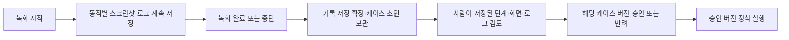
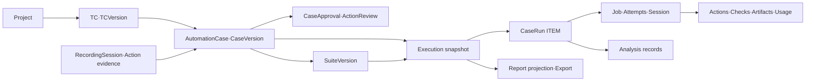

# AI QA 플랫폼 UI 설계 v0.3

개정일: **2026-10-31 (Asia/Seoul)** · 상태: 검토용 설계, 제품 코드 미구현.

기준: 첨부 `AI_QA_UI_design.md`와 후속 사용자 설명. [DESIGN.md](DESIGN.md)는 중심 설계, [RESEARCH.md](RESEARCH.md)는 공개 엔진 근거, [IMPLEMENTATION_PLAN.md](IMPLEMENTATION_PLAN.md)는 구현 준비 문서다. [v0.2 UI](docs/history/v0.2/UI_SPEC.md)는 보관했다. 아래 화면/API는 제안 플랫폼 계약이며 현재 엔진에 이미 있는 제품 기능이 아니다.

## 1. 검토 결론과 저장·승인 순서

기존의 단일 ‘테스트’ 자산을 **TC와 자동화 케이스로 분리**한다. 프로젝트 안에서 TC를 작성하고, AI 수행을 녹화 기록으로 먼저 보관하며, 저장된 케이스를 독립적으로 실행·묶음 구성·리포트 분석한다. 기존 엔진/로컬 실행/QA 원칙은 유지한다.

**사용자가 명확히 정한 흐름:**



**녹화 중 승인 버튼·승인 대기 정지는 없다. 승인은 저장의 선행 조건이 아니다.** 정상·실패·중단·미완성 기록도 먼저 보존한다. 저장된 초안은 승인 전에도 조회·편집·복제·시범 실행이 가능하다. 승인은 그 버전을 정식/회귀 실행에 사용하도록 허용하는 절차다.

| 첨부 초안 검토 항목 | 채택/보완 결정 |
|---|---|
| TC/케이스/녹화/수행/리포트 분리 | 채택. ID·버전·화면·데이터·API를 각각 연결 |
| 녹화 의미 | AI 수행의 동작·변수·검증·화면/로그 기록. 영상/무모델 코드 재생과 동일시하지 않음 |
| 수동 조작 녹화·pause | 엔진 지원 미확인으로 후속. 작동하는 버튼으로 노출하지 않음 |
| 동작별 확인 | 탭·스와이프 등 전후 PNG·로그를 저장한 뒤, 완료 후 검토 화면에서 사람이 확인 |
| 저장과 승인 | 불완전 기록도 저장. 부족한 증거는 승인만 차단 |
| 마지막 재시도 결과 | 첫/마지막 시도는 함께 표시하되, 확인된 필수 검증 실패를 후속 PASS로 덮지 않음 |
| 7개 리포트 결과 | QA 판정 4종과 실행 disposition을 분리하고 중복 없는 display_result로 집계 |
| 내보내기 | CSV·인쇄 가능한 HTML을 MVP, PDF 생성·예약 배포는 후속 |

## 2. 관리 단위·버전 연결

| 단위/표시 ID | 의미·기록 규칙 |
|---|---|
| 프로젝트 SHOP | 제품별 공간. 하위 ID를 알아도 다른 프로젝트 권한으로 조회 불가 |
| TC-104 / TC 버전 | 무엇을 검증할지: 원문·목적·조건·단계·기대 결과. 자동화 없이도 저장 |
| AUT-041 / 케이스 버전 | 어떻게 실행할지: 주 TC 버전·단일 대상·동작/변수/검증 binding·engine/model/config manifest |
| REC-018 녹화 세션 | 생성 중 실제 동작·관찰 원본. 실패·중단도 보존, 정식 통계와 분리 |
| SUITE-01 / 구성 버전 | 정확한 승인 AUT 버전·데이터·순서·환경. 새 승인 버전 자동 추종 금지 |
| RUN-012 테스트 수행 | 단일 1개/선택 N개/묶음 N개를 모두 담는 새 수행과 snapshot |
| ITEM-012-1 케이스 실행 | 케이스 버전×데이터 행×대상 조합 하나. job/attempt/동작·증거 연결 |
| 리포트 | RUN을 집계하는 화면. 수정 가능한 정답 사본이 아님 |

한 TC에는 여러 Web/Android AUT를 연결할 수 있고, 한 AUT의 주 TC는 하나다. TC는 양쪽 대상을 지원할 수 있으나 AUT 버전은 한 대상만 실행한다. **TC 없이 시작한 REC도 먼저 저장**한다. 완료 후 기존 TC 연결/최소 TC 생성으로 AUT draft를 만든다. 연결/검증 부족은 준비 필요이지 REC 저장 금지 사유가 아니다.

TC 의미 변경은 새 TC 버전이다. 기존 AUT는 원래 TC 버전을 유지하며 승인 상태와 별도로 `TC 변경 확인 필요`를 표시한다. 기본 current 실행은 차단하고 새 AUT 버전에서 TC 연결 갱신→시범→승인을 요구한다. 과거 재현은 `reference_policy=historical`과 사유를 남겨 별도 허용하되 최신 TC 검증 비율에 포함하지 않는다. 분류용 제목/태그/폴더/담당자 변경만으로 의미 변경을 만들지는 않는다.

기존 케이스 연결은 같은 프로젝트·주 TC에 한정한다. 다른 TC용 절차 재사용은 새 AUT ID/draft 복제다. 승인·실행 이력을 복제하지 않는다. REC 원본은 수정하지 않고 케이스 변경은 새 버전으로 저장한다. 기존 화면은 ‘수정 전 녹화 증거’로 표시하고 새 trial을 요구한다.

## 3. 정보 구조·공통 상태

전역: 프로젝트 목록/전체 연결/공통 설정. 프로젝트 메뉴: **개요 / TC 관리 / 녹화 케이스 / 테스트 묶음 / 테스트 수행 / 리포트 / 실행 환경 / 프로젝트 설정**. 검토 대기·미완성 REC는 녹화 케이스 탭, 기기·앱 빌드·데이터는 실행 환경 탭으로 묶는다.

상단은 프로젝트 전환·breadcrumb·프로젝트 검색·‘이 PC’ 연결 상태다. 데스크톱 1440px 기준으로 목록은 밀도 높은 테이블, 편집·증거는 전체 폭 작업 공간이다. 1024px에서는 보조 패널을 접되 ID·대상·버전·판정·핵심 버튼은 유지한다. 색 외 상태 문구/아이콘, 키보드 탐색·focus·읽을 수 있는 오류를 제공한다.

| 상태 | UI·조작·복원 규칙 |
|---|---|
| 빈 데이터 | 첫 프로젝트/TC/녹화 안내. 예시 성과를 실제 수치로 표시하지 않음 |
| 로딩 | 기존 값·갱신 시각 유지, 중복 제출 비활성 |
| 입력 오류 | 422 필드 오류·입력 보존. 비밀 원문을 응답/브라우저 저장에 재노출하지 않음 |
| 연결 끊김 | stale·마지막 수신·로컬/서버 보관 구분. mutation 자동 반복 금지 |
| 권한 부족 | 403·읽기 가능 범위. 서버도 project scope 확인 |
| 미저장 편집 | 저장/버리기/이동 취소. 미저장 내용의 재접속 복원은 보장하지 않음 |
| 동시 수정 | expected revision/If-Match 불일치 409·서버본 비교 후 새 버전 |
| 실행 불가 | 미승인/TC 변경/미지원/기기·앱·변수 사유와 조치 링크. 조용히 제외하지 않음 |
| 증거 누락·만료 | 동작/원인/보관 기간·재검증 안내. 빈 화면·성공 추정 금지 |

목록→상세→뒤로가기는 filter/sort/page/scroll을 유지한다. ID는 링크/복사 가능하다. 새로고침은 서버 snapshot과 URL selected item/action을 읽고 job을 다시 만들지 않는다. 승인/실행 snapshot은 읽기 전용이며 수정은 새 draft다. 관리 탭 종료는 녹화/수행 취소가 아니다. PC 종료·절전 중 지속 실행/자동 재개는 보장하지 않는다.

## 4. 화면별 명세·와이어프레임

아래 경로는 UI route다. 각 조작의 API/저장·worker 연결은 §7–8을 따른다. 저장/승인/정식 실행은 별개 버튼·상태다.

### UI-01 프로젝트 목록·생성

`/projects`. 이름/키/설명/대상, TC 수, 유효 승인 자동화 연결 TC 수, 진행 수행/검토 대기, 마지막 수행의 범위·결과를 표시한다. 생성·검색·활성/보관 필터·열기를 제공한다. 이름·고유 key·대상 필수, 중복 key는 409다. 생성 후 UI-14 환경 준비로 안내한다. 보관은 진행 REC/RUN 종료·취소/정리를 먼저 처리한 뒤 허용하고 이력은 읽기 가능하다. 보관 복구도 감사 기록을 남긴다.

### UI-02 프로젝트 개요

`/projects/{p}`. 미완성 REC/검토 대기 AUT/TC 변경 영향/미분류 실패, 진행·대기 수행, 최근 결과, 실제 연결 차단 사유를 보여준다. TC 작성/새 녹화/승인 케이스 실행/묶음 실행은 해당 화면으로 이동한다.

자동화 연결 비율은 선택 대상의 활성 TC 중 **현재 TC 버전과 맞는 유효 승인 AUT가 1개 이상인 TC 수 / 활성 TC 수**다. TC 중복 집계와 전체 제품 커버리지 표현은 금지한다. 분모 0은 산출 불가다.

### UI-03 TC 목록 — 와이어프레임 1

```text
+ SHOP / TC 관리 ------------------------------------------------+
| [TC 만들기] 검색 [ID·이름·태그       ] [검색] [필터 초기화]      |
| 대상[전체] 담당자[ ] 자동화[ ] 최근 결과[ ] 환경[ ]              |
+ 기능 폴더 ----+------------------------------------------------+
| 로그인        | 선택 TC ID   제목    버전 자동화       최근 결과  |
| 장바구니      | [ ] TC-104  로그인   v2   영향 확인   FAIL/QA앱   |
| 주문          | [ ] TC-105  로그아웃 v1   없음        실행 없음  |
|               | [컬럼 설정] [정렬] [이전] [다음]                |
+---------------+------------------------------------------------+
| 선택 2 [자동화 만들기] [연결 케이스 선택·실행] [보관]            |
+----------------------------------------------------------------+
```

컬럼은 ID/제목/폴더/대상/우선순위/담당자·태그/TC 버전/연결 AUT 수·유효성/최근 결과·환경·빌드·일시/수정일이다. 컬럼 선택·검색·필터·cursor paging을 제공한다. 생성/상세/복제/폴더 이동/태그·담당자 변경/보관은 자산 API와 연결한다. 선택 TC 실행은 연결된 승인 AUT 선택으로 이동하고 자동화 없는 TC도 제외 사유 목록에 남긴다. 사용자가 확인하기 전 임의 제외하지 않는다. TC CSV 가져오기는 후속이다.

### UI-04 TC 작성·상세 — 와이어프레임 2

```text
+ SHOP / TC-104 정상 로그인 / v2 -------- [새 버전] [복제] -------+
| [정의] [연결 자동화 2] [실행 이력] [변경 이력]                  |
+-----------------------------------------+-----------------------+
| 원문 [                           ]      | 대상·폴더·태그        |
| [AI로 단계 정리] [제안 diff 확인]        | 담당자·우선순위       |
| 목적/사전조건/데이터·비밀 참조           | 준비 상태             |
| 단계 | 수행 내용 | 기대 결과 | 필수     | AUT-041 v1            |
| 1    | 로그인    | 사용자명 표시 | 예   | TC 변경 확인 필요     |
| [단계 추가/복제/삭제/위로/아래로]        | [자동화 만들기]       |
+-----------------------------------------+-----------------------+
| 미저장 변경 [초안 저장] [저장된 TC로 녹화 시작]                  |
+----------------------------------------------------------------+
```

목적·사전 조건·data/secret ref·초기화/정리·단계/필수 기대 결과를 편집한다. 자동화/검증이 없어도 TC draft 저장은 허용하고 readiness로 알린다. AI 구조화는 적용 전 diff 확인·직접 편집 가능한 제안이다. 저장은 append-only TC revision이다.

연결 자동화 탭은 AUT/버전/연결 TC 버전/승인·유효성·최근 결과와 새 녹화/기존 연결/단독 실행을 제공한다. 이력은 REC/trial/정식을 구분하고 과거 실행을 현재 TC 검증으로 표시하지 않는다. 이전 내용 복구는 새 revision이다.

### UI-05 녹화 시작·진행 — 와이어프레임 3

```text
+ SHOP / REC-018  AI 수행 기록  상태: 녹화 중 ---------------------+
| TC-104 v2 / Android / 이 PC·기기A / QA앱 v12                     |
+ TC 목표·단계 --+------------------------+-----------------------+
| S1 계정 입력   | 마지막 화면 미리보기   | A001 탭       저장됨  |
| S2 로그인 탭   | [원본 비율·확대]       | A002 입력     저장됨  |
| C1 사용자명    | 마지막 수신 1초 전     | A003 스와이프 전송 중 |
+----------------+------------------------+-----------------------+
| 기록3 / 서버 보관2 / 전송 대기1 / 증거 오류0                    |
| [메모 추가] [녹화 완료] [중단]                                   |
| 승인 기능 없음. 기록은 먼저 저장하며 완료 후 검토합니다.        |
+----------------------------------------------------------------+
```

시작 설정은 project/선택 TC 버전/이름/단일 대상/환경·기기·빌드/계정·data/목표·기대/reset/한도다. AI 기록만 활성이다. worker·권한·점유·모델·대상 preflight 뒤 멱등 요청으로 REC/job을 만든다.

녹화 중 **각 동작 전후 PNG·실행 로그는 승인 없이 계속 저장**한다(§5). 목표 수정/승인/정식 실행 버튼은 없고 메모는 append-only다. 완료는 새 행동 중지→기록 flush/정리→보관 확정이다. 중단/단절/비정상 종료도 수집 기록을 보존한다. 저장을 버릴지 승인자에게 묻거나 반려 시 폐기하는 흐름은 없다.

완료 후 저장된 AUT draft의 UI-07로 이동한다. TC 미연결은 REC 저장 완료 화면에서 TC 연결/최소 생성 후 AUT draft를 만든다. 서버 ACK 전에는 ‘이 PC 임시 보관·서버 전송 대기’이며 저장 완료/승인 가능으로 표시하지 않는다. 녹화 중 사람이 동작을 승인해야 다음 행동/저장을 하는 구조가 아니다.

### UI-06 녹화 케이스 목록

`/projects/{p}/cases`. 전체/실행 가능/초안/검토 대기/TC 변경 확인/미완성 REC/보관 탭. AUT ID·이름·TC/TC 버전·대상/태그·최신 draft/현재 approved·생성 방식·동작 수·모드·유효성·최근 정식 결과/환경/빌드/일시를 표시한다.

새 녹화/편집/시범/단독·선택 실행/묶음 추가/복제/보관을 제공한다. draft v4와 approved v3가 있으면 정식 기본 실행은 v3임을 명시한다. 미승인/TC 변경/비호환은 차단 사유를 표시한다. 승인 전 기록도 조회 가능하다. 미완성 REC는 중단 원인/원본 증거·새 녹화로 이동하며 이전 프로세스를 재개하지 않는다.

### UI-07 케이스 편집·완료 후 검토·승인 — 와이어프레임 4

```text
+ SHOP / AUT-041 v2 / TC-104 v2 / 저장됨·미승인 -------------------+
| [단계] [입력·설정] [시범 결과] [저장 기록 검토] [버전 이력]    |
+ 단계·동작 -----+------------------------+-----------------------+
| S1 A001 탭     | 동작 전 PNG / 후 PNG   | 의도·실제 명령        |
|    검토함      | [맞춤][100%][확대]     | 좌표/스와이프 경로    |
| S1 A002 입력   | 캡처 시각·해상도       | 전달/화면/검증        |
|    미검토      | 마스킹·근거 ID         | 로그·오류·재시도      |
| S2 A003 탭     |                        | [검토함][수정 필요]   |
+----------------+------------------------+-----------------------+
| REC 완료·저장됨 / 필수 증거6/6 / 현재 trial PASS / 검토2/3      |
| [새 초안 저장] [시범 실행] [검토 요청]                           |
| 의견 [          ] [승인: 미검토1건으로 비활성] [반려]            |
| 저장은 이미 완료됨. 승인 대상은 AUT v2입니다.                  |
+----------------------------------------------------------------+
```

좌측 step/action, 중앙 편집 또는 전후 캡처, 우측 명령·기대/관찰·검증·오류, 하단 로그를 쓴다. 탭은 단계/입력/설정/시범/저장 기록 검토/이력이다. 좌표·locator·생성 코드는 고급 상세이며 engine capability 없는 편집 기능은 제공하지 않는다.

추가/삭제/복제/정렬·변수화·검증 변경은 새 draft로 저장한다. 증거/검증 부족도 저장하며 needs_review다. REC 원본은 불변이다. 새 trial은 현재 exact manifest의 별도 수행이고 자동 승인하지 않는다.

**검토는 녹화 완료·서버 보관 확정 이후에만** 한다. action별 전후 PNG/로그·오류/우회/검증을 보고 `reviewed/needs_change/evidence_missing`을 남긴다. 검토 표시는 QA 판정을 수정하지 않는다. 필수 근거/동작 검토 누락, TC 미연결/변경, 현재 PASS trial 없음, 다른 hash/오래된 증거는 승인 차단이다. 승인/반려는 actor/time/reason·version/evidence digest에 결합한다. 수정하면 이전 review/approval을 자동 복사하지 않는다. 반려해도 저장된 기록은 유지하고 새 수정본으로 이어진다.

### UI-08 테스트 묶음 목록·편집

`/projects/{p}/suites`. 묶음 ID/이름/설명/대상/구성 수/담당자/최근 수행/수정일. 왼쪽 승인 AUT 검색, 오른쪽 순서/정확한 AUT·TC 버전/data/환경/준비 상태다. 추가/제거/정렬/복제/기본 환경·continue/stop 정책/초기화·데이터 행/저장/실행/이력을 제공한다.

새 approved 버전은 업데이트 가능·diff만 표시하고 명시 교체·새 suite revision을 요구한다. 같은 AUT의 다른 data는 행 이름으로 구분한다. mixed는 대상별 자원 필수·순차이며 다른 항목의 로그인/데이터에 암묵 의존하지 않는다. 분기/병렬 의존성은 후속이다. 실행/제외 확인은 UI-09다.

### UI-09 수행 생성·실행 설정 — 와이어프레임 5

```text
+ SHOP / 새 테스트 수행 -----------------------------------------+
| 1대상 확인 → 2환경·데이터 → 3사전 점검 → 4최종 확인            |
| 이름[로그인 회귀] 목적[정식] 릴리스[선택]                       |
+------------------------------------+---------------------------+
| AUT-041v2 / TC-104v2 / data-A       | Android: 이 PC·기기A       |
| AUT-052v1 / TC-105v1 / data-B       | 요청앱v12 / 설치앱v12      |
| 차단1: TC-106 자동화 없음          | 초기화 없음·시간/비용 한도 |
| [제외 목록/사유 확인]              |                           |
+------------------------------------+---------------------------+
| 선택3 / 확정 실행2 / 명시 제외1 [이전] [취소] [새 수행 시작]    |
+----------------------------------------------------------------+
```

단일/선택/묶음/재실행 공통4단계다. exact TC/AUT/data/env revision·요청/실제 build·모드·한도/reset·failure policy·원본 수행/사유를 확인한다. busy는 점유 링크+대기 등록/돌아가기다. preview는 자원 예약이 아니며 claim 직전 재검사한다.

변수·승인·TC 변경·모델/정책 오류는 차단한다. 일부 제외는 항목/사유 확인 후 snapshot에 남기며 조용히 빼지 않는다. 시작은 Idempotency-Key로 RUN을 1개 만들고 UI-10으로 이동한다. 이후 편집은 snapshot을 바꾸지 않는다. 시범/정식 항목은 같은 RUN에 섞지 않는다.

### UI-10 수행 목록·진행 현황

`/projects/{p}/executions`, `/executions/{e}`. 대기·진행/완료/전체 탭, RUN ID·이름/purpose·출처/요청자/환경·빌드/진행/종료 수·PASS 수/분포/시각·기간. 상태·결과·기간·환경/build·suite/TC/AUT·작업자·trial/정식 필터다.

진행 상세는 좌측 ITEM 목록·중앙 현재 케이스/화면·우측 최신 이벤트/연결·상단 종료 수/전체/경과/자원이다. 완료 수와 PASS 수는 별도다. 상세/취소/리포트/같은 구성 새 실행을 제공하고 취소 요청/정지/정리를 구분한다. ITEM 취소는 완료 결과를 바꾸지 않으며 stop 정책을 적용한다. 수신 시각·stale·재접속 복원이 보인다.

### UI-11 케이스 실행 상세·실패 분석 — 와이어프레임 6

```text
+ SHOP / RUN-012 / ITEM-1 / TC-104v2 / AUT-041v2 / attempt1 -------+
| 진행 completed | QA FAIL | 분석 미분류 | 실제 기기·빌드         |
+ 단계·동작 -----+------------------------+-----------------------+
| S1 A001 탭     | 동작 전 / 동작 후      | 의도·실제 명령        |
| S2 A003 FAIL   | [맞춤][100%][확대]     | 전달 성공             |
| [첫 실패로]    | 캡처 시각/증거 상태    | 기대≠관찰 → FAIL     |
+----------------+------------------------+-----------------------+
| [로그] [설정] [시도·복구] [근거] [분석 메모]                    |
| 분류[제품/자동화/환경/데이터/미분류] 담당자[ ] 이슈URL[ ]        |
| [분석 저장] [새 수행으로 재실행] [새 버전/재녹화]                |
+----------------------------------------------------------------+
```

정확한 TC/AUT/attempt/data/env/build/engine/model을 고정 표시한다. 목표 step 안의 실제 탭·스와이프 등을 펼친다. fit/100%/zoom/pan/전체 보기·전후/이전다음/첫 실패로 이동과 action별 로그/시도를 연결한다. 근거는 실제 대상 캡처의 마스킹 보관본이며 모델 렌더 요약이 아니다.

분석 상태(unclassified/in_progress/resolved)와 분류(product/automation/environment/data/unclassified)는 QA/진행과 별개다. 담당자·메모·외부 issue URL은 append-only다. 정정 의견은 원본 판정 옆에 표시하고 통계를 덮지 않는다. 외부 이슈 자동 생성은 후속이다. 영상은 수집된 경우만 탐색 링크, MVP는 PNG/로그다.

### UI-12 리포트 목록·수행 리포트 — 와이어프레임 7

```text
+ SHOP / RUN-012 리포트 [CSV] [인쇄용 HTML] [새 재실행] ----------+
| 목적·버전·data·환경·요청/실제 build·기간·요청자                 |
| 상태 completed | 실패 포함 + 검증 미완료 | 중간 보고 여부       |
+----------------------------------------------------------------+
| 총10 / PASS6 FAIL2 BLOCKED1 NOT_RUN1 / 나머지0 / 진행0           |
| 완료100% | 검증 통과75% | 전체 대상 대비 통과60% | 미검증2      |
| 확정 전 제외1 / 미분류 실패2                                   |
+----------------------------------------------------------------+
| TC/AUT·data | 결과 | 첫/마지막 시도 | 실패 단계 | 근거          |
| [결과 필터] [선택 항목 새 수행] [비교]                          |
+----------------------------------------------------------------+
```

단일1개 RUN도 같은 리포트다. 범위/분포/미검증 사유·실패 근거/분석·issue/실제 설정/계측 범위·증거 보관/재실행 원본을 제공한다. REC는 정식 통계에 없고 trial은 기본 제외다. 진행 export는 중간 보고서·as_of를 표시한다.

CSV는 목록, HTML은 인쇄용 보고서로 생성 시각/RUN/snapshot/집계 기준을 포함한다. secret/hidden reasoning 제외·CSV 수식 안전화를 적용한다. PDF/예약 발송은 후속이다. localhost 링크가 외부에서도 열린다고 표시하지 않는다. 집계는 §6을 따른다.

### UI-13 수행 비교·케이스 이력

기준/비교 RUN을 선택하고 같은 AUT·data·대상 기준으로 변화/지속 실패/추가·제외를 정렬한다. TC/AUT/env/build/data가 다르면 먼저 조건 차이를 보여준다. 단계/PNG/기대·관찰/시간·비용은 나란히 확인한다. 최초 실패·새 재실행 통과/작은 표본의 변동 이력을 함께 표시하고 다른 조건을 자동 개선/회귀 결함으로 확정하지 않는다.

### UI-14 실행 환경·기기·앱 빌드·데이터

환경/연결/기기/앱 빌드/데이터 탭. 초기 위치는 이 PC다. installed package 기본 선택, 선택 APK 해시/버전·OS/ABI 검사·명시 설치, 권한/offline/busy/quarantine·조치, worker/browser·시각을 표시한다. 설치/초기화/logout은 영향/대상을 명시 확인하며 매 수행 재설치를 강제하지 않는다.

data는 이름/version/schema·행·케이스 연결/유효성·secret refs를 관리하고 행 값은 수행 snapshot에 고정한다. key 원문은 읽기 응답에 없다. 진단/설치는 관리 job이고 QA PASS를 만들지 않는다. 클라우드·직접 조작·pause/resume 미지원 버튼은 제공하지 않는다.

### UI-15 프로젝트 설정·활동 이력

project·폴더/태그·기본 제한/보관·실패 정책, model/key ref·비용 안내 연결 확인, worker 범위, 공간/삭제 예정, TC/AUT/묶음/검토/녹화/수행/환경 변경 이력을 제공한다. 개인형은 한 사람이 작성·승인할 수 있으나 actor/time을 남긴다. 팀 role/SSO는 후속 필요에 맞춘다. 진행 작업이 있으면 보관 전 종료/취소·정리를 안내한다.

## 5. 동작별 기록·저장·완료 후 승인 계약

### 5.1 각 동작의 증거

S1 안에 탭 A001·입력 A002·스와이프 A003이 있으면 **action3개와 각각의 PNG/로그**를 만든다. 목표 step 대표 화면 하나로 대체하지 않는다. trusted action executor가 계측하며 모델의 완료 보고/stdout 분석만으로 성공을 만들지 않는다.

| 필드 | 내용 |
|---|---|
| ID/시간 | project·REC 또는 ITEM·attempt·step·action·local_seq, 명령 시작/반환·전후 캡처 시각·duration |
| 의도/행동 | 목표 요약·type·대상/locator/label·실제 tap 좌표 또는 swipe start/end/duration |
| 좌표/입력 | 원본·모델 해상도/rotation/transform, 비밀값 대신 변수·ref |
| 로그 | 정제 tool request/result·exit/timeout·관찰·오류·retry/우회/원래 실패 연결 |
| 전 PNG | 실제 명령 직전 artifact ID/hash·캡처 metadata·마스킹 정책 |
| 후 PNG | 명령 반환 후 현재 화면/승인 상태 대기 뒤 화면·각 캡처 시각·action ID |
| 결과 분리 | command delivered/rejected/error, 화면 observed/unknown, check satisfied/violated/unknown/not_run |
| 증거 상태 | ready/pending/missing/expired/redacted·지연 캡처·오류 사유 |

tap/click, swipe/scroll, type, long press, back/home, 앱 실행/페이지 이동, 명시 wait에 적용한다. reset/install은 setup 이벤트/로그로 연결한다. 실패한 명령도 오류/전 PNG·가능한 후 PNG를 남긴다. 모델 timeout·거부 proposal은 실행 안 한 관찰/오류 이벤트이며 fake action이 아니다. 복합 호출을 하위 action으로 계측할 수 없으면 해당 recorder capability를 승인 가능으로 광고하지 않는다.

전 캡처 불가면 새 action을 실행하지 않고 사유를 저장한다. 후 캡처 실패는 이미 동작했을 수 있어 재관찰/불명 상태를 기록하며 무조건 재동작하지 않는다. 지연 캡처를 즉시 후 화면으로 바꾸지 않는다. 이 경우도 **REC/로그/미완성 AUT 저장은 허용**하고 필수 근거가 완성된 새 trial 전 승인을 차단한다. swipe 중간 프레임/영상은 후속, 전후 PNG·경로/duration은 MVP다.

### 5.2 저장 수명·출처

정제 action record는 local journal/spool에 먼저 쓰고 server event/artifact ACK를 받는다. 전송/디스크 전에 화면/로그·입력/DOM을 마스킹한다. 비밀값 있는 원본 PNG를 임시 파일로 먼저 저장하지 않는다. 같은 seq/hash 재전송은 중복 추가하지 않는다. REC 완료 manifest는 artifact/check/hash를 연결한다. hash는 보관 변조/혼합 검출용이며 화면 정답 보장은 아니다.

녹화 단계는 `created→queued→preparing→recording→stopping→storing→stored`다. 중단/오류는 termination_reason을 남기고 가능한 기록을 storing→stored로 보존한다. server 미접속은 storing·로컬 보관/전송 대기다. 녹화 저장 상태와 AUT review status는 별개다. 녹화 중 승인·자동 폐기·반려 시 삭제를 하지 않는다.

정상 finish는 REC를 seal하고 TC가 있으면 AUT draft/source manifest를 **자동 저장**한다. 저장 초안은 목록에 즉시 나타난다. 증거 누락/미연결 TC/불완전 검증은 readiness이며 REC 보존을 막지 않는다. 중단본도 보존하고 후속 새 녹화/편집으로 이어간다.

저장 장치 자체 장애·용량 부족에는 수집하지 못한 파일을 저장했다고 표시하지 않는다. 마지막 보관 성공 범위와 실패 사유를 남긴다. 원본 job이 lost/terminal인 뒤 local spool이 돌아오면 새 제어 lease를 주지 않고 **별도 evidence_sync 작업으로 읽기 전용 업로드**한다. 이전 job terminal/QA는 변경하지 않고 REC의 복구 보관 revision·출처를 추가한다. artifact/digest가 바뀌면 새 source manifest와 검토가 필요하다. 복구할 수 없는 필수 source PNG/로그는 evidence_missing이며 새 녹화를 안내한다.

### 5.3 저장 후 검토·승인

검토 대상은 **sealed REC 출처의 저장 AUT version + 같은 manifest의 완료 trial evidence**다. 원본 탐색/실패/제외 행동도 볼 수 있고 canonical에서 제외한 사유를 남긴다. 필수 동작에 매핑한 source action과 해당 trial의 실제 행동 전후 PNG/로그·policy/QA 근거를 확인한다. 출처 REC와 현재 trial은 각 ID로 구분한다.

review record는 reviewer/time/comment, case_version_hash/source_recording_digest/trial_evidence_digest, action별 reviewed 상태를 저장한다. 녹화 recording/storing, 필수 PNG/로그 missing/pending, 미검토/needs_change, TC 불일치, trial non-PASS는 승인 비활성이다. 반려해도 보관 유지, 수정 후 이전 review/approval 자동 복사 금지다. 검토 중 manifest/evidence가 바뀌면409·새 검토다. 승인 근거는 pin하며 공간 부족이면 새 작업을 차단·안내한다.

검토 화면은 `출처 REC`와 `현재 trial ITEM` 범위 선택을 제공하고 각 범위의 검토/증거 개수를 따로 표시한다. action_review의 key는 `(case_version_id, evidence_owner_kind, evidence_owner_id, attempt_id, action_id, evidence_digest)`다. case version의 required_action_ids는 source REC의 canonical 매핑 ID이고, trial의 실제 action IDs는 trial evidence manifest에 둔다. 서로 다른 실행에서 같은 A001 문자열을 사용해도 검토가 섞이지 않는다. 녹화 원본의 탐색·실패·제외 동작은 숨기지 않으며 canonical에 포함하지 않은 사유를 보여준다.

승인 전 trial은 허용, **정식/회귀는 승인된 유효 버전만** 허용한다. 이후 실행도 동작별 증거/현재 QA를 다시 수집한다. 과거 승인/PASS 화면은 새 실행 근거가 아니다.

## 6. 상태·결과·리포트 집계

| 축 | 채택 상태/의미 |
|---|---|
| TC readiness | draft/ready/archived. 자동화·PASS와 별개 |
| AUT review | draft/needs_review/review_pending/approved/rejected/revoked + asset archived |
| AUT validity | valid/tc_changed/environment_incompatible/unsupported |
| 저장 | local/spooling/stored. 승인 여부와 무관 |
| job 진행 | queued/preparing/running/cancel_requested/finalizing/completed/error/cancelled/lost |
| 부모 RUN 진행 | queued/running/cancel_requested/completed/cancelled/error. 모든 ITEM terminal 후 확정하며 부모 자체가 기기 lease를 소유하지 않음 |
| QA verdict | PASS/FAIL/BLOCKED/INCONCLUSIVE 또는 null |
| item disposition | executed/skipped/cancelled/not_run. terminal에서 확정 |
| display_result | terminal ITEM의 PASS/FAIL/BLOCKED/INCONCLUSIVE/SKIPPED/CANCELLED/NOT_RUN 중 하나 |
| 분석 | unclassified/in_progress/resolved + product/automation/environment/data/unclassified |

진행 ITEM은 display_result=null·진행 bucket 하나다. terminal 변환은 ①유효 필수 violation 있으면 FAIL ②그 외 skipped/cancelled/not_run이면 해당 결과 ③그 외 executed의 QA verdict다. 취소 직전 이미 FAIL이면 주 결과 FAIL+취소 badge이며 CANCELLED에 중복 집계하지 않는다. 환경 준비 문제는 BLOCKED, 관찰 근거 부족은 INCONCLUSIVE다. 의도적 skip은 미시작 ITEM만 사유와 함께 SKIPPED, policy stop은 NOT_RUN, 사용자 취소는 CANCELLED다.

REC·structure/설치/진단/model check/export job은 **모든 종료 경로에서 QA verdict=null**이며 정식 분모에 없다. 공통 timeout/lease lost/finalize도 purpose를 분기한다. trial/정식 case_run만 QA를 집계한다.

N은 실행 확정 ITEM 수다. 확정 전 제외는 항목/사유/요청자의 exclusions로 남기고 N에서 뺀다. 확정 후 SKIPPED/CANCELLED/NOT_RUN은 N에 포함한다. **7개 terminal 결과+진행 bucket=N**이다.

- 완료율=terminal/N. 통과율이 아니다.
- 검증 통과율=PASS/(PASS+FAIL), 분모0이면 산출 불가. 미검증 수를 바로 옆에 표시한다.
- 전체 대비 통과=PASS/N. N=0 접수는 거부한다.
- 미검증=BLOCKED+INCONCLUSIVE+SKIPPED+CANCELLED+NOT_RUN, 진행은 별도다.
- 예: N10, PASS6/FAIL2/BLOCKED1/NOT_RUN1이면 완료100%·검증통과75%·전체통과60%·미검증2다.

MVP는 모든 ITEM 필수다. 모두 PASS만 전체 검증 통과, FAIL 포함/미검증 존재는 두 안내를 함께 표시한다. 부모 verdict는 FAIL→BLOCKED→INCONCLUSIVE→전부 PASS이며 status와 별개다.

모델 retry/action 재탐색/전체 attempt retry는 구분한다. 기본 전체 attempt 자동 retry는0이다. 향후 허용해도 reset/side effect 안전성·승인 정책이 필요하다. first/latest attempt 결과를 함께 보존하고 **같은 ITEM의 유효 필수 violation은 latch해 최종 FAIL**을 유지한다. 마지막 PASS만으로 바꾸지 않는다. 사용자 재검증은 새 RUN/ITEM이며 원본 실패→새 수행 통과를 연결한다. 사람 이의 의견도 원본 자동 집계를 바꾸지 않는다.

## 7. 데이터·API·워커 — v0.3 규범 계약

### 7.1 MVP 관계



| 저장 단위 | 필드/결정 |
|---|---|
| projects/environments/resources/workers | 기존 책임·환경 revision·lease·inventory·app_build 유지 |
| tcs/tc_versions | 분류 metadata와 immutable 원문/intent/expected, draft는 검사 없어도 저장 |
| automation_cases/case_versions | 주 TC·draft/approved pointer; version은 tc_version/target/steps/check bindings/REC·manifest/hash 불변 |
| recording_sessions | project·선택 TC/source case·job·저장/종료 상태·sealed digest·중단·draft ref. 미연결도 보존 |
| approvals/action_reviews | exact case/source/trial digest·동작 검토·승인/반려/revoke·actor/time/reason |
| suites/suite_versions | exact case/TC version·data row/version·순서·defaults·failure policy의 불변 JSON |
| executions | RUN·single/selection/suite/rerun·trial/regression/reverification·이름/릴리스/요청자·item/exclusion snapshot·parent status/summary |
| case_runs | ITEM·execution·entry/data/target·case/TC version·job·원본rerun·verdict/disposition/display_result·first/latest attempt·violation latch |
| jobs/attempts | queue/lease/status·purpose별 payload·IPC/session. REC/관리 job도 사용하며 case_run FK는 선택 |
| actions/events/check_results/artifacts/model_calls | job/attempt·REC 또는 ITEM에 연결. REC도 관찰/check는 남기지만 정식 집계 제외 |
| datasets/dataset_versions | schema·행 JSON·secret refs, exact row/version/hash snapshot |
| analysis_records/audit_log | 분석/이의 의견·담당자/issue·actor/time, 원본 판정과 분리 |

report는 별도 수동 결과 테이블이 아니라 execution+ITEM projection이다. CSV/HTML만 as_of/criteria_version/snapshot hash artifact로 저장한다. folder/tag/settings·작은 suite/data 행은 JSON으로 합친다. **jobs를 별도 저장 단위로 분리**하여 REC/관리 작업과 ITEM 생명주기를 구분한다. v0.2의 runs=job 단일 테이블 계약을 교체하며 실제 migration은 이번에 수행하지 않는다.

### 7.2 API·조작 추적

prefix는 `/api/v1`. project scope/role·CSRF/worker auth·cursor(기본25/최대100)/필터·정렬 whitelist·If-Match·멱등성/오류 계약은 DESIGN을 따른다. 아래가 기존 `/tests`, `/runs`, `/suite-runs`의 **대체 계약**이며 두 체계를 동시에 구현하지 않는다.

| 화면/조작 | 제안 API | 저장·worker 책임 |
|---|---|---|
| UI01/02 project·개요·보관/복구 | projects GET/POST/PATCH, overview GET, archive/restore POST | scope/집계/진행 작업 점검·보관 mutation 차단 |
| UI03/04 TC CRUD·버전·복제/분류 | projects/{p}/tcs GET/POST, tcs/{tc} GET/PATCH, clone/archive POST, versions GET/POST, diff GET | TC revision·metadata·AUT impact |
| UI04 AI 구조화 | tc-versions/{v}/structure POST | 관리 job·새 제안 TC revision만 |
| UI06/07 AUT 목록·초안·복제/연결 | projects/{p}/cases GET/POST, cases/{c} GET, clone/archive POST, versions GET/POST, diff GET | exact 주 TC/source·draft 저장·capability 검사 |
| UI05 녹화 시작/동작 조회 | projects/{p}/recordings POST, recordings/{r} GET, recordings/{r}/actions GET | REC/job·action마다 PNG/로그 저장 |
| UI05 완료/중단/메모 | recordings/{r}/finish, /stop, /notes POST | 승인 없이 seal/flush/cleanup·draft 자동 저장 |
| UI05 미연결 REC 연결 | recordings/{r}/case-drafts POST | stored REC→TC 선택/최소 생성+AUT draft, 원본 보존 |
| UI05/07 단절 후 증거 보관 복구 | recordings/{r}/evidence-recoveries POST | worker scope를 확인한 evidence_sync job, 제어 불가·새 보관 revision·기존 QA 불변 |
| UI07 검토/승인·반려 | case-versions/{v}/review-requests, /action-reviews, /approvals, /rejections POST | stored REC·trial digest·동작 review 검사 |
| UI07 승인 취소 | approvals/{a}/revoke POST | 새 정식 claim 차단·진행 취소, 과거/저장본 유지 |
| UI08 묶음/복제 | projects/{p}/suites GET/POST, suites/{s}/versions, /clone, /archive POST | exact AUT·data/defaults·새 구성 hash |
| UI09 preview/수행 | projects/{p}/execution-previews POST, projects/{p}/executions POST | 승인/TC/data/환경·제외 사유 점검, 시작 재검증→RUN/ITEM/jobs |
| UI10/11 수행·ITEM·취소/skip | projects/{p}/executions GET, executions/{e} GET, case-runs/{i} GET, executions/{e}/cancel POST, case-runs/{i}/cancel 또는 /skip POST | 순차·미시작 사유·finalizing race·정리 |
| UI10/12 재실행 | executions/{e}/reruns POST | selected ITEM/사유로 새 RUN/ITEM·원본 불변 |
| UI12/13 report/export/비교 | projects/{p}/reports GET, executions/{e}/report GET, executions/{e}/exports POST, execution-comparisons GET | trial 필터·분모 검증·CSV/printable_html·export job verdict null |
| UI11 분석·이의 의견 | case-runs/{i}/analysis-records GET/POST | 별도 append-only 기록, QA 덮어쓰기 금지 |
| UI14/15 환경/build/data/settings | environments/resources/app-builds/datasets/model-bindings/settings/secret-refs | 기존 진단/설치·versioned data·secret 미반환 |

worker claim/heartbeat/attempt events/artifact/finish는 유지하며 job_id와 선택 recording_id/case_run_id를 받는다. `(attempt_id,local_seq)`·generation/hash fencing을 유지하고 display_result는 서버가 계산한다. 미시작 skip만 원자 terminal 처리, 진행 skip은 거부한다. parent RUN은 모든 확정 ITEM terminal일 때만 terminal이다. failure stop은 남은 ITEM NOT_RUN, 사용자 취소는 CANCELLED다. slot1·정리/quarantine도 유지한다. 보조 job에는 모든 오류/취소/lease lost에서 verdict=null이다.

### 7.3 대표 JSON

**저장된 녹화 동작:**

```json
{
  "recording_id": "REC-018", "attempt_id": "attempt-rec-1", "step_id": "S2", "action_id": "A003", "local_seq": 7,
  "action": {"type": "swipe", "coordinate_space": "device_pixel", "from": [540, 1600], "to": [540, 700], "duration_ms": 600},
  "before": {"artifact_id": "img-before-A003", "captured_at": "2026-10-31T00:10:01.100Z", "state": "ready"},
  "after": {"artifact_id": "img-after-A003", "captured_at": "2026-10-31T00:10:01.950Z", "state": "ready"},
  "log_artifact_id": "log-A003", "command_status": "delivered", "step_progress": "observed", "qa_check_status": "not_run",
  "redaction_policy_version": "mask-2", "evidence_status": "complete"
}
```

**저장 완료된 AUT 초안, 승인 전:**

```json
{
  "case_id": "AUT-041", "case_version_id": "case-v2", "primary_tc_id": "TC-104", "tc_version_id": "tc-v2",
  "target_kind": "android", "execution_mode": "fixed_steps_ai", "manifest_hash": "sha256:example-case-v2",
  "source_recording_id": "REC-018", "recording_storage_status": "stored", "draft_saved": true,
  "review_status": "needs_review", "validity": "valid", "required_action_ids": ["A001", "A002", "A003"], "approval": null
}
```

**수행 접수 요청:**

```json
{
  "name": "로그인 회귀", "source": "selection", "purpose": "regression", "reference_policy": "current",
  "failure_policy": "stop_on_non_pass", "preview_hash": "sha256:preview-example",
  "items": [{"entry_id": "E1", "case_version_id": "case-v2", "manifest_hash": "sha256:example-case-v2", "tc_version_id": "tc-v2", "dataset_version_id": "data-v1", "row_id": "account-A", "environment_revision_id": "env-v3", "resource_id": "phone-A", "install_policy": "use_installed"}],
  "exclusions": [{"tc_id": "TC-106", "reason": "승인 자동화 없음, 이번 수행 제외 확인"}]
}
```

Idempotency-Key는 header다. preview는 자원 예약이 아니며 enqueue/claim에서 재검사한다. 데이터 확장 후 ITEM 최대100개를 초기 한도로 제안하며 초과는 접수 전422다. RUN은 최신값 대신 exact revisions/hashes·secret refs·요청/실제 환경을 snapshot한다.

## 8. 사용자 동선·화면 간 연결

| 동선 | 저장·API·worker | 완료/오류 뒤 화면 |
|---|---|---|
| 첫 설정 UI01→14→15→03 | project/env/worker/model/data·진단 | ready면 TC 작성, 사유별 조치 링크 |
| TC UI03→04 | tcs/versions·structure·diff/편집 | 자동화 없어도 저장, readiness 안내 |
| 녹화 UI04→05 | REC/job→action 전후 PNG/로그 spool·전송 | 중간 승인 없음, 오류/중단도 보존 |
| 완료 UI05→07 | finish→stored manifest·AUT 자동 저장 | 저장 확인 후 검토, 전송 대기는 저장 완료 아님 |
| 저장본 검토 UI07 | action-reviews·현재 trial·승인/반려 | 정식 가능 또는 초안·근거 유지 |
| 독립 실행 UI06→09→10 | AUT/TC/data preview→RUN/ITEM/jobs | 1개도 독립 수행/리포트, 차단·제외 확인 |
| 회귀 UI08→09→10→12 | suite revision→snapshot→순차 | 개별/전체·미실행·중단 이유 보존 |
| 분석 UI12→11→13 | 분석·근거·새 rerun RUN | 과거 FAIL/새 결과 병기 |
| 변경 UI04/07→08 | 새 TC/AUT→trial·승인→명시 교체 | 이전 수행/묶음 불변, current 영향 검토 |
| 장애 UI10/11→14 | 진단/정리·generation·새 수행 | 탭 복원, PC 복귀 lost/정리·새 시작 |

프런트엔드는 engine/셸/ADB를 직접 호출하지 않는다. 분류·메모·review·approval·저장은 서버 기록이고 일상 운영에 내부 ID 수동 연결/터미널 입력을 요구하지 않는다.

## 9. UI 합격 조건 — 향후 시험

이번 작업에서는 실행하지 않았다. 문서상의 기능은 구현/엔진 지원 증거가 아니다.

1. A/B project가 TC/AUT/REC/RUN/artifact/API에서 분리된다.
2. 한 TC의 Web/Android AUT와 exact TC/AUT 버전이 녹화·수행·리포트에 연결된다.
3. 탭/입력/swipe/back 각각의 전후 PNG/로그·오류/출처가 저장되고 **녹화 종료 후** 검토된다. 녹화 중/저장 전 승인은 없다.
4. 미승인 정상/중단/실패 REC·AUT draft도 저장된다. 단절은 local/spooling, 재연결은 중복 없는 ACK 보관이다.
5. 저장 기록에서 동작 검토→trial→승인/반려를 수행한다. 근거/검토 누락·digest/TC 불일치는 승인만 차단하고 기록은 남는다.
6. AUT 목록에서 TC 편집 없이 단독/선택 수행·리포트. 자동화 없음/미승인은 몰래 제외하지 않는다.
7. mixed 묶음 continue/stop·순차·고정 버전/data·취소/skip·제외/재실행이 정확하다.
8. N10 예시·진행·취소 직전 FAIL·분모0·재시작에서도 terminal7+진행=N, 세 비율/미검증 수가 일치한다.
9. TC 의미 변경→impact/current 차단→historical 사유 또는 새 AUT/trial/승인→묶음 교체를 확인한다.
10. 분석/정정·새 재실행은 원본 verdict를 바꾸지 않는다. CSV/HTML as_of·기준/원본 ID·마스킹·만료 표시가 맞다.
11. 탭 재접속/PC 종료·절전/worker·USB 장애와 lease/정리·quarantine을 구분한다.
12. 필터·페이지·scroll·키보드/문구·미저장/409/403/0건·전송 대기·실패 상태를 검증한다.

출시 gate는 이 UI 동선과 양 플랫폼 정상/부정/장애 시험을 모두 포함한다. 보이는 메뉴만으로 완료 처리하지 않는다.
