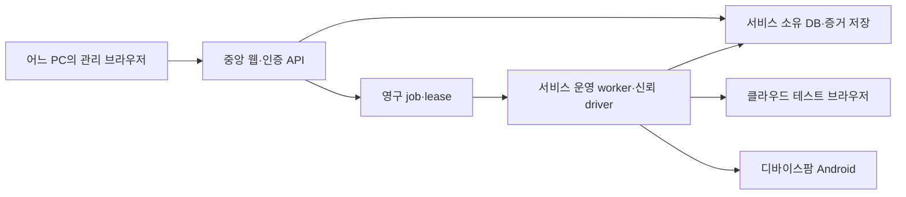

# 클라우드 실행을 기본으로 하는 서비스 배치

> **이전 배치안:** [사용자 확정 배치](2026-11-02-managed-pc-execution-design.md)가 우선이다. 현재 PC를 등록 실행 자원으로 사용하며 중앙 관리/증거는 독립 유지한다. 아래 cloud 전용 MVP·CF-01 우선순위는 더 이상 활성 지시가 아니다. 상용 provider 조사는 선택 후속이다.

2026-11-02 · 최신 사용자 결정. 기존 v0.6의 케이스·증거·승인·재생 계약은 유지하고 **실행 위치·접속·배포 우선순위**를 이 문서로 갱신한다. 클라우드 연동·중앙 인증·배포는 아직 구현/검증되지 않았다.

## 1. 사용자 요구와 이전 가정의 정정

- 사용자는 어느 PC에서든 관리 사이트에 접속하여 클라우드 브라우저·디바이스팜 Android를 선택해 QA 작업을 한다. 사용자의 PC 제어권, ADB, worker 설치, 개인 Chrome profile, 로컬 Linux VM을 기본 사용 조건으로 요구하지 않는다.
- 이전 첨부 수정본과 v0.6에는 로컬 MVP/클라우드 후속 가정이 있었다. **최신 직접 지시가 그 실행 배치를 대체한다.** 과거 기록을 고쳐 처음부터 클라우드였다고 주장하지 않는다.
- AI 녹화 → 동작별 화면/로그 선저장 → 완료 후 사람 검토/승인 → 저장 package/plan 반복 재생을 유지한다. 일반 재생 actor0, 필요한 검증 AI, 기본OFF/명시ON 셀프힐링도 유지한다.
- AD-01과 로컬 에뮬레이터는 개발·관찰 어댑터 검증 자산이다. 사용자 PC 연결 기능을 필수 제품 경로로 확대하지 않는다. 로컬 개발 성공은 클라우드 수용 근거가 아니다.

## 2. 기본 배치

worker는 서비스 운영 인프라에 속한다. 클라우드 공급자의 browser/device session을 관리하며 사용자의 PC에서 실행되는 프로그램이 아니다. 브라우저·Android 공급자는 서로 달라도 같은 job/action/evidence 계약을 소비해야 한다.

VM은 필요한 경우 **서비스 측 생성 코드 격리 수단**이다. 사용자 PC의 Hyper-V/WSL 준비와 별개다. 원격 브라우저를 쓴다는 사실만으로 agent 생성 Python/bash가 안전해지는 것은 아니다. provider 자격·CDP/ADB/제어 endpoint는 신뢰 driver만 소유하고 생성 script/브라우저 사용자에게 전달하지 않는다. 실제 격리·권한·egress·동작 계측 증명을 생략하지 않는다.

## 3. 실행 자원과 세션 계약

공급자는 아직 미선정이다. 다음은 요구 계약이며 특정 공급자가 이미 지원한다는 뜻이 아니다.

- `ProviderAccountRef`: project/권한 범위, provider ID, secret reference, 사용 가능 region/pool/capability. 실제 key 원문은 서버 측 비밀 저장소만 소유한다.
- `ResourcePreset`: Web/Android, browser/OS/device/API/geometry, pool·region, app/build/URL 요구, 지원 동작·캡처·세션 한도. 없는 capability를 ready로 표시하지 않는다.
- `RemoteSession`: 내부 session ID, provider session reference, job/attempt/lease, 관찰 상태·시각, expiry·cleanup 상태. raw endpoint/token은 서버 전용이다.
- lifecycle: 요청/preflight → acquire pending → ready/busy/failed → executing → stop requested → release pending → released/cleanup unknown. 생성·명령·종료의 응답 유실을 구분하고 duplicate session이나 이미 처리됐을 수 있는 동작을 자동 재생성하지 않는다.
- 공급자의 실제 물리 device identity가 있으면 그 범위로 점유를 관리하고, ephemeral browser/pool이면 account/session capacity를 함께 관리한다. 로컬 serial만으로 모든 cloud identity를 표현하지 않는다.
- 계정·session의 project 권한, lease/generation·취소·watchdog·한도는 기존 core 계약을 재사용해 서버에서 검사한다. worker는 API/정제 spool을 쓰고 DB 파일을 공유하지 않는다.

## 4. 엔진·재생 연결

### Web

CUAWright는 authoring 담당이다. 생성한 승인 code/package는 서비스 측 제한 runtime→신뢰 driver→클라우드 browser session으로 재생한다. provider의 remote-control 프로토콜, CUAWright의 실제 Playwright/browser 접근 지점, compound helper의 action별 전후 capture를 대조해야 한다. endpoint 주소만 바꾸면 호환된다고 가정하지 않는다.

### Android

Mobile-Agent는 authoring 담당이다. 관찰/행동 hook을 원격 device adapter에 연결하고, 저장 plan의 tap/type/swipe/back은 신뢰 실행기가 재생한다. 공급자가 ADB·screenshot·input 또는 해당 동작에 대응되는 제어 API를 제공하는지 확인한다. **Appium 지원만으로 Mobile-Agent가 그대로 동작한다고 단정하지 않는다.** API·좌표·회전·IME·capture 제약을 실제 공개 코드/공식 문서/실제 세션으로 각각 검증한다.

## 5. UI와 증거

- 기본 흐름은 클라우드 환경/기기 선택→필요 정보→자연어 검증→AI 녹화다. 개인 Chrome·로컬 ADB·사용자 PC worker 등록을 필수 단계로 넣지 않는다.
- 자원에 provider/pool·region, browser/OS/device/API, 사용 가능/점유/연결 오류, 마지막 관찰 시각을 표시한다. cloud 설정이 없으면 연결 필요를 표시하고 가짜 기기/성공 화면을 넣지 않는다.
- 선택 기기의 허가된 최근 캡처를 서비스 API로 조회한다. 최근 이미지와 실시간 stream·수동 제어는 구분한다. provider credential/임시 권한 URL을 그대로 프런트에 노출하지 않는다.
- action마다 source/attempt/action에 속한 전후 PNG·로그를 플랫폼 증거 저장소에 보존한다. 공급자의 만료되는 session 화면/로그 링크만 저장해서 사후 검토를 대신하지 않는다.
- 불완전/실패 녹화도 먼저 저장하고 사람이 완료 후 승인한다. 재녹화는 새 후보이며 이전 승인본·suite/RUN snapshot을 보존한다. TC는 계속 선택이다.

## 6. 저장·인증·비용

- 서비스 DB·artifact·secret은 서비스 인프라가 소유한다. 사용자 PC의 `%LOCALAPPDATA%`나 OS key store가 서비스 사용 조건이 아니다. 현재 SQLite/로컬 파일/DPAPI 코드는 개발 구현이며 중앙 운영 DB·저장소·비밀 backend의 배치·전환을 검증해야 한다. 사용자 DB를 이 문서 수정으로 마이그레이션하지 않는다.
- 어느 PC에서 접속하더라도 중앙 로그인·project 권한·동일 Origin/CSRF·server-side worker identity를 적용한다. 현재 loopback/local-owner bootstrap을 인터넷 서비스용 인증으로 노출하지 않는다. 중앙 인증/HTTPS/운영 배포 준비는 별도 구현과 실제 확인이 필요하다.
- 모델 역할별 API key와 provider 계정 자격은 별도 reference다. AI 토큰/모델 사용량과 cloud session 준비·실행·idle·release 지연 비용을 별도 계측한다. 미측정 금액은0이나 확정 청구액으로 표시하지 않는다.
- 월1회3000개는 workload 가정이다. provider account/상품·동시성·세션 수명·실제 release 비용을 조사/표본 계측한 뒤 추정한다. 문서 작성은 유료 세션 생성·구매·배포 승인이 아니다.
- 사내 URL/private network 대상은 공급자의 네트워크 접근 방식도 확인한다. 사용자의 브라우저에서 접근 가능하다는 사실을 원격 실행기의 접근 가능 근거로 사용하지 않는다.

## 7. 기존 산출물의 처리와 검증

| 기존 항목 | 처리 |
|---|---|
| 케이스/버전/검토·승인/재녹화·결과 ledger | core 재사용. 클라우드 환경 snapshot·권한·저장소 연결 영향만 대조 |
| job/lease/취소/증거·usage | core 재사용. provider session 수명/자원 identity/추가 비용·실패 변환을 구현 |
| AD-01·로컬 emulator·ADB | 개발 전용 자산으로 보존. AD-02~04는 선택 개발 경로이며 cloud MVP 필수 선행 아님 |
| 같은 PC VM/USB의 미완료 W gate | 과거 local-provider 검증 기록으로 보존. 클라우드의 보안/양 플랫폼 실제 수용을 대체하지 않으며 고객 PC 준비 선행으로 소비하지 않음 |
| 기존 완료126/163·부모6/33·269 tests | 기존 구현의 검증 이력. 새 cloud 배치의 완료율/원격 호환성/배포 합격으로 해석하지 않음 |
| 운영 인증·DB/artifact/secret backend·cloud provider | 미구현/미선정 부분을 신규 계획에서 추적. 실제 공급자 세션과 두 PC의 동일 서비스 접속으로 최종 수용 |

실제 cloud 수용은 Web·Android 모두에서 AI 녹화의 action별 증거, 저장 후 승인, 일반 재생 actor0, 필요한 검증·허용된 healing, session 종료/장애·늦은 비용을 확인해야 한다. 기존 fixture/local proof로 올리지 않는다. 다음 Current는 [CF-01](../plans/2026-11-02-cloud-execution-transition.md#cf-01)이다.
