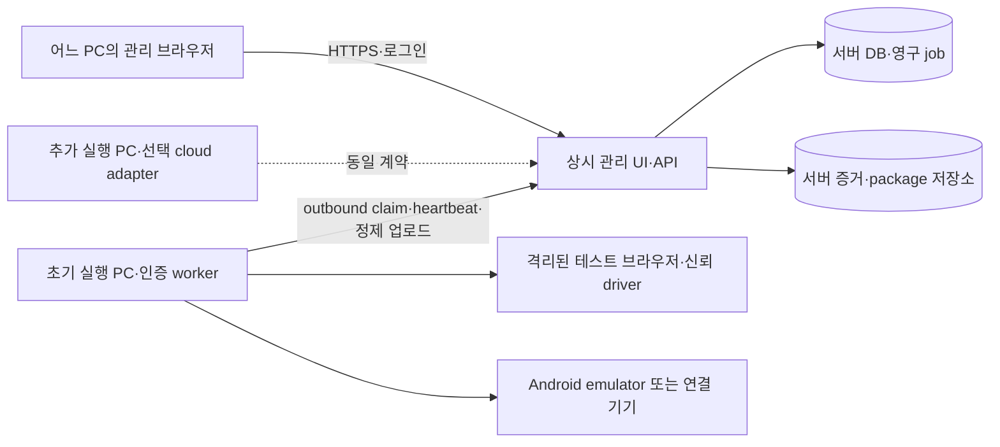

# 중앙 관리·저장소와 확장 가능한 실행 PC

2026-11-02 · 사용자 확정: 초기 실행 자원은 현재 PC, 이후 여러 PC/외부 자원으로 확장한다. **실행 PC가 꺼져도 중앙에 저장된 녹화는 조회·검토·승인 가능하며 재녹화·테스트 실행은 불가**하다. 이 문서가 앞선 cloud 전용 배치와 ‘로컬 PC는 개발용만’이라는 제한을 대체한다. 핵심은 접속 PC와 실행 PC의 분리이며 상용 디바이스팜 사용은 필수가 아니다.

## 목표와 선택

| 배치 | 판단 |
|---|---|
| 웹·저장·실행을 PC 한 대에 동거 | 개발은 가능하지만 그 PC 종료 시 조회/승인도 중단하므로 운영 수용 조건을 충족하지 않음 |
| 중앙 관리/저장 + 등록된 실행 PC | 사용자 선택. 현재 PC로 시작하며 실행 자원 증설 가능 |
| 상용 cloud browser/device farm | 추후 선택 adapter. 기본 사용자 흐름은 같고 공급자 호환성은 별도 검증 |

관리 API/DB/artifact/승인용 secret backend는 실행 PC와 독립적으로 가동되는 호스트/저장소에 배치한다. 호스팅 상품·접속 도메인·인증 방식은 아직 미선정이며 이 설계 변경으로 구매·설치·공개·배포하지 않는다. 초기 동시 slot1·자원별 lease를 유지한다. 현재 localhost 앱을 그대로 외부 공개하지 않는다.

## PC별 책임과 제어

- 접속 PC는 웹 UI만 사용한다. ADB/worker/개인 Chrome 제어권을 요구하지 않는다.
- 등록한 실행 PC에는 서비스가 운영하는 worker·브라우저/격리 backend·Android 환경을 준비한다. 서버가 사용자 PC 전체 desktop 제어권을 획득하는 구조가 아니다.
- worker는 서버에 outbound 인증 HTTP로 등록·polling·heartbeat·event·artifact를 전달한다. 원격 DB 파일 공유·임의 shell HTTP endpoint·공개 ADB/CDP는 사용하지 않는다.
- worker_id와 project/purpose scope·폐기/재등록 generation을 사용한다. 관리 서버의 부팅 상태와 원격 worker의 boot/session identity를 혼동하지 않는다. worker가 꺼졌다고 서버 재시작 시 진행 중인 다른 worker까지 lost로 만들지 않는다.
- 실행 PC는 code 격리·신뢰 driver·action 계측을, 관리 서버는 모델 broker와 모델 비밀을 소유한다. Android와 Web의 통합은 각 실제 환경에서 검증한다.

## 저장과 오프라인 동작

| 작업 | 실행 PC offline | 추가 조건 |
|---|---|---|
| 녹화·동작별 PNG/로그·결과 조회 | 가능 | 서버가 ACK한 증거가 실제 ready이며 권한/보관 유효 |
| 검토 의견·승인/반려·철회 | 가능 | 기존 버전/hash·필수 증거 검토·완료된 healing OFF trial 등 기존 gate 유지 |
| 정의/설정 초안 편집·새 후보 준비 | 가능 | 저장은 실행과 별개. 이전 승인본 불변 |
| 새 AI 녹화·재녹화·trial·정식/묶음·재실행 | 불가 | 실행 접수·claim 직전·dispatch 전 서버/worker가 다시 검사 |
| 기기 현재 화면·설치/진단·실시간 제어 | 불가 | 서버 보관 과거 이미지는 시각/오래됨 표시로 조회 가능 |

‘저장되어 있다’는 실행 PC spool에만 남은 상태가 아니라 서버 DB manifest와 영구 artifact가 commit/ACK된 상태다. provider/worker URL만 기록하지 않는다. 부분 업로드·누락/만료/corrupt·필수 trial 미완료는 offline과 별개 차단 사유다. 승인 시 worker 접속이나 새 trial을 강제하지 않으며, 기존 필수 trial이 없으면 PC 복구 후 수행해야 한다.

초기 정책은 offline 자원에 대한 새 실행 접수를 거부하고 자동 재연결 실행 예약을 만들지 않는 것이다. 폼/초안과 이전 승인본은 보존하고 접속 복구 후 사용자가 준비 확인·명시 실행한다. 접수 당시 online이어도 claim 전에 단절되면 새 side effect를 만들지 않는다. 명시적인 예약 실행 기능은 후속이다.

## 접속과 장애 계약

- worker heartbeat 제안 간격10초, 서버 수신 기준45초 이상 미수신 시 offline. `observed_at` 캡처 시각과 서버 수신 접속 시각은 분리하며 잘못된 미래 timestamp를 online 근거로 삼지 않는다. 기존 resource 상태만으로 전원 단절 감지를 완료했다고 하지 않는다.
- PC는 online이지만 resource가 busy/unauthorized/quarantine이면 해당 자원은 실행 불가다. 존재하지 않거나 다른 project 자원은 권한 밖으로 숨긴다. inventory에 ready가 남아도 offline host를 실행 가능으로 표시하지 않는다.
- UI 비활성만으로 막지 않는다. preview·최초 admission·rerun·claim/dispatch에 동일 정책을 적용한다. 이미 성공한 멱등 요청 재전송은 과거 receipt 조회이며 새 실행이 아니다.
- 단절 중 실행은 lease/watchdog로 중단·lost/불명 결과를 기록하고, 기존 side effect를 자동 재전송하지 않는다. 복귀 시 journal/spool을 대조하고 ready 증명 전 quarantine 해제/자동 재개를 하지 않는다.

## 유지할 도메인·비용 계약

AI 녹화 → action별 전후 PNG/로그 선저장 → 완료 후 사람 검토/승인 → 승인 code/action 재생을 유지한다. 일반 동작 actor0, 필요한 검증만 AI, healing 기본OFF·명시ON/제한, 재녹화는 새 후보와 이전본 보존, TC 선택 원칙도 유지한다. 모델 key는 역할별 server secret ref/broker 경계를 사용하고 생성 code에 넘기지 않는다. worker가 필요한 권한만 짧게 부여받는 구체 방식은 인증 카드에서 결정한다.

모델 tokens·실행 PC 점유/전력 등 운영비·선택 상용 provider 세션 요금은 분리한다. 월3000개는 workload 가정이며 단일 PC의 처리량/병렬 수/운영비는 실측한다. 전용 실행 PC의 sleep/재시작·가속 성능과 서버 증거 백업/복원도 수용 대상이다.

## 현재 구현과 확장

기존 job/lease·scope·spool/ACK·case/version/review를 재사용한다. `launcher.py` worker는 아직 sleep loop이고 원격 등록/소비가 연결되지 않았다. SQLite/local artifact/Windows Credential Manager와 local-owner 인증은 개발 baseline이다. [후속 구현 경계](../../managed-pc/RUNTIME_BOUNDARIES.md)와 [RX 색인](../../managed-pc/IMPLEMENTATION_TASKS.json)이 독립 관리 서버와 워커의 구현·실환경 수용을 추적한다.

단계별로 (1) offline 자원 admission/저장 검토 분리, (2) 서버 수신 heartbeat와 host identity, (3) 자원 선택 UI, (4) 원격 worker 실제 소비/드라이버·ACK 업로드, (5) 독립 관리 서버 인증·저장 배포, (6) 실행 PC 전원 종료 상태의 조회/승인과 두 PC E2E를 검증한다. 추가 PC는 동일 API로 등록하고 이후 cloud adapter는 그 뒤에 편성한다. CF-01 공급자 조사는 후속 선택 작업이며 현재 PC 실행을 막는 선행이 아니다.

운영 수용은 실제로 실행 PC를 끈 상태에서 다른 PC가 서버의 증거를 조회·승인하고, 녹화/재녹화/trial/회귀/rerun/진단을 거부하는지 확인해야 한다. core 시험/두 임시 프로세스만으로 전원 단절·원격 배포 수용을 완료 처리하지 않는다.
