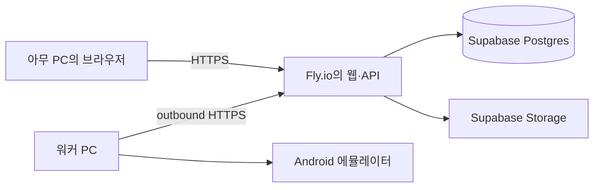

# Fly.io · Supabase · 워커 PC

2026-11-20. 사용자가 확정한 배치다. 웹은 잠들지 않는 Fly.io 머신 한 대에 둔다. 무료 플랜처럼 일정 시간 뒤 프로세스를 끄는 방식은 쓰지 않는다. 데이터와 녹화 파일은 Supabase에 둔다. Android 에뮬레이터는 워커 PC 한 대에서 돌린다.

제품 동작은 유지한다. AI가 녹화하고, 동작마다 화면과 로그를 먼저 저장하고, 사람이 검토·승인한 뒤, 재생은 저장된 동작만 실행한다. 재생의 모델 호출은 0이다. healing은 기본 OFF다. 검증은 재생 동작과 별도다.

[2026-11-02 실행 PC 설계](2026-11-02-managed-pc-execution-design.md)의 접속 PC와 워커 분리는 유지한다. 집 Windows 공개, Windows 자격 증명 관리자, 상용 기기 팜은 이 배치의 전제가 아니다.

## 구성

- Fly.io 머신은 한 대이고 자동으로 멈추지 않는다. 공개 HTTPS 주소를 만들고 집 IP와 집 공유기의 포트는 열지 않는다.
- Supabase Postgres는 케이스, 작업, 승인, 멤버십을 보관한다. 재배포 뒤에도 남는다.
- Supabase Storage는 동작별 PNG, 로그, 승인 패키지를 보관한다. 머신 로컬 디스크에 두지 않는다.
- OIDC 비밀과 모델 키는 Fly.io 비밀에 둔다. 브라우저와 워커 프로세스에는 넣지 않는다.
- 워커 PC는 Android 에뮬레이터를 돌리고 Fly.io 주소로 밖으로만 접속한다. 들어오는 포트는 없다. 워커 PC를 꺼도 이미 저장된 조회의 검토·승인은 된다. 새 녹화와 재생은 워커가 다시 켜진 뒤 사용자가 명시 실행한다.
- Web 테스트의 브라우저는 같은 워커 PC에 나중에 붙인다. 워커 PC를 두 대 사지 않는다.
- 로컬 개발은 기존 SQLite, 로컬 파일, Windows 자격 증명 관리자를 유지한다. hosted 프로필만 Supabase와 Fly.io 비밀을 쓴다.

## 사용자가 만들 계정

코드 변경만으로 생기지 않는다. Fly.io 앱, Supabase 프로젝트, OIDC 앱이 필요하다. Fly.io 머신은 유휴 상태에도 꺼지지 않게 둔다. OIDC 콜백은 `https://<Fly.io 주소>/api/v1/auth/oidc/callback`이다. 모델 키는 Fly.io 비밀에만 둔다.

## 작업 순서

| ID | 작업 | 완료로 보지 않는 것 |
|---|---|---|
| HS-1 | hosted 비밀 저장. Linux에서 Windows 자격 증명 관리자 없이 OIDC 비밀과 모델 키를 읽는다. 로컬 Windows 저장은 개발용으로 남긴다. | Fly.io 배포, 실사용 로그인 |
| HS-2 | hosted 프로필의 관리 데이터를 Supabase Postgres에 둔다. 로컬 개발의 SQLite는 유지한다. | 기존 로컬 DB를 운영 데이터로 올리기 |
| HS-3 | hosted의 동작별 PNG·로그·패키지를 Supabase Storage에 둔다. 워커는 파일을 직접 올리지 않고 API로 보낸다. | 저장소 공개 URL을 브라우저에 노출 |
| HS-4 | Fly.io에 웹·API를 한 대 상시 가동하고 공개 HTTPS와 OIDC 콜백을 그 주소로 고정한다. 집 포트를 열지 않는다. | 머신을 꺼 두는 설정, 워커 없이 한 녹화 성공으로 처리 |
| HS-5 | 워커 PC가 Fly.io로 밖으로 접속해 Android 에뮬레이터를 등록한다. 들어오는 포트는 없다. | 상용 기기 팜, 집 IP 공개 |
| HS-6 | 다른 네트워크의 브라우저로 로그인하고, 워커 PC에서 녹화·승인·모델 없는 재생을 한 번 확인한다. 워커 PC를 끈 뒤 저장된 검토가 되는지도 확인한다. | fixture 통과를 이 수용으로 기록 |

2026-11-25: [HS-1 코드/모의 통합 인계](../../validation/tasks/HS-1.md)를 완료했다. 설정은 [HOSTED_SECRETS](../../managed-pc/HOSTED_SECRETS.md)를 따른다. 실제 Linux/Fly 기동과 운영 IdP 수용은 HS-4이며 이식성 fixture로 대신하지 않는다. 현재 구현은 HS-2부터 한다. HS-4 전에 Fly.io·Supabase·OIDC 계정이 없으면 그 카드는 계정 준비로 남기고, 코드 카드는 로컬 fixture로 검증한다.
